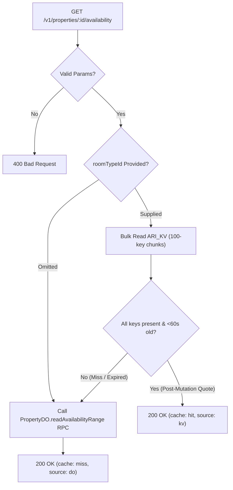

# Booking Engine Availability Read Endpoint Design

**Date:** 2026-07-29  
**Status:** Revised (v3 — explicit roomTypeId KV key construction, element-wise route index alignment, Map<string, string|null> return type)  
**Sources:** ARCHITECTURE.md §7.1 (ARI staleness SLA, reject-on-commit, versioned entries), §4.3 (KV projection), §13 (observability); [ARI KV projection spec](./2026-07-29-ari-kv-projection-design.md); [property RBAC dispatcher spec](./2026-07-28-property-rbac-dispatcher-design.md)

---

## 1. Context & Motivation

The ARI KV projection slice ([2026-07-29-ari-kv-projection-design.md](./2026-07-29-ari-kv-projection-design.md)) implemented outbox-driven denormalization of `availability_day` rows into Cloudflare KV (`ARI_KV`).

This slice completes the **read side of availability**:
1. Exposes `GET /v1/properties/:propertyId/availability` on the HTTP API dispatcher.
2. Implements a **KV-first read pipeline for room-type quotes with fallback to `PropertyDO`** when projection entries are missing or expired (>60 s hard TTL).
3. Connects `inventory:read` permission gating and `pms.core` entitlement checks.
4. Documents the forward contract for **`ari.reject_on_commit`** and **stale-vs-race classification** (§7.1).

---

## 2. Design Decisions

### 2.1 Route & Dispatch Specification

- **HTTP Method & Path**: `GET /v1/properties/:propertyId/availability`
- **Route Pattern**: `/^\/v1\/properties\/([^/]+)\/availability$/`
- **Route Audit ID**: `get_property_availability`
- **Scope**: `property`
- **Permission**: `inventory:read`
- **Entitlement**: `pms.core`
- **Query Parameters**:
  - `fromDate`: ISO 8601 YYYY-MM-DD (required)
  - `toDate`: ISO 8601 YYYY-MM-DD (required, inclusive)
  - `roomTypeId`: string (optional — if omitted, returns availability for all active room types)

**Validation**:
- Format validation: If `fromDate` or `toDate` fails `/^\d{4}-\d{2}-\d{2}$/`: returns `400 {"error":"invalid_date"}`.
- Inverted range: If `fromDate > toDate`: returns `400 {"error":"invalid_date_range"}`.
- Range width cap: If `toDate > addDays(fromDate, 89)`: returns `400 {"error":"date_range_exceeds_max"}`.
- `fromDate === toDate` is a valid 1-day availability query.

### 2.2 Pipeline Branching: Scoped KV vs. All-Room DO Baseline

Keys in `ARI_KV` follow `ari:{propertyId}:{roomTypeId}:{stayDate}`. Constructing KV keys requires knowing `roomTypeId`.

Therefore, the pipeline branches on `roomTypeId`:

- **When `roomTypeId` is supplied (Quote Path):**
  1. Construct KV keys `ari:{propertyId}:{roomTypeId}:{stayDate}` for the range.
  2. Perform a 100-key bulk read (`getKvBulkBounded`).
  3. If all keys exist in KV and `writtenAt < 60_000` (60 s hard TTL): return `200 OK` with `cache: 'hit'`, `source: 'kv'`.
  4. If any key is missing or expired: fall back to `stub.readAvailabilityRange(fromDate, toDate, roomTypeId)`.
- **When `roomTypeId` is omitted (Property-Wide Query):**
  1. Active room type IDs are stored in `PropertyDO` SQLite, not in KV key prefixes.
  2. Go directly to `stub.readAvailabilityRange(fromDate, toDate)`. Return `200 OK` with `cache: 'miss'`, `source: 'do'`.



#### Bulk KV Read Helper (`getKvBulkBounded`)

```ts
async function getKvBulkBounded(
  kv: KVNamespace,
  keys: string[],
): Promise<Map<string, string | null>>
```

- Returns a map of key → value (or `null` if the key is missing).
- Performs bulk reads in chunks of 100 keys per call.

### 2.3 Response Payload & Version Aggregation

When aggregating projection entries across a stay date range, `ariVersion` is calculated as the **minimum (weakest link) `ariVersion`** (`Math.min(...versions)`).

```ts
export type AvailabilityQueryItem = {
  roomTypeId: string;
  stayDate:   string;
  physical:   number;
  blocked:    number;
  held:       number;
  sold:       number;
  oversell:   number;
  free:       number;
};

export type GetAvailabilityResponse = {
  propertyId: string;
  fromDate:   string;
  toDate:     string;
  ariVersion: number;
  source:     'kv' | 'do';
  cache:      'hit' | 'miss';
  items:      AvailabilityQueryItem[];
};
```

### 2.4 `ari.reject_on_commit` & Stale-vs-Race Classification (§7.1 — Deferred Forward Note)

ARCHITECTURE.md §7.1 defines **reject-on-commit**:

> Every booking commits against the PropertyDO, which re-checks and may reject with `NoAvailability`.
> A rejection increments `ari.reject_on_commit`, tagged by property. Because each projection entry
> carries the DO version it was derived from, a rejection can be classified as *stale projection*
> (version behind) versus *genuine race* (version current). Only the first is a defect.

**Forward Note:** This metric hook belongs in the future HTTP reservation creation endpoint (`POST /v1/properties/:id/reservations`), not in this read endpoint. When that endpoint lands, it will compare `quoteAriVersion` against current DO `ariVersion`:
- `quoteAriVersion < currentAriVersion` → Log `ari.reject_on_commit` tagged `classification: 'stale_projection'`
- `quoteAriVersion === currentAriVersion` → Log `ari.reject_on_commit` tagged `classification: 'genuine_race'`

---

## 3. File Changes & Index Alignment

### Element-Wise Index Alignment Requirement
`check:permissions` verifies that `V1_ROUTES` in `apps/pms-core/src/v1-dispatch.ts` and `V1_HTTP_ROUTE_AUDIT` in `packages/contracts/src/v1-http-routes.ts` match **element-wise by index**.
Both entries MUST be appended as the **10th element (index 9)** at the exact end of their respective arrays.

---

### `packages/contracts/src/v1-http-routes.ts`  [MODIFY]

Append `get_property_availability` to `V1_HTTP_ROUTE_AUDIT` at index 9:

```diff
   {
     id: 'delete_room_type',
     scope: 'property',
     permission: 'inventory:write',
     commandId: 'inventory.delete_room_type',
   },
+  {
+    id: 'get_property_availability',
+    scope: 'property',
+    permission: 'inventory:read',
+    entitlement: 'pms.core',
+  },
 ];
```

---

### `apps/pms-core/src/v1-dispatch.ts`  [MODIFY]

1. Implement `handleGetAvailability` handler function using inline date math (`addDays`) and `getKvBulkBounded`.
2. Register route in `V1_ROUTES` at index 9 (matching `V1_HTTP_ROUTE_AUDIT` position):

```ts
  {
    method: 'GET',
    pattern: /^\/v1\/properties\/([^/]+)\/availability$/,
    scope: 'property',
    permission: 'inventory:read',
    entitlement: 'pms.core',
    handler: handleGetAvailability,
  },
```

---

### `apps/pms-core/test/availability-read.spec.ts`  [NEW]

Integration test matrix:

| # | Test | Assertion |
|---|---|---|
| 1 | `GET /v1/properties/:id/availability?roomTypeId=...` post-mutation (fresh KV cache hit) | Returns `200 OK`, `cache: 'hit'`, `source: 'kv'`, valid `items` array matching room type |
| 2 | Query range with `roomTypeId` omitted | Goes straight to DO, returns `200 OK`, `cache: 'miss'`, `source: 'do'` |
| 3 | Query range with no KV entries (steady-state DO fallback) | Falls back to `PropertyDO`, returns `200 OK`, `cache: 'miss'`, `source: 'do'` |
| 4 | Single-day query (`fromDate === toDate`) | Returns `200 OK` with 1 stay date |
| 5 | Query range exceeding 90 days (`toDate > addDays(fromDate, 89)`) | Returns `400 {"error":"date_range_exceeds_max"}` |
| 6 | Invalid date strings (`fromDate=invalid`) | Returns `400 {"error":"invalid_date"}` |
| 7 | Non-member user query | Returns `404 {"error":"not_found"}` (RBAC privacy protection) |
| 8 | Member `staff` role user query | Returns `200 OK` (all roles hold `inventory:read`) |
| 9 | Active kill-switch on `pms.core` | Returns `503 Service Unavailable` |

---

## 4. Implementation Checklist

- [ ] Add `get_property_availability` to `V1_HTTP_ROUTE_AUDIT` in `packages/contracts/src/v1-http-routes.ts` at index 9.
- [ ] Implement `handleGetAvailability` and append route in `V1_ROUTES` in `apps/pms-core/src/v1-dispatch.ts` at index 9.
- [ ] Write `apps/pms-core/test/availability-read.spec.ts` with all 9 integration tests.
- [ ] Run `pnpm build`, `check:ddl`, `check:entitlements`, `check:permissions`, `check:class-denylist`, `typecheck`, `pnpm test --force`, `pnpm lint`.
