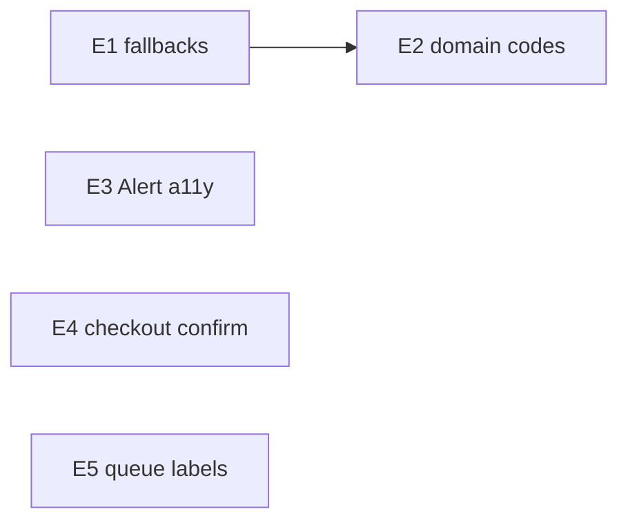

# Audit Phase E — user-facing behaviour (E1–E5)

**Tree verified 2026-08-15:** `COMMAND_CATALOG` length **89**, `AUDIT_WRITER_COMMAND_IDS.size === 63`, `V1_HTTP_ROUTE_AUDIT` length **144** (`[143].id === 'get_city_ledger_statement'`), `PROPERTY_SCHEMA_HEAD === 34`, `NIGHT_AUDIT_STEPS` length **8**, `[3] === 'AUTO_TRANSFER'`, `idempotency.ts` `export const` count **158**. Phases **A** (test signal), **B** (business logic), **C** (security), and **D** (typed error channel) are landed on `main`.

**Date:** 2026-08-15  
**Status:** Draft (spec writer)  
**Sources:** [Full codebase audit — remediation plan](../../audit/2026-08-15-full-codebase-audit.md) Phase **E** items **E1**–**E5** (`:405–525`); [Ground rules](../../audit/2026-08-15-full-codebase-audit.md) (`:20–33`); [Do not fix](../../audit/2026-08-15-full-codebase-audit.md#do-not-fix--deliberate-decisions) (`:751–766`); `apps/web-pms/src/copy/classified-user-message.ts`; `apps/web-pms/src/copy/queued-command-line.ts`; `packages/ui-kit/src/Badge.tsx` (`Alert`); `packages/client-core/src/queued-commands.ts`.

**Closes:** Audit **E1** (discarded fallbacks), **E2** (desk domain-code copy), **E3** (a11y async feedback), **E4** (credit-balance checkout confirm), **E5** (queued-command labels). **Requires:** Phases **A/B/C/D** green. **Does not** advance Phase **F/G/H**, DO/schema/catalog/route changes, or server error semantics.

---

## Executive summary

Phase E fixes five user-facing defects in **`apps/web-pms`** and shared copy helpers — no server, schema, or catalog changes. **E1** restores caller-written fallbacks in `classifiedUserMessage` when neither a domain-code nor class map applies. **E2** adds a domain-code map (checked before the class map) so check-in, assign, checkout, and folio mutations stop showing retryable generic copy for permanent failures like `balance_due` and `room_out_of_order`. **E3** replaces three bare `<p>` status lines with `<Alert>` (`role="alert"`) on the highest-traffic screen (check-in) and the shell shift strip. **E4** aligns the checkout override confirm with server semantics (`balanceMinor > 0` only) and adds non-alarming credit-balance guidance. **E5** humanizes degraded-mode queue rows from `commandId` + optional reservation reference. **No frozen heads move.**

**Dependency order:** **E1 → E2** (E2 domain map + fallback chain depends on E1 honouring fallbacks for unmapped codes). **E3**, **E4**, and **E5** are independent of each other and may land in parallel after E1 (E4 interacts with landed **B1** but does not block on it).

---

## 1. Context & motivation

### 1.1 Problem statement

| Item | Severity | Symptom | Root cause |
|---|---|---|---|
| **E1** | high | Every screen-specific fallback ("Assign failed", "Open shift failed", …) is discarded; users always see "Something went wrong — try again or ask a manager." | `classified-user-message.ts:22` — `_context` unused; resolution always falls through to `UNKNOWN_MESSAGE` |
| **E2** | high | Check-in / assign / checkout / folio paths show retryable generic copy for permanent domain failures | Booking wizard handles ~25 codes locally; central helper has no domain-code map; generic copy ends in "try again" |
| **E3** | high | Check-in success/failure and shift-open feedback silent to screen readers | `CheckInScreen.tsx:205`, `ShiftStrip.tsx:146,:165` use bare `<p>` without `role="alert"`; nine other screens use `<Alert>` correctly |
| **E4** | medium | Overpaid guests get "Depart with open balance -$50.00?" confirm; server would allow checkout silently | `FolioScreen.tsx:654` — `balanceMinor !== 0` vs server `> 0` (`property-do.ts:9710`) |
| **E5** | medium | Degraded-mode queue shows three identical "Queued action · {date}" rows | `queued-command-line.ts` ignores `commandId` and `reservationId` on `QueuedCommandEntry` |

### 1.2 E1 — fallback discard (evidence)

Eight call sites pass `{ fallback: '…' }` (and `BookingScreen` also passes `knownCode`); none reach the user today:

| Call site | Intended fallback |
|---|---|
| `CheckInScreen.tsx:81` | "Assign failed" |
| `CheckInScreen.tsx:112` | "Check-in failed" |
| `ShiftStrip.tsx:69` | "Open shift failed" |
| `ShiftScreen.tsx:81`, `:177` | "Close shift failed" / "Could not load shift" |
| `BookingScreen.tsx:496` | "Booking failed" (+ `knownCode`) |
| `use-folio-action-mutation.ts:31` | caller's `fallback` |

Tests in `classified-user-message.test.ts` currently **codify** the discard (`client_error` + fallback → asserts "Something went wrong").

### 1.3 E4 — B1 interaction (landed)

**B1** scopes checkout balance to the GUEST folio window (`docs/superpowers/specs/2026-08-15-audit-phase-b-business-logic-design.md` Lock 1). **E4** fixes the **client** confirm gate so it matches server `balanceMinor > 0`. Together they restore trust: direct-bill guests no longer spuriously confirm (B1), and credit balances no longer alarm (E4). Keep the existing positive-balance confirm copy that names the exact amount and states the consequence.

### 1.4 Heads (frozen — this chunk moves none)

| Head | Current | This chunk |
|---|---|---|
| `COMMAND_CATALOG` | length **89** | **89** — unchanged |
| `AUDIT_WRITER_COMMAND_IDS.size` | **63** | **63** — unchanged |
| `V1_HTTP_ROUTE_AUDIT` | length **144**, tail `get_city_ledger_statement` | unchanged |
| `PROPERTY_SCHEMA_HEAD` | **34** | **34** — no migration |
| `NIGHT_AUDIT_STEPS` | length **8**, `[3] === 'AUTO_TRANSFER'` | **8** — unchanged |
| `idempotency.ts` `export const` count | **158** | **158** — unchanged |

**Scope:** `apps/web-pms` + copy/unit tests only. **`packages/client-core`** touched only if a shared `bodyErrorCode` helper is extracted (optional — prefer local helper in `classified-user-message.ts` to minimize scope).

### 1.5 Scope in

1. **E1** — honour `context.fallback`; update two tests (Lock 1).
2. **E2** — domain-code map in `classified-user-message.ts`; shared body helpers; unit tests per code (Lock 2).
3. **E3** — `<Alert>` on three bare-`<p>` sites (Lock 3).
4. **E4** — checkout confirm guard + credit-balance copy (Lock 4).
5. **E5** — `commandId` → label map + reservation suffix in `queued-command-line.ts` (Lock 5).

### 1.6 Scope out (normative)

- **DO / schema / catalog / HTTP route changes** — none expected; Phase D locked server error codes and statuses.
- **Server error payload changes** — do **not** add `balanceMinor` to `balance_due` HTTP bodies in this phase; client copy must tolerate absent payload fields (see §6.1).
- Phase **F/G/H** audit items.
- **Booking wizard local copy** — the 25-code block in `BookingScreen.tsx:onError` works; do **not** refactor or remove it. Central map is for paths that call `classifiedUserMessage` / `messageForFolioMutationError` without local handling.
- **Route-guard fail-open** on `authority.kind === 'unknown'` — deliberate; do not fix (`apps/web-pms/src/auth/me.ts:21`, audit Do-not-fix table).
- **Code splitting**, edge rate limiting, `gatePermission` / auth semantics.
- Push.

---

## 2. Locked decisions (verbatim — do not deviate)

### Lock 1 — E1: honour caller fallbacks

**File:** `apps/web-pms/src/copy/classified-user-message.ts`

#### 1a — Rename and use context

```diff
 export function classifiedUserMessage(
   classified: ClassifiedResponse,
-  _context: { fallback?: string; knownCode?: string | null },
+  context: { fallback?: string; knownCode?: string | null },
 ): string {
```

#### 1b — Resolution order (after Lock 2 domain map is added)

1. **`forbidden`** — existing `permissionForForbidden` branch (unchanged).
2. **Domain code map** — Lock 2; keyed off `bodyErrorCode(classified.body)`.
3. **`CLASS_MESSAGES[classified.class]`** — existing class map (unchanged entries).
4. **`context.fallback ?? UNKNOWN_MESSAGE`** — **E1 fix**; never return raw class tokens or wire codes.

`knownCode` is honoured indirectly: screens like `BookingScreen.tsx:496` pass `knownCode: code` together with `fallback: 'Booking failed'`. When the domain map (Lock 2) has no entry for `code`, step 4 returns **"Booking failed"** instead of `UNKNOWN_MESSAGE`. Do **not** echo `knownCode` or `body.error` strings to the user.

#### 1c — Test updates (required)

In `classified-user-message.test.ts`, update the two tests that codify discard:

| Test | Change |
|---|---|
| `unknown class does not paint the raw token` | Assert returns **`"Open shift failed"`** (fallback), not "Something went wrong"; still assert no `client_error` substring |
| (Add assertion to `fail_closed` test if needed) | Class-mapped messages **still beat** fallback — `fail_closed` + fallback `'Booking failed'` → **"Property unreachable."** |

**Verify snippet:**

```ts
expect(
  classifiedUserMessage(classified({ class: 'client_error' }), { fallback: 'Open shift failed' }),
).toBe('Open shift failed');
expect(
  classifiedUserMessage(classified({ class: 'client_error' }), { fallback: 'Open shift failed' }),
).not.toMatch(/client_error/);
```

---

### Lock 2 — E2: domain-code map (depends on E1)

**File:** `apps/web-pms/src/copy/classified-user-message.ts`

Add helpers (may mirror `BookingScreen.tsx:21–27,49–55` — extract to same file, **do not** change BookingScreen's local handlers):

```ts
function bodyErrorCode(body: unknown): string | null { /* same shape as BookingScreen */ }
function bodyNumberField(body: unknown, key: string): number | undefined { /* typeof number only */ }
```

Import `formatMinor` from `apps/web-pms/src/money.js` for amount interpolation.

#### 2a — Lookup order

```ts
const code = bodyErrorCode(classified.body);
const domainMsg = code ? DOMAIN_CODE_MESSAGES[code]?.(classified.body) : undefined;
if (domainMsg) return domainMsg;
// … then class map, then fallback (Lock 1)
```

#### 2b — `DOMAIN_CODE_MESSAGES` map (locked copy)

Every message **must not** contain the substring `try again` (case-insensitive). Wire codes **must not** appear in returned strings.

| Wire code | Message template (locked) | Payload detail |
|---|---|---|
| `balance_due` | `Guest owes ${formatMinor(n)} — settle on the folio before checkout.` when `body.balanceMinor` is a number; else `Guest balance is due — settle on the folio before checkout.` | `balanceMinor` optional on wire today — see §6.1 |
| `folio_balance_due` | Same pattern as `balance_due` but ending `… before generating the invoice.` / fallback without amount: `Folio balance is due — settle before generating the invoice.` | `balanceMinor` optional |
| `room_already_assigned` | `That room is already assigned — pick another room.` | — |
| `room_out_of_order` | `Room is out of order — pick another room.` | — |
| `room_type_mismatch` | `That room does not match the booked room type — pick another room.` | — |
| `hold_expired` | `This hold has expired — create a new booking.` | — |
| `inquiry_expired` | `This inquiry has expired — create a new booking.` | — |
| `invoice_required` | `Generate an invoice before checkout.` | — |
| `not_modifiable` | `This reservation cannot be changed in its current status.` | — |
| `no_availability` | `No availability on ${date} — pick another room type or date.` when `body.date` string present; else `No availability — pick another room type or date.` | `date` — server returns on booking/availability paths |

**Not in central map (stay screen-local):** `room_not_ready` — `CheckInScreen.tsx:99` sets `showOverride` and reveals the cleanliness override control. Do **not** move that branch into the central helper; assign/check-in screens already expose the room picker for `room_*` codes above.

#### 2c — In-screen recovery affordances (prefer existing shape)

| Code | Screen | Affordance (already present — keep) |
|---|---|---|
| `room_not_ready` | CheckIn | `showOverride` + override checkbox (`CheckInScreen.tsx:99–101,193–203`) |
| `room_already_assigned`, `room_out_of_order`, `room_type_mismatch` | CheckIn | Room `<NativeSelect>` + Assign button |
| `balance_due`, `folio_balance_due`, `invoice_required` | Folio | Balance line, charge/post controls, Generate invoice button |
| `hold_expired`, `inquiry_expired` | — | Copy only (no wizard on those screens today) |

No new UI controls required in E2 — copy + existing controls suffice.

---

### Lock 3 — E3: accessible async feedback

Replace bare paragraphs with `<Alert>` from `@hospai/ui-kit` (`packages/ui-kit/src/Badge.tsx:23–28` — `role="alert"`).

| File | Line (approx) | Before | After |
|---|---|---|---|
| `CheckInScreen.tsx` | 205 | `{message ? <p>{message}</p> : null}` | `{message ? <Alert data-testid="check-in-message">{message}</Alert> : null}` |
| `ShiftStrip.tsx` | 146 | `{message ? <p className="muted">{message}</p> : null}` | `{message ? <Alert data-testid="shift-strip-message">{message}</Alert> : null}` |
| `ShiftStrip.tsx` | 165 | same | same `data-testid` |

Do **not** add `aria-live` on a wrapper if `<Alert>` already provides `role="alert"`. Do **not** change the nine screens that already use `<Alert>`.

---

### Lock 4 — E4: checkout confirm vs credit balance

**File:** `apps/web-pms/src/screens/FolioScreen.tsx` (~654)

#### 4a — Override guard (locked)

```diff
-const overrideBalance =
-  typeof balanceMinor === 'number' && balanceMinor !== 0;
+const overrideBalance =
+  typeof balanceMinor === 'number' && balanceMinor > 0;
```

Positive balance: **keep** existing confirm verbatim:

```ts
`Depart with open balance ${formatMinor(balanceMinor)}? This posts checkout with a balance override.`
```

Negative balance (`balanceMinor < 0`): **no** `window.confirm`; checkout proceeds without `overrideBalance: true`.

#### 4b — Credit-balance guidance copy (locked)

When `typeof balanceMinor === 'number' && balanceMinor < 0`, render an `<Alert data-testid="folio-credit-notice">` adjacent to the checkout section (below balance chrome or above the Check out button):

```tsx
<Alert data-testid="folio-credit-notice">
  Guest credit {formatMinor(Math.abs(balanceMinor))} — issue a refund after departure if needed.
</Alert>
```

**Constraints:** copy **must not** contain the substrings `balance override`, `override`, or `open balance`. Informational only — does not block checkout.

---

### Lock 5 — E5: queued-command human labels

**File:** `apps/web-pms/src/copy/queued-command-line.ts`

#### 5a — Line shape (locked)

```ts
// `{label} · {date}[ · #{reservationSuffix}]`
// date = entry.businessDate ?? entry.issuedAt.slice(0, 10)
// reservationSuffix = entry.reservationId.slice(-8) when reservationId present (matches registration-card confirmation token pattern)
```

Example: `Check-in · 2026-08-14 · #res_1` → actually for `res_abc12def` suffix is last 8 chars: `#abc12def`.

Unknown `commandId`: **`Queued action`** (preserve today's generic noun, not wire id).

#### 5b — `COMMAND_ID_LABELS` map (locked)

Cover every `QUEUE_PROVISIONAL` catalog id plus aliases seen in tests/client call paths:

| `commandId` | Label |
|---|---|
| `reservations.check_in` | Check-in |
| `reservations.check_out` | Checkout |
| `reservations.assign_room` | Room assignment |
| `reservations.update_status` | Reservation update |
| `reservations.cancel_check_in` | Cancel check-in |
| `folio.add_item` | Folio charge |
| `folio.add_line` | Folio charge |
| `post_folio_charge` | Folio charge |
| `folio.record_cash_payment` | Cash payment |
| `folio.open_shift` | Open shift |
| `folio.close_shift` | Close shift |
| `rooms.update_status` | Room status update |
| `rooms.bulk_update_status` | Bulk room status |
| `housekeeping.assign` | Housekeeping assignment |

Do **not** embed raw `commandId`, `idempotencyKey`, or full `reservationId` in the line (existing tests forbid wire tokens).

#### 5c — Test updates

`queued-command-line.test.ts`:

- Replace assertions expecting `Queued action · {date}` with label-specific expectations.
- Add case: two entries with different `commandId`s on the same date produce **distinct** strings.
- Add case: same command + `reservationId` appends ` · #${suffix}`.

Update `FolioScreen.test.tsx` queued-section expectations (`~1301`) from `/Queued action ·/` to match new labels (e.g. `/Folio charge · 2026-08-14/`).

---

## 3. Dependency & implementation order



| Step | Item | Notes |
|---|---|---|
| 1 | **E1** | Unblocks fallback chain for E2 unmapped codes |
| 2 | **E2** | Domain map before class map; unit tests per code |
| 3a | **E3** | Parallel-safe |
| 3b | **E4** | Parallel-safe; verify against B1 direct-bill fixture mentally |
| 3c | **E5** | Parallel-safe |

**TDD preference:** update failing tests first per audit ground rules §6.

---

## 4. File map

| File | Change |
|---|---|
| `apps/web-pms/src/copy/classified-user-message.ts` | E1 context + fallback; E2 `bodyErrorCode`, `DOMAIN_CODE_MESSAGES`, lookup order |
| `apps/web-pms/src/copy/classified-user-message.test.ts` | E1 fallback assertions; E2 per-code message tests |
| `apps/web-pms/src/screens/CheckInScreen.tsx` | E3 `<Alert>` (~205); optional `data-testid` |
| `apps/web-pms/src/shell/ShiftStrip.tsx` | E3 `<Alert>` (~146, ~165) |
| `apps/web-pms/src/screens/FolioScreen.tsx` | E4 `> 0` guard (~654); credit `<Alert>` |
| `apps/web-pms/src/screens/FolioScreen.test.tsx` | E4 negative-balance no-confirm; E5 queued label expectations |
| `apps/web-pms/src/copy/queued-command-line.ts` | E5 label map + reservation suffix |
| `apps/web-pms/src/copy/queued-command-line.test.ts` | E5 distinct-line assertions |
| `apps/web-pms/src/screens/CheckInScreen.test.tsx` | E3 `getByRole('alert')` |
| `apps/web-pms/src/shell/ShiftStrip.test.tsx` | E3 `getByRole('alert')`; E1 may change expected copy from "Something went wrong" to "Open shift failed" |

**Not touched:** `apps/pms-core/**`, `packages/contracts/**`, `COMMAND_CATALOG`, routes, schema, `BookingScreen.tsx` local error handlers, `packages/client-core/src/queued-commands.ts` (shape already sufficient).

---

## 5. Test plan

**Runner:** `pnpm --filter @hospai/web-pms test`

### 5.1 E1 — fallbacks

| Test | Assert |
|---|---|
| `classified-user-message.test.ts` | `client_error` + `{ fallback: 'Open shift failed' }` → `'Open shift failed'`; no `client_error` |
| same | `fail_closed` + fallback → class message wins (`Property unreachable`); no `fail_closed` token |

### 5.2 E2 — domain codes

Add one test per locked code in `classified-user-message.test.ts` (table-driven `it.each` encouraged):

| Code | Assert |
|---|---|
| Each Lock 2b code | Message matches locked template; `/try again/i` absent; wire code absent |
| `balance_due` with `{ balanceMinor: 2500 }` | Contains `25.00` (via `formatMinor` — bare major units, no currency symbol) |
| `balance_due` without `balanceMinor` | Fallback sentence without amount |
| `no_availability` with `{ date: '2026-08-11' }` | Contains date |

### 5.3 E3 — accessibility

| Test | Assert |
|---|---|
| `CheckInScreen.test.tsx` | After failed check-in or success message, `screen.getByRole('alert')` finds text |
| `ShiftStrip.test.tsx` | After open-shift error, `getByRole('alert')` finds message; update copy expectation if E1 changes fallback surfacing |

### 5.4 E4 — checkout confirm

| Test | Assert |
|---|---|
| `FolioScreen.test.tsx` (new) | `balanceMinor: -5000` → `window.confirm` **not** called; checkout proceeds |
| existing `54: confirm dialog yes…` | `balanceMinor: 5000` → confirm **unchanged**; `overrideBalance: true` on accept |
| new | Credit notice visible: `/Guest credit/` ; no `/override/i` in credit notice |

### 5.5 E5 — queue labels

| Test | Assert |
|---|---|
| `queued-command-line.test.ts` | `reservations.check_in` vs `folio.add_item` same date → different strings |
| same | `reservationId: 'res_abc12def'` → line contains `· #abc12def` (last 8) |
| `FolioScreen.test.tsx` | Advanced queued section shows human labels, not identical "Queued action" rows |

### 5.6 Gates

All **14** `check:*` gates remain green (audit ground rules §4). No new gates required.

---

## 6. Open decisions / ambiguities (for product owner review)

| Question | Resolution |
|---|---|
| **`balance_due` payload on HTTP wire** | Audit claims server returns amount; **`mapReservationPreconditionError` today returns `{ ok: false, error: BALANCE_DUE }` without `balanceMinor`** (`property-do.ts:1204`). **Locked for E:** client uses `body.balanceMinor` when present; amount-less template otherwise. **No server change** in this phase (scope-out). Folio screen already displays balance from `getFolio`. |
| **`knownCode` explicit branch** | **Locked:** honour via fallback chain (§Lock 1b step 4); no separate `knownCode` equality branch unless a test proves BookingScreen regression. |
| **ShiftStrip muted styling on alerts** | **Locked:** drop `className="muted"` when switching to `<Alert>` — alert styling from ui-kit takes precedence. |
| **`folio.add_line` vs `folio.add_item`** | Both map to **"Folio charge"** — tests use both strings; catalog canonical id is `folio.add_item`. |
| **Reservation suffix format** | **Locked:** last 8 chars with `#` prefix (matches `registration-card.tsx:21`). |

---

## 7. Risks

| Risk | Mitigation |
|---|---|
| E1 changes ShiftStrip test expecting "Something went wrong" | Update test to expect fallback "Open shift failed" |
| E2 central map diverges from BookingScreen local copy for shared codes | BookingScreen stays local-first; central map is for other call sites; wording intentionally aligned for `no_availability` |
| `balance_due` without wire amount feels thin | Folio balance chrome + amount-less copy; flag server payload gap for future vertical |
| E4 credit notice clutter | Single `<Alert>` only when `balanceMinor < 0` and checkout allowed |
| E5 incomplete commandId map | Fallback **"Queued action"**; extend map when new QUEUE_PROVISIONAL ids appear in client tests |

---

## 8. Implementation checklist (reviewer §8)

- [ ] Lock 1 (E1): `context` param used; fallback after class map; two tests updated
- [ ] Lock 2 (E2): `DOMAIN_CODE_MESSAGES` before `CLASS_MESSAGES`; no "try again"; per-code unit tests
- [ ] Lock 3 (E3): three `<Alert>` replacements; `getByRole('alert')` tests green
- [ ] Lock 4 (E4): `balanceMinor > 0` confirm only; credit notice without "override" wording
- [ ] Lock 5 (E5): command label map; reservation suffix; distinct-line tests
- [ ] No frozen head moves (§1.4)
- [ ] Scope-out respected — no server/DO/schema/catalog/route edits
- [ ] `pnpm --filter @hospai/web-pms test` green
- [ ] All **14** `check:*` gates green

---

## 9. Tree conflicts with reviewer locks

**No structural head moves.**

| Head | Moves? |
|---|---|
| `COMMAND_CATALOG` (89) | **No** |
| `AUDIT_WRITER_COMMAND_IDS` (63) | **No** |
| `V1_HTTP_ROUTE_AUDIT` (144) | **No** |
| `PROPERTY_SCHEMA_HEAD` (34) | **No** |
| `NIGHT_AUDIT_STEPS` (8) | **No** |
| `idempotency.ts` const count (158) | **No** |
