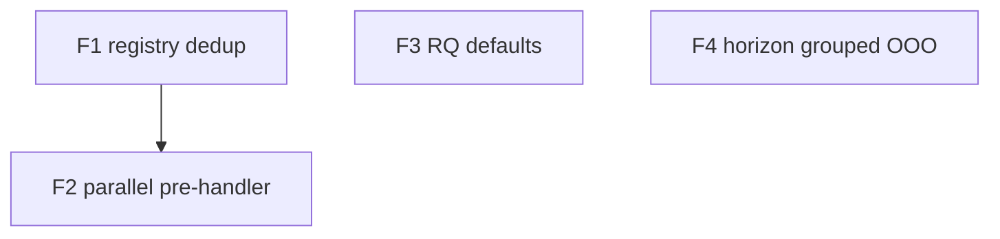

# Audit Phase F — performance (F1–F4)

**Tree verified 2026-08-15:** `COMMAND_CATALOG` length **89**, `AUDIT_WRITER_COMMAND_IDS.size === 63`, `V1_HTTP_ROUTE_AUDIT` length **144** (`[143].id === 'get_city_ledger_statement'`), `PROPERTY_SCHEMA_HEAD === 34`, `NIGHT_AUDIT_STEPS` length **8**, `[3] === 'AUTO_TRANSFER'`, `idempotency.ts` `export const` count **158**. Phases **A** (test signal), **B** (business logic), **C** (security), **D** (typed error channel), and **E** (user-facing behaviour) are landed on `main`.

**Date:** 2026-08-15  
**Status:** Draft (spec writer)  
**Sources:** [Full codebase audit — remediation plan](../../audit/2026-08-15-full-codebase-audit.md) Phase **F** items **F1**–**F4** (`:527–604`); [Ground rules](../../audit/2026-08-15-full-codebase-audit.md) (`:20–33`); [Do not fix](../../audit/2026-08-15-full-codebase-audit.md#do-not-fix--deliberate-decisions) (`:751–766`); [ARCHITECTURE.md](../../../ARCHITECTURE.md) §4.2 (BULK cursor rule, `:340–384`), §4.3 (KV registry projection, `:408–414`), §6.3 (entitlement version-keying, `:971–991`); `apps/pms-core/src/v1-dispatch.ts`; `apps/pms-core/src/registry.ts`; `apps/pms-core/src/provision.ts`; `apps/pms-core/src/property-do.ts`; `apps/web-pms/src/App.tsx`.

**Closes:** Audit **F1** (duplicate D1 property reads), **F2** (serial pre-handler chain), **F3** (React Query default refetch storm), **F4** (cold-path horizon reconcile query explosion). **Requires:** Phases **A/B/C/D/E** green. **Does not** advance Phase **G/H**, KV registry projection, entitlement version-keying changes, or server error semantics (Phase D locked).

---

## Executive summary

Phase F removes four measured performance defects — **three on the dispatch/registry path (F1–F2, pms-core)** and **one client-side (F3, web-pms)**, plus **one DO-internal algorithm fix (F4, property-do)**. **F1** threads the `PropertyRecord` already fetched in `resolveTenant` through `resolvePropertyContext` → `assertTenantActive` → `resolvePropertyFromRegistry`, cutting property-scoped D1 `prepare` calls from **5 → 2** (one property + one org) before PropertyDO contact. **F2** parallelizes independent pre-handler work (kill-switch eager start; permission + entitlement `Promise.all`) while preserving permission-before-entitlement response precedence. **F3** sets global `staleTime: 60_000` and locks **`refetchOnWindowFocus: false`** — front-desk board/arrivals freshness is already WebSocket-driven via `FrontOfficeLive`. **F4** hoists per-date OOO `COUNT(*)` into one grouped query per room type; **BULK classification is out of scope** — `reconcileHorizon` stays an internal helper, catalog stays **89**.

**Dependency order:** **F1 + F2** share `v1-dispatch.ts` — land in one task or **F1 → F2** sequentially. **F3** and **F4** are parallel-safe (web-pms-only and property-do-only respectively).

**Mandatory measurement (F1):** instrument `PLATFORM_DB.prepare` call count and wall-clock latency on a representative property-scoped route **before and after**; record baselines in the new spec file (see §5.1).

---

## 1. Context & motivation

### 1.1 Problem statement

| Item | Severity | Symptom | Root cause |
|---|---|---|---|
| **F1** | high | Every property-scoped HTTP command pays **four** identical `SELECT * FROM property WHERE property_id = ?` round trips plus one org read, all sequential, before PropertyDO | `resolveTenant` discards `PropertyRecord`; `resolvePropertyContext`, `assertTenantActive`, and `resolvePropertyFromRegistry` each re-fetch |
| **F2** | medium | Pre-handler chain awaits five steps strictly serially though two pairs are independent | `dispatchV1` (`v1-dispatch.ts:9211`) — kill-switch waits on actor; permission waits on entitlement |
| **F3** | medium | Tab-back refetch burst across ~70 mounted queries, each paying the F1 pipeline | `QueryClient` defaults omit `staleTime`; React Query defaults `staleTime: 0` + `refetchOnWindowFocus: true`; only **19/89** `useQuery` sites set `staleTime` |
| **F4** | medium | Cold-path horizon reconcile ≈ **14,600** SQL statements (20 types × 365 dates × 2) in one txn, no yield | `reconcileHorizon` (`property-do.ts:1440`) runs per-date OOO `COUNT(*)` subquery inside nested loops |

### 1.2 F1 — duplicate registry reads (evidence)

Tracing one property-scoped command end-to-end today:

| # | Call | Source | Query |
|---|---|---|---|
| 1 | `getProperty` | `resolveTenant` (`v1-dispatch.ts:1322`) | `SELECT * FROM property WHERE property_id = ?` |
| 2 | `getProperty` | `resolvePropertyContext` (`:1238`) | **identical** |
| 3 | `getProperty` | `assertTenantActive` (`registry.ts:63`) | **identical** |
| 4 | `getOrg` | `assertTenantActive` (`registry.ts:71`) | `SELECT … FROM org WHERE org_id = ?` |
| 5 | `getProperty` | `resolvePropertyFromRegistry` (`provision.ts:140`) | **identical** |

No KV or in-memory cache on the registry path (`registry.ts`, `provision.ts`). §4.3 prescribes KV projection as the long-term fix; **this phase does the cheap thread-through only.**

Handlers that call `resolvePropertyContext` directly (bypassing `resolveTenant`) are unchanged in count — F1 targets the **`dispatchV1` pre-handler + handler** path where both run.

### 1.3 F2 — serial pre-handler chain (evidence)

Current `dispatchV1` order (`v1-dispatch.ts:9218–9255`):

1. `resolveActor` (Clerk / dev actor)
2. `checkKillSwitch(env, feature)` — depends only on route feature key (`entitlementForRoute(route)` computable before tenant resolution)
3. `resolveTenant` — D1
4. `requirePermission` — OrgDO RPC; depends on `tenant.orgId` (+ `propertyId`)
5. `gateEntitlement` — KV; depends only on `tenant.orgId` + `feature`

Independent pairs: **(1 ∥ 2)** when `feature` is defined; **(4 ∥ 5)** when `feature` is defined.

### 1.4 F3 — React Query refetch storm (evidence)

- `apps/web-pms/src/App.tsx:31–38` — `defaultOptions.queries` sets `retry` / `retryDelay` only.
- **89** `useQuery` call sites; **19** set `staleTime` (17 use `60_000`, `FolioScreen` one query uses `Infinity`, `QueuedCommandsPanel` uses `0`).
- `StaffScreen.tsx:132,140` already sets `refetchOnWindowFocus: false`; `StaffScreen.test.tsx:317` asserts single-fetch on simulated focus — pattern not generalized.
- **Board / arrivals / tape chart** (`BoardScreen.tsx`, `TapeChartScreen.tsx`, `board-summary.tsx`) have **no** `staleTime` and **no** focus override today.
- **`FrontOfficeLive.tsx`** (`:34–40`, `:145`) invalidates `['board']`, `['front-desk-summary']`, `['front-desk-tape']`, etc. on WebSocket snapshot/delta — front-desk live data does **not** depend on window-focus refetch.

### 1.5 F4 — cold-path horizon reconcile (evidence)

- `reconcileHorizon` (`property-do.ts:1440–1497`) — steady state (night-audit roll, one missing date per type) ≈ 3 queries/type: fine.
- Cold path: every date missing → inner loop runs OOO `COUNT(*)` **per room type per date** (`:1467–1482`) plus one `INSERT` per missing date.
- `HORIZON_DAYS = 365` (`modules/pms/inventory/src/domain/horizon.ts`).
- Production callers: `runRollStepSync` (`property-do.ts:4311`) — steady state; `reconcileHorizonForTest` (`:2977`) — unsafe-local test helper only.
- `tryAddRoomType` seeds `availability_day` inline (`:5814–5823`) **without** calling `reconcileHorizon` — normal provisioning does not hit the cold path. Cold path is catch-up / test / edge-case (empty horizon with active types).
- §4.2 BULK cursor rule applies to **`@lane('BULK')` DO methods**, not internal helpers; `reconcileHorizon` was never classified.

### 1.6 Heads (frozen — this chunk moves none)

| Head | Current | This chunk |
|---|---|---|
| `COMMAND_CATALOG` | length **89** | **89** — unchanged (F4 grouped-query hoist only; no BULK command) |
| `AUDIT_WRITER_COMMAND_IDS.size` | **63** | **63** — unchanged |
| `V1_HTTP_ROUTE_AUDIT` | length **144**, tail `get_city_ledger_statement` | unchanged |
| `PROPERTY_SCHEMA_HEAD` | **34** | **34** — no migration |
| `NIGHT_AUDIT_STEPS` | length **8**, `[3] === 'AUTO_TRANSFER'` | **8** — unchanged |
| `idempotency.ts` `export const` count | **158** | **158** — unchanged |

### 1.7 Scope in

1. **F1** — `ResolvedTenant` carries `PropertyRecord`; thread-through signatures; D1 prepare-count spec (**5 → 2**); before/after latency capture (Lock 1).
2. **F2** — kill-switch eager start; permission ∥ entitlement; precedence test (Lock 2).
3. **F3** — global `staleTime: 60_000`; global `refetchOnWindowFocus: false`; focus-refetch spec (Lock 3).
4. **F4** — grouped OOO count → `Map<stayDate, count>` per room type; cold-path provisioning spec (Lock 4).

### 1.8 Scope out (normative)

- **KV registry projection** for permissions / property registry / org settings (§4.3) — explicit larger follow-up; **do not start**.
- **Entitlement version-keying** changes (§6.3) — unchanged.
- Phase **G/H** audit items.
- **New routes or catalog commands** — none (F4 does **not** add BULK classification or cursor RPC).
- **Server error codes / HTTP statuses** — Phase D locked; F2 precedence must preserve existing status codes (**403** before **402**).
- Edge rate limiting, code splitting, `gatePermission` / auth semantics, degraded-replay permission bypass.
- Push.

---

## 2. Locked decisions (verbatim — do not deviate)

### Lock 1 — F1: thread `PropertyRecord` through dispatch registry path

#### 1a — Extend `ResolvedTenant`

**File:** `apps/pms-core/src/v1-dispatch.ts`

```ts
import type { PropertyRecord } from './registry.js';

type ResolvedTenant =
  | { orgId: string; propertyId: null }
  | { orgId: string; propertyId: string; property: PropertyRecord };
```

For `route.scope === 'property'`, `resolveTenant` **must** return the full `property` row already fetched at `:1322` — do not call `getProperty` again downstream on the happy path.

#### 1b — Thread-through signatures

| Function | Change |
|---|---|
| `resolvePropertyContext(ctx, propertyId, prefetched?: PropertyRecord)` | When `prefetched` provided, skip `getProperty` at `:1238`; pass `prefetched` to `assertTenantActive` and `resolvePropertyFromRegistry` |
| `assertTenantActive(env, opts & { prefetchedProperty?: PropertyRecord })` | When `opts.prefetchedProperty` set and `opts.propertyId` matches, skip `getProperty` at `registry.ts:63`; still **must** call `getOrg` |
| `resolvePropertyFromRegistry(env, propertyId, prefetched?: PropertyRecord)` | When `prefetched` provided, skip `getProperty` at `provision.ts:140` |

**Call site in `dispatchV1` handlers:** not required for F1 acceptance — F1 proves the **`dispatchV1` → handler** path that uses `resolveTenant` output. Handlers that call `resolvePropertyContext(ctx, propertyId)` without a prefetched record retain today's behaviour (acceptable; out of F1 scope).

**Org-scoped routes:** `resolveTenant` returns `{ orgId, propertyId: null }` — prepare count is **1** (`getOrg` only); F1 assertion applies to **property-scoped** routes only.

#### 1c — D1 prepare-count assertion (locked)

**New file:** `apps/pms-core/test/dispatch-registry-dedup.spec.ts`

Instrument **`env.PLATFORM_DB.prepare`** with `vi.spyOn` for the duration of one HTTP request:

```ts
function countPrepareCalls(spy: ReturnType<typeof vi.spyOn>, sqlFragment: string): number {
  return spy.mock.calls.filter(([sql]) => String(sql).includes(sqlFragment)).length;
}
```

**Representative route (locked):** `GET /v1/properties/:propertyId/me` — hits `resolveTenant` + handler `resolvePropertyContext`; minimal body; existing fixture pattern from `property-me.spec.ts`.

**Assertions (after F1 land):**

| Metric | Before (baseline captured pre-land) | After (hard assert) |
|---|---|---|
| `prepare` calls containing `FROM property WHERE property_id` | **4** | **1** |
| Total `prepare` calls on dispatch registry path for this route | **5** | **2** (property + org) |

Count **only** calls issued during `worker.fetch` for the single request (spy installed immediately before fetch, restored after). Exclude unrelated test `beforeEach` schema setup.

#### 1d — Wall-clock latency measurement (locked)

Same spec file, same route, same provisioning fixture:

```ts
const t0 = performance.now();
const res = await worker.fetch(/* GET .../me */);
const elapsedMs = performance.now() - t0;
expect(res.status).toBe(200);
```

**Record baselines before implementation** as named constants at top of spec file:

```ts
/** Captured YYYY-MM-DD on main @ <commit-short>; re-capture if fixture changes. */
const BASELINE_ME_PREPARE_TOTAL = 5;
const BASELINE_ME_ELAPSED_MS = /* fill on first run */;
const POST_F1_ME_PREPARE_TOTAL = 2;
```

After F1 land:

- Hard-assert prepare total === **2** (§1c).
- Log `elapsedMs` in test output (`console.info`) and assert **`elapsedMs <= BASELINE_ME_ELAPSED_MS * 1.10`** OR, if baseline not yet captured on main, **skip the ratio assert on first green run** and commit the observed `BASELINE_ME_ELAPSED_MS` constant in the same PR that lands F1 (second CI run then enforces ≤10% regression guard).

**Do not** add production timing middleware — test-only instrumentation satisfies the audit measurement requirement.

---

### Lock 2 — F2: parallelize pre-handler chain, preserve precedence

**File:** `apps/pms-core/src/v1-dispatch.ts` — `dispatchV1` (`:9211+`)

#### 2a — Kill-switch eager start

```ts
const feature = entitlementForRoute(route);
const killSwitchPromise =
  feature != null ? checkKillSwitch(env, feature) : Promise.resolve(false);

const actor = await resolveActor(request, env);
if (actor instanceof Response) return actor;
observability.userId = actor.userId;

// … dev / bootstrap early returns unchanged …

if (feature && (await killSwitchPromise)) {
  return new Response(null, { status: 503 });
}
```

Kill-switch **must not** start before `feature` is computed; **must** await at the same decision point as today (after actor resolution, before `resolveTenant`).

#### 2b — Permission ∥ entitlement

After `resolveTenant` succeeds:

```ts
const permissionPromise = requirePermission(
  env,
  tenant.orgId,
  tenant.propertyId,
  actor.userId,
  route.permission,
);

if (feature) {
  const [denied, gated] = await Promise.all([
    permissionPromise,
    gateEntitlement(env, tenant.orgId, feature),
  ]);
  if (denied) return denied;       // 403 or 404 — precedence Lock 2c
  if (gated) return gated;         // 402 or 503
} else {
  const denied = await permissionPromise;
  if (denied) return denied;
}
```

Routes without `feature` (no entitlement gate) keep permission-only await — no `Promise.all` with `undefined`.

#### 2c — Response precedence (locked)

When **both** permission and entitlement fail, return the **permission** response — same as sequential code today:

| Permission result | Entitlement result | Status returned |
|---|---|---|
| **403** `forbidden` | **402** `entitlement_required` | **403** |
| **404** `not_found` (not_member) | **402** | **404** |

**New test:** `apps/pms-core/test/dispatch-prehandler-parallel.spec.ts`

Setup:

1. Provision hotel (`postOrg` + `postProperty` + subscription) with owner actor.
2. Add staff member (`org.ensureMember(staffUser, 'staff')`) — lacks e.g. `folio:adjust`.
3. `cancelSubscription(env, orgId)` — entitlement gate fails (**402**).
4. `POST /v1/properties/:id/folio/lines` (or any route with `permission: 'folio:adjust'` + `entitlement: 'pms.core'`) as **staff** actor.

**Assert:** `response.status === 403` (not 402). Existing kill-switch / entitlement / permission route specs remain green.

---

### Lock 3 — F3: React Query global defaults + focus policy

**File:** `apps/web-pms/src/App.tsx`

```ts
const queryClient = new QueryClient({
  defaultOptions: {
    queries: {
      retry: (count, err) => shouldRetry(asClassified(err)) && count < 3,
      retryDelay: (count, err) => retryDelay(asClassified(err), count),
      staleTime: 60_000,
      refetchOnWindowFocus: false,
    },
    mutations: { retry: false },
  },
});
```

#### 3a — `refetchOnWindowFocus` decision (locked)

**Global `false`.** No board/arrivals opt-in.

**Rationale (do not revisit without product owner):**

- `FrontOfficeLive.tsx` invalidates front-desk query keys on WebSocket snapshot/delta — board, tape chart, and summary stay live while the socket is connected.
- `staleTime: 60_000` already prevents refetch-on-focus for data younger than 60 s even if focus refetch were enabled.
- `StaffScreen` proved explicit `refetchOnWindowFocus: false` for member lists; generalizing globally matches desk-terminal usage (tab away to email/channel manager/phone).

**Per-query overrides (allowed, minimal):**

| Site | Override | Why |
|---|---|---|
| `QueuedCommandsPanel.tsx` | Keep `staleTime: 0`, `refetchInterval: 1000` | Degraded queue already polls; no focus opt-in needed |
| `FolioScreen.tsx` | Keep explicit `staleTime: Infinity` on folio snapshot query | Unchanged |
| Explicit per-screen `staleTime: 60_000` | **May remove** redundant duplicates (optional cleanup, not required for acceptance) | Global default subsumes |
| `StaffScreen.tsx` `refetchOnWindowFocus: false` | **May remove** redundant overrides (optional) | Global default subsumes |

**Do not** add `refetchOnWindowFocus: true` to `BoardScreen` / `TapeChartScreen` — WS invalidation is the freshness mechanism.

#### 3b — Focus-refetch spec (locked)

**New file:** `apps/web-pms/src/App.query-defaults.test.tsx`

Pattern mirrors `StaffScreen.test.tsx:309–321`:

1. Render a minimal component with `useQuery({ queryKey: ['focus-test'], queryFn })` inside `QueryClientProvider` using the **same** `defaultOptions` as `App.tsx` (extract shared `createQueryClient()` helper if needed to avoid drift).
2. Await initial fetch (`queryFn` called once).
3. `fireEvent(window, new Event('focus'))` + `visibilitychange`.
4. Wait 50 ms.
5. **Assert** `queryFn` still called **once**.

---

### Lock 4 — F4: grouped OOO count hoist (no BULK cursor)

**File:** `apps/pms-core/src/property-do.ts` — `reconcileHorizon` (`:1440+`)

#### 4a — Algorithm (locked)

For each active physical room type, **before** the per-date loop:

1. Run **one** grouped query over `[fromDate, toDate]`:

```sql
SELECT ooo.start_date, ooo.end_date, COUNT(*) AS room_count
  FROM room_ooo ooo
  JOIN room r ON r.room_id = ooo.room_id
 WHERE r.room_type_id = ?
   AND ooo.end_date > ?
   AND ooo.start_date <= ?
 GROUP BY ooo.start_date, ooo.end_date
```

2. Expand each `(start_date, end_date, room_count)` range into a `Map<string, number>` keyed by `stayDate` (increment counts for dates in `[max(start_date, fromDate), min(end_date - 1 day, toDate)]` using existing date helpers — **same semantics** as the per-date subquery at `:1471–1478`: blocked = count of rooms with `start_date <= stayDate AND end_date > stayDate`).

3. Inner loop: `blockedBorn = oooCountByDate.get(stayDate) ?? 0` — **no per-date SELECT**.

**Invariant:** For each `(room_type_id, stay_date)` inserted, `blocked` column value must match the old per-date subquery (existing `night-audit.spec.ts` tests + new cold-path test).

#### 4b — BULK classification (locked OUT)

| Question | Decision |
|---|---|
| Is cold path reachable outside provisioning in normal ops? | **No** — `tryAddRoomType` seeds horizon inline; production roll adds ≈1 day/type |
| Is cold path reachable at all? | **Yes** — `reconcileHorizonForTest` (tests) and catch-up when horizon rows are missing |
| Add `@lane('BULK')` cursor RPC? | **No** — internal helper, not a catalog command; grouped query reduces ≈14,600 → ≈40 statements, sufficient |
| `COMMAND_CATALOG` moves? | **No** — stays **89** |

If a future vertical exposes horizon reconcile as a user-triggered bulk operation, that vertical owns BULK classification separately — **not Phase F**.

#### 4c — Cold-path spec (locked)

**Extend** `apps/pms-core/test/night-audit.spec.ts` (or add `horizon-reconcile-cold.spec.ts`):

1. Provision property stub with timezone + business date.
2. Add **20** active physical room types (unique codes).
3. Delete all `availability_day` rows (use existing test helper or `deleteAvailabilityDaysFrom` per type).
4. Call `stub.reconcileHorizonForTest(businessDate)`.
5. **Assert** `result.insertedCount === 20 * HORIZON_DAYS`.
6. **Assert** test completes without timeout (vitest default sufficient after hoist).

---

## 3. Dependency & implementation order



| Step | Item | Package | Notes |
|---|---|---|---|
| 1 | **F1** | `pms-core` | Capture baseline prepare count + latency **before** code change; then thread-through |
| 2 | **F2** | `pms-core` | Same file as F1 — land immediately after F1 or in same commit |
| 3 | **F3** | `web-pms` | Parallel-safe with F1/F2/F4 |
| 4 | **F4** | `pms-core` | Parallel-safe; property-do only |

**TDD preference:** F1 prepare-count test fails at 4/5 before fix; F2 precedence test fails if `Promise.all` returns entitlement first; F3 focus test fails under defaults today; F4 cold-path test may timeout before hoist.

---

## 4. File map

| File | Change |
|---|---|
| `apps/pms-core/src/v1-dispatch.ts` | F1 `ResolvedTenant`, thread-through call sites; F2 `dispatchV1` parallelization |
| `apps/pms-core/src/registry.ts` | F1 `assertTenantActive` optional `prefetchedProperty` |
| `apps/pms-core/src/provision.ts` | F1 `resolvePropertyFromRegistry` optional prefetched record |
| `apps/pms-core/src/property-do.ts` | F4 grouped OOO map in `reconcileHorizon` |
| `apps/pms-core/test/dispatch-registry-dedup.spec.ts` | **New** — F1 prepare count + latency baselines |
| `apps/pms-core/test/dispatch-prehandler-parallel.spec.ts` | **New** — F2 precedence |
| `apps/pms-core/test/night-audit.spec.ts` (or new cold spec) | F4 cold-path `insertedCount` |
| `apps/web-pms/src/App.tsx` | F3 global `staleTime` + `refetchOnWindowFocus` |
| `apps/web-pms/src/App.query-defaults.test.tsx` | **New** — F3 focus no-refetch |
| `apps/web-pms/src/query-client.ts` (optional) | Extract `createQueryClient()` shared by `App.tsx` + test |

**Not touched:** `packages/contracts/**`, `COMMAND_CATALOG`, HTTP routes, `PROPERTY_SCHEMA_HEAD`, entitlement KV key scheme, `packages/client-core/**`.

---

## 5. Test plan

**Runners:**

```bash
pnpm test:local
# or targeted:
pnpm --filter @hospai/pms-core exec vitest run apps/pms-core/test/dispatch-registry-dedup.spec.ts \
  apps/pms-core/test/dispatch-prehandler-parallel.spec.ts \
  apps/pms-core/test/night-audit.spec.ts
pnpm --filter @hospai/web-pms test
```

### 5.1 F1 — registry dedup + measurement

| Test | Assert |
|---|---|
| `dispatch-registry-dedup.spec.ts` | Property `prepare` count **1**; total registry `prepare` **2** on `GET .../me` |
| same | `res.status === 200` |
| same | `BASELINE_*` constants committed; latency ratio ≤ 1.10 after land (§1d) |

### 5.2 F2 — parallel pre-handler

| Test | Assert |
|---|---|
| `dispatch-prehandler-parallel.spec.ts` | Staff + cancelled subscription + privileged route → **403** not **402** |
| Existing route specs | Kill-switch **503**, entitlement **402**, permission **403** unchanged |

### 5.3 F3 — React Query defaults

| Test | Assert |
|---|---|
| `App.query-defaults.test.tsx` | Simulated window focus → single `queryFn` invocation |
| `StaffScreen.test.tsx` | Remains green (global default matches explicit override) |
| Full `web-pms` suite | Green |

### 5.4 F4 — horizon cold path

| Test | Assert |
|---|---|
| `night-audit.spec.ts` (existing) | Gap catch-up, roll, archived-type skip — green |
| New cold-path case | `insertedCount === 20 * HORIZON_DAYS`; completes without timeout |

### 5.5 Gates

All **14** `check:*` gates remain green (audit ground rules §4).

---

## 6. Open decisions / ambiguities (for product owner review)

| Question | Resolution |
|---|---|
| **Handlers calling `resolvePropertyContext` without prefetch** | **Locked:** out of F1 scope; only `dispatchV1` + `resolveTenant` path must hit 2 prepares. Optional follow-up can thread prefetched record into handlers later. |
| **Board/arrivals focus refresh** | **Locked:** global `refetchOnWindowFocus: false`; WS invalidation (`FrontOfficeLive`) is the refresh mechanism. Flag if product wants 60 s stale tab-back refresh later. |
| **F4 BULK cursor** | **Locked OUT** — grouped query sufficient; catalog stays 89. |
| **Latency ratio threshold (10%)** | **Locked** for CI guard; flaky in miniflare — if flaky, relax to log-only but **keep prepare-count hard assert**. |
| **`useQuery` count (89 vs 142 lines)** | Audit count **89 call sites** is normative; tree grep may count imports/`useQueryClient` — do not churn unrelated queries in F3. |

---

## 7. Risks

| Risk | Mitigation |
|---|---|
| F1/F2 merge conflict in `v1-dispatch.ts` | Single implementer task or F1 immediately followed by F2 |
| `prefetchedProperty` / `propertyId` mismatch | `assertTenantActive` validates `prefetchedProperty.propertyId === opts.propertyId`; else fall back to D1 fetch |
| F2 `Promise.all` breaks precedence | Explicit `if (denied) return denied` before `if (gated) return gated`; dedicated spec |
| F3 hides stale board when WS disconnected | `StaleWatermark` + 60 s `staleTime`; user sees stale indicator; reconnect refetches via invalidation |
| F4 range expansion bug vs per-date COUNT | Table-driven unit test comparing old vs new `blockedBorn` for sample OOO ranges; existing horizon tests green |
| Baseline latency constant flaky | Prepare-count assert is primary; latency ratio is secondary guard |

---

## 8. Implementation checklist (reviewer §8)

- [x] Lock 1 (F1): `ResolvedTenant.property`; thread-through; prepare **5 → 2**; baseline constants committed
- [x] Lock 2 (F2): kill-switch ∥ actor; permission ∥ entitlement; precedence spec **403** over **402**
- [x] Lock 3 (F3): `staleTime: 60_000` + `refetchOnWindowFocus: false` global; focus spec green
- [x] Lock 4 (F4): grouped OOO map; cold-path **20 × HORIZON_DAYS**; **no** BULK/cursor
- [x] No frozen head moves (§1.6)
- [x] Scope-out respected — no KV projection, no catalog/route/schema changes, no Phase D status changes
- [x] `pnpm test:local` green (or sharded equivalent)
- [x] All **14** `check:*` gates green

---

## 9. Tree conflicts with reviewer locks

**No structural head moves.**

| Head | Moves? | Justification |
|---|---|---|
| `COMMAND_CATALOG` (89) | **No** | F4 internal helper only |
| `AUDIT_WRITER_COMMAND_IDS` (63) | **No** | — |
| `V1_HTTP_ROUTE_AUDIT` (144) | **No** | — |
| `PROPERTY_SCHEMA_HEAD` (34) | **No** | — |
| `NIGHT_AUDIT_STEPS` (8) | **No** | — |
| `idempotency.ts` const count (158) | **No** | — |
