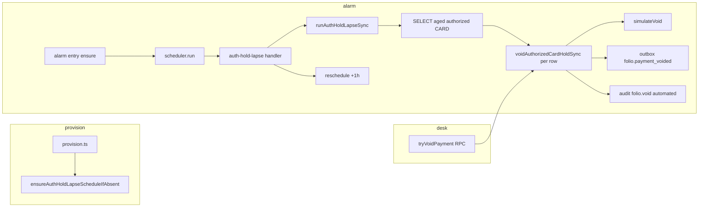

# Auth hold lapse — automatic void of aged card authorizations

**Tree verified 2026-08-15 (post unknown-payment close `5d2c5c7`):** `COMMAND_CATALOG` length **81** (`register.test.ts` ~678), `AUDIT_WRITER_COMMAND_IDS.size === 56` (`register.test.ts` ~268 and ~677), `V1_HTTP_ROUTE_AUDIT[133].id === 'post_folio_reconcile_payment'` (`register.test.ts` ~669–675; `v1-http-routes.ts` ~792+), `[132] delete_room` (`register.test.ts` ~662–668), `[131] post_folio_routing_rule_archive` (~655–661), `[128] post_folio_stay_discount` (~633–638), `[127] post_demo_seed` (~619–624), `PROPERTY_SCHEMA_HEAD === 29` / `ORG_SCHEMA_HEAD === 7` (`migrate.test.ts` ~626–627), `NIGHT_AUDIT_STEPS` length **8** with `[3] === 'AUTO_TRANSFER'` (`property-do.ts` ~1065–1074), `PLATFORM_GAPS === []` (`register.test.ts` ~679), catalog last entry `folio.reconcile_payment` ~897–909, `tryVoidPayment` ~15434–15528 (`simulateVoid` ~15472, outbox `folio.payment_voided` ~15504–15513, audit `folio.void` ~15514–15522), `tryCapturePayment` guard `status !== 'authorized'` → `PAYMENT_NOT_CAPTURABLE` ~15239–15240, `payment.created_at INTEGER NOT NULL` (v21 rebuild ~672 in `property-migrations.ts`), `alarm()` multiplex ~1988–2022 (`outbox` + `night-audit`), `ensureOutboxScheduleIfAbsent` ~1799–1806, `setAlarmScheduleForTest` / `triggerAlarmForTest` ~2442–2460, `SystemActor` union ~10–18 in `permissions.ts`, `folio.void` catalog ~473–481 + audit writer ~35, desk HTTP `post_folio_void` ~558–563, `FolioScreen` void button ~922–930 (`tenderPayments` filter ~810–812), int DOMAIN pattern `pms.reservations.pending_hold_hours` ~214–219 in `register.ts`, Settings `DomainText` + `inputType="number"` ~566–578.

**Date:** 2026-08-15  
**Status:** Approved (reviewer, 2026-08-15)  
**Sources:** ARCHITECTURE.md §4.4 (PropertyDO `alarm()` multiplexes named `alarm_schedule` rows; only caller of `setAlarm`), §4.6 (payments FAIL_CLOSED; simulate void/refund seam), §8 (8-step night-audit machine — do not grow without authorization); [payments ledger simulate](./2026-08-06-payments-ledger-simulate-design.md) (§5 **Auth expiry** leftover ~362; authorize/capture/void state machine); [folio money operations](./2026-08-12-folio-money-operations-design.md) (§6 void semantics; §19 leftover **8** ~801); [unknown payment reconcile](./2026-08-15-unknown-payment-reconcile-design.md) (§7 leftover **1** ~338 — auth expiry explicitly out); [night-audit auto-extend](./2026-08-15-night-audit-auto-extend-design.md) (PropertyDO alarm vs night-audit growth; `afterJson.automated: true` audit pattern); [queues consumer](./2026-07-28-queues-consumer-design.md) (`OUTBOX_SWEEP_INTERVAL_MS = 30_000`; backlog-aware reschedule); [rule 3 + config surface](./2026-08-06-rule3-config-surface-design.md) (DOMAIN register + Settings); `apps/pms-core/src/property-do.ts`; `apps/pms-core/src/psp-simulate.ts` (`simulateVoid` ~71–79); `packages/contracts/src/config/register.ts`; `packages/contracts/src/permissions.ts`; `apps/web-pms/src/screens/SettingsScreen.tsx`; `apps/pms-core/test/folio-payment-lifecycle.spec.ts` (void case **26** ~62–82); `apps/pms-core/test/night-audit.spec.ts` (`setAlarmScheduleForTest` ~482).

**Closes:** [payments ledger simulate](./2026-08-06-payments-ledger-simulate-design.md) leftover **Auth expiry** (~362: `authorized` never ages out). [folio money operations](./2026-08-12-folio-money-operations-design.md) leftover **8** (~801). [unknown payment reconcile](./2026-08-15-unknown-payment-reconcile-design.md) leftover **1** (~338). Bidirectional one-sentence pointers in those specs are the **final implementation task**, not this spec writer’s job.

**Amends:** [payments ledger simulate](./2026-08-06-payments-ledger-simulate-design.md) §5 row **Auth expiry** (~362) (closed). [folio money operations](./2026-08-12-folio-money-operations-design.md) §19 item **8** (~801) (closed). [unknown payment reconcile](./2026-08-15-unknown-payment-reconcile-design.md) §7 item **1** (~338) (closed). Bidirectional pointer sentences in those specs are the **final implementation task**, not this spec writer’s job.

---

## 1. Context & Motivation

Simulate authorize creates real **`authorized`** CARD holds that persist indefinitely. Desk **`folio.void`** (~15434) is the manual exit, but nothing ages holds out automatically — payments spec §5 and folio-money §19 both name **authorization expiry / hold-lapse** as an open leftover. Unknown reconcile (closed `5d2c5c7`) explicitly scoped auth expiry **out**; this chunk closes it.

Hold-lapse is a **PropertyDO background alarm** (new `alarm_schedule` name **`auth-hold-lapse`**), **not** a ninth night-audit step and **not** a new catalog command or HTTP route. Reuse desk void semantics (including **`simulateVoid`**) via an internal sync helper the alarm calls with a **system actor** — no `folio:post` permission gate.

### 1.1 What already exists (verified — do not re-spec)

| Piece | Where (verified) |
|---|---|
| Void RPC | `tryVoidPayment` ~15434–15528: `gatePermission(actor, 'folio:post')`, `pspSimulateEnabled()`, CARD + `status='authorized'`, await `simulateVoid`, txn2 `UPDATE … WHERE status='authorized'`, outbox **`folio.payment_voided`**, audit **`folio.void`** |
| Capture guard after void | `tryCapturePayment` ~15239–15240: `status !== 'authorized'` → `PAYMENT_NOT_CAPTURABLE` (voided holds blocked) |
| Hold clock column | `payment.created_at INTEGER NOT NULL` ~672 (v21 rebuild); authorize sets both `created_at` / `updated_at` on insert |
| Alarm infrastructure | `alarm_schedule` table (migration v3); `AlarmScheduler.run(handlers)`; `alarm()` ~1988–2022 registers **`outbox`** + **`night-audit`** only today |
| Outbox schedule bootstrap | `ensureOutboxScheduleIfAbsent` ~1799–1806 at provision (`provision.ts` ~130–131); pattern to mirror |
| Night-audit schedule | `ensureNightAuditSchedule` ~1791–1796; `rescheduleNightAuditSync` ~1830–1840 — **do not** attach hold-lapse here |
| Config read | `readConfigValueSync` ~1854–1861 (stored row or register default) |
| Int DOMAIN precedent | `pms.reservations.pending_hold_hours` ~214–219: `z.number().int().min(1).max(168)`, default `24`, `consumersExempt: true` |
| System audit actor pattern | Auto-extend: `commandId: 'reservations.modify'`, `afterJson.automated: true`, `{ kind: 'system', reason: 'night_audit' }` |
| Desk void UI | `FolioScreen` authorized row → **Void** button ~922–930; `api.voidPayment` ~642–650 |
| Catalog / HTTP heads | Last catalog `folio.reconcile_payment` ~897–909; last route `[133] post_folio_reconcile_payment` ~669–675; **`folio.void`** already catalog ~473–481 |
| Audit writers | `folio.void` in set ~35; size pin **56** |
| Night audit | **8** steps ~1065–1074; `[3] === 'AUTO_TRANSFER'` — **unchanged** |
| Schema head | **29** (`migrate.test.ts` ~626) — `payment.created_at` present; no new column needed |

**Heads (frozen — this chunk does not move them):**

| Head | Current | This chunk |
|---|---|---|
| `COMMAND_CATALOG` | length **81** | **81** — **no** new command (reuse `folio.void` audit writer) |
| `AUDIT_WRITER_COMMAND_IDS.size` | **56** | **56** — `folio.void` already in set |
| `V1_HTTP_ROUTE_AUDIT` | `[133] = post_folio_reconcile_payment` | **unchanged** — `[132]`/`[131]`/`[128]`/`[127]` unmoved |
| `PROPERTY_SCHEMA_HEAD` | **29** | **29** — no migration |
| `ORG_SCHEMA_HEAD` | **7** | **7** |
| `NIGHT_AUDIT_STEPS` | length **8** | **8** — **no** new step |
| `PLATFORM_GAPS` | `[]` | stays `[]` |

### 1.2 Scope in

1. DOMAIN config **`pms.payments.auth_hold_hours`** (Lock 3).
2. Extract internal **`voidAuthorizedCardHoldSync`** from `tryVoidPayment` body (Lock 2) — desk RPC wraps it after permission/entitlement gates.
3. PropertyDO alarm schedule **`auth-hold-lapse`**: ensure at provision, test stub, and `alarm()` entry; handler; periodic sweep (Lock 1).
4. **`SystemActor.reason`** += **`'auth_hold_lapse'`** in `permissions.ts` (~12–18).
5. Settings SPA int field + hint (Lock 5).
6. Tests §6 Lock 6; config register invariants (`assertRegisterInvariants`, prototype key list).

### 1.3 Scope out (normative — name them so a later pass does not “fix” them here)

- Unknown reconcile (done `5d2c5c7`); **`unknown`** / **`pending`** auto-recovery
- Real PSP webhooks / inquire-on-lapse
- Growing `NIGHT_AUDIT_STEPS` to **9**; new catalog id (e.g. `folio.lapse_hold`); new V1 HTTP route
- **`CASH`** captures / authorized cash (never lapsed here)
- Folio muted “Hold aged out” badge / new expire button (desk **Void** stays manual path)
- City ledger / AR / invoices; derived rates; promo; rooms leftovers
- Collapse split commands; demo seed rewrite
- Bidirectional leftover pointer sentences (final implementation task)
- New `export class` / `CLASS_DENYLIST` edit

---

## 2. Behaviour (normative locks)

Implementation that violates these is out of spec.

### Lock 1 — PropertyDO alarm; no 9th night-audit step; no new catalog/HTTP

Hold-lapse runs on a **dedicated `alarm_schedule` row** named **`auth-hold-lapse`**, registered in `alarm()` alongside `outbox` and `night-audit` (~1988–2022).

1. **`ensureAuthHoldLapseScheduleIfAbsent()`** — idempotent first-write (mirror `ensureOutboxScheduleIfAbsent` ~1799–1806): if no row, `upsertSchedule('auth-hold-lapse', Date.now() + AUTH_HOLD_LAPSE_SWEEP_INTERVAL_MS)`, then `armFromTable()`. **Three call sites (all required):**
   - **`provision.ts`** ~130–131 — next to `ensureOutboxScheduleIfAbsent` (new hotels).
   - **`apps/pms-core/test/fixtures.ts`** `provisionedPropertyStub` ~69 — next to outbox ensure; otherwise most tests never arm the schedule.
   - **Start of `alarm()`** ~1988 — **`await this.ensureAuthHoldLapseScheduleIfAbsent()`** before `scheduler.run`, so the next outbox/night-audit fire on an already-provisioned PropertyDO inserts `auth-hold-lapse` and `armFromTable()`.
2. **Handler** `'auth-hold-lapse'`: call **`runAuthHoldLapseSync()`** (Lock 2–3), then **`upsertSchedule('auth-hold-lapse', Date.now() + AUTH_HOLD_LAPSE_SWEEP_INTERVAL_MS)`** so the handler advances `next_run_at` past “now” (AlarmScheduler never-spin invariant).
3. **Constant** `AUTH_HOLD_LAPSE_SWEEP_INTERVAL_MS` — default **`3_600_000`** (1 hour). Place in **`apps/pms-core`** (`property-do.ts` or a small adjacent const file) **or** `@hospai/do-runtime` index **alongside** outbox exports — **not** in `packages/do-runtime/src/outbox.ts` (hold-lapse is not an outbox concern). Sweeps are cheap SQL; hourly is sufficient for 72h TTL.

**Forbidden:** inserting hold-lapse into `NIGHT_AUDIT_STEPS` (~1065–1074); adding `folio.lapse_hold` to `COMMAND_CATALOG`; appending a V1 route; wiring `consumers.reschedulesNightAudit` on the config key.

### Lock 2 — Reuse void semantics; system actor; `folio.void` audit with `automated: true`

Extract an internal sync path from `tryVoidPayment` (~15434–15528):

```ts
/** Sync void of one authorized CARD hold. Caller supplies actor + stable void fingerprint. */
private async voidAuthorizedCardHoldSync(
  actor: ActorContext,
  input: { paymentId: string; voidFingerprint: string },
): Promise<
  | { ok: true; paymentId: string; status: 'voided' }
  | { ok: false; error: typeof NOT_FOUND | typeof PAYMENT_NOT_VOIDABLE | typeof PSP_UNAVAILABLE | string }
>
```

**Shared core (desk + alarm):**

- Refuse `CASH` or `status !== 'authorized'` → `PAYMENT_NOT_VOIDABLE` (same as ~15468–15469).
- Refuse when `!pspSimulateEnabled()` → `PSP_UNAVAILABLE` (real hold exists in simulate mode — same as desk ~15456).
- Await **`simulateVoid`** with `{ paymentId, gatewayReference: payment.gateway_reference ?? \`sim_${paymentId}\` }` (~15472–15477).
- Adapter **`declined`** or **`timeout`** → return `PAYMENT_NOT_VOIDABLE` / error string; **leave status `authorized`** (folio-money rule: void timeout does not promote to `unknown`).
- Adapter **`approved`** → txn2: conditional `UPDATE payment SET status='voided', void_fingerprint=?, updated_at=? WHERE payment_id=? AND status='authorized'`; outbox **`folio.payment_voided`** (same payload shape ~15504–15513); audit **`commandId: 'folio.void'`** with `beforeJson: { status: 'authorized' }`, `afterJson: { status: 'voided', automated?: true }`.

**Desk RPC `tryVoidPayment`:** keep `assertRpcAvailable`, `touchInteractive`, entitlement + **`gatePermission(actor, 'folio:post')`**, idempotency replay on `void_fingerprint` (~15462–15467). Delegate to `voidAuthorizedCardHoldSync` after gates. **`afterJson.automated` omitted** (or `false`) for human voids.

**Alarm path `runAuthHoldLapseSync`:** **no** `gatePermission`. Actor **`{ kind: 'system', reason: 'auth_hold_lapse' }`** — **add** `'auth_hold_lapse'` to `SystemActor.reason` union in `permissions.ts` (~12–18). Per payment void fingerprint: **`auth_hold_lapse:${paymentId}`** (stable idempotent replay). Set **`afterJson.automated: true`** on audit rows (pattern: auto-extend `reservations.modify` + `automated: true`).

**Per-payment failure isolation (Lock 4):** adapter/txn failure on one hold → log/skip; **do not** fail the whole alarm handler or poison the schedule beyond normal AlarmScheduler backoff.

### Lock 3 — TTL config `pms.payments.auth_hold_hours`

Register entry (append in `register.ts`, near other payment/folio DOMAIN keys):

```typescript
entry({
  key: 'pms.payments.auth_hold_hours',
  prototypeKey: 'pms_payments_auth_hold_hours',
  class: 'DOMAIN',
  schema: z.number().int().min(1).max(720),
  default: 72,
  consumersExempt: true,
}),
```

| Rule | Detail |
|---|---|
| Default | **72** hours when unset (register default via `readConfigValueSync`) |
| Min / max | **1** – **720** (30 days); stored **0** rejected at PUT validation |
| “Off” switch | **None.** TTL always active; very large stored value (e.g. **720**) = effectively off |
| Age clock | **`payment.created_at`** vs `Date.now()` — **do not** add `authorized_at` column |
| Candidate query | `status = 'authorized' AND tender_type = 'CARD' AND created_at <= ?` where `? = Date.now() - hours * 3_600_000` |
| Excluded statuses | **`unknown`**, **`pending`**, **`declined`**, **`captured`**, **`voided`**, **`refunded`**, **`CASH`** — not lapsed here |

Changing the config key does **not** reschedule night-audit or outbox; next alarm sweep reads the new hours.

### Lock 4 — Capture after lapse; skip semantics

Once voided, **`tryCapturePayment`** remains blocked (`payment_not_capturable` ~15239–15240) — no capture shortcut.

- **`unknown`** holds: **out** — closed by unknown-reconcile chunk; alarm must not select `unknown`.
- Adapter void failure on one payment: skip, continue sweep; do not abort sibling voids.
- Already **`voided`** with same `auth_hold_lapse:${paymentId}` fingerprint: idempotent no-op (reuse desk replay logic ~15499–15501).

### Lock 5 — SPA

**Settings only** this chunk:

- Add **`DomainText`** (or equivalent) under a **Payments** / **Folio** settings group:
  - `configKey="pms.payments.auth_hold_hours"`
  - `inputType="number"`
  - **`hint="Authorized card holds older than this many hours are voided automatically."`**
- Mirror `pending_hold_hours` placement pattern (~566–572).

**Folio:** no new expire button; existing **Void** (~922–930) stays the manual path. Optional muted “Hold aged out” UI is **out**.

### Lock 6 — Tests

New file recommended: `apps/pms-core/test/auth-hold-lapse.spec.ts` (or extend `folio-payment-lifecycle.spec.ts` if it stays focused).

**Harness:** `provisionHotel` / `provisionedPropertyStub`; authorize CARD hold (`tryAuthorizePayment` or HTTP); **`setPaymentCreatedAtForTest(paymentId, ms)`** unsafe-local helper (mirror `stampFolioWindowClosedForTest` ~2175–2181) to warp `payment.created_at` — **do not** `vi.spyOn` into the DO isolate.

**Alarm fire:** `setAlarmScheduleForTest('auth-hold-lapse', Date.now() - 60_000)` + `triggerAlarmForTest()` (~2442–2444) — same pattern as `night-audit.spec.ts` ~482.

| # | Case | Expect |
|---|---|---|
| 1 | Authorize CARD; warp `created_at` to `now - 73h`; default config (72h); fire alarm | `status='voided'`; outbox contains **`folio.payment_voided`**; audit `commandId='folio.void'`, `afterJson.automated=true`, actor `system:auth_hold_lapse` |
| 2 | Same payment after lapse; `tryCapturePayment` | `payment_not_capturable` |
| 3 | Authorize; warp to `now - 71h` (inside TTL) | still `authorized` after alarm |
| 4 | `tryPutDomainConfig('pms.payments.auth_hold_hours', 720)`; warp `now - 100h` | still `authorized` (effectively off) |
| 5 | `CASH` / `unknown` / `pending` rows aged past threshold | unchanged after alarm |
| 6 | `setPspSimulateOutcomeForTest({ void: 'declined' })` on aged hold | stays `authorized`; alarm completes (schedule advanced) |
| 7 | Desk `tryVoidPayment` still works on fresh authorized hold | permission gate intact; no `automated` on audit |
| 8 | `ensureAuthHoldLapseScheduleIfAbsent` on provision | `getAlarmSchedule('auth-hold-lapse')` non-null |
| 9 | Provisioned stub **without** lapse ensure (call `ensureOutboxScheduleIfAbsent` only, skip lapse ensure — or delete the row via an existing test helper if present); set outbox due and **`triggerAlarmForTest()`** | After any alarm fire, `getAlarmSchedule('auth-hold-lapse')` non-null (lazy ensure at `alarm()` entry) |

**Settings test:** `SettingsScreen.test.tsx` — domain list includes key; hint **`Authorized card holds older than this many hours are voided automatically.`** present (follow auto-extend hint case pattern).

**Register:** catalog **81**, writers **56**, `[133]` last, `[132]`/`[131]`/`[128]`/`[127]` unmoved, `PROPERTY_SCHEMA_HEAD === 29`, `NIGHT_AUDIT_STEPS.length === 8`, `PLATFORM_GAPS === []`; `assertRegisterInvariants()`; update `EXPECTED_PROTOTYPE_KEYS` length **96 → 97** + sorted `pms_payments_auth_hold_hours`.

---

## 3. Architecture sketch



---

## 4. File-level impact

| Area | Touch |
|---|---|
| `packages/contracts/src/permissions.ts` | `SystemActor.reason` += `'auth_hold_lapse'` (~12–18) |
| `packages/contracts/src/config/register.ts` | + `pms.payments.auth_hold_hours` |
| `packages/contracts/src/register.test.ts` | prototype key **97**; invariants |
| `apps/pms-core/src/property-do.ts` (or small adjacent const) | + `AUTH_HOLD_LAPSE_SWEEP_INTERVAL_MS` (**`3_600_000`**) — **or** export from `@hospai/do-runtime` index only (not `outbox.ts`); extract `voidAuthorizedCardHoldSync`; `runAuthHoldLapseSync`; `ensureAuthHoldLapseScheduleIfAbsent`; `alarm()` entry ensure + handler; `setPaymentCreatedAtForTest` |
| `apps/pms-core/src/provision.ts` | call `ensureAuthHoldLapseScheduleIfAbsent` (~130–131) |
| `apps/pms-core/test/fixtures.ts` | `provisionedPropertyStub` ~69 — call `ensureAuthHoldLapseScheduleIfAbsent` next to outbox ensure |
| `apps/web-pms/src/screens/SettingsScreen.tsx` | int field; hint **`Authorized card holds older than this many hours are voided automatically.`** |
| `apps/web-pms/src/screens/SettingsScreen.test.tsx` | key + exact hint string |
| `apps/pms-core/test/auth-hold-lapse.spec.ts` | Lock 6 matrix (cases **1–9**) |

**Not touched:** `COMMAND_CATALOG`, `audit-writers.ts`, `v1-http-routes.ts`, `property-migrations.ts`, `NIGHT_AUDIT_STEPS`, `v1-dispatch.ts`, `FolioScreen.tsx`, unknown-reconcile code paths.

---

## 5. Leftovers this chunk names

| # | Item | Notes |
|---|---|---|
| 1 | **`pending` seam auto-recovery** | Test 20 path — explicit scope-out |
| 2 | **Real PSP expiry webhooks** | Simulate-only void on lapse |
| 3 | **Per-hold `authorized_at` / PSP TTL** | Uses `created_at` only |
| 4 | **Folio “Hold aged out” muted label** | Optional UI — out |
| 5 | **Alarm observability dashboard** | `alarm_schedule.last_error` exists; no new metrics |

---

## 6. Implementation checklist

- [x] `SystemActor.reason` includes `'auth_hold_lapse'`
- [x] Config register + SPA + invariants (**97** prototype keys)
- [x] Settings SPA hint: **`Authorized card holds older than this many hours are voided automatically.`**
- [x] `voidAuthorizedCardHoldSync` extracted; desk `tryVoidPayment` delegates
- [x] `runAuthHoldLapseSync` + `auth-hold-lapse` alarm schedule + ensure at provision, test stub, and `alarm()` entry (Lock 1 three call sites)
- [x] `setPaymentCreatedAtForTest` unsafe-local helper
- [x] Tests Lock 6 (cases **1–9**); register pins unchanged (**81** / **56** / `[133]`)
- [x] Bidirectional pointers: payments-ledger §5 row; folio-money §19 item **8**; unknown-reconcile §7 item **1** (final implementation task)

---

## 7. Tree conflicts with reviewer locks

**None on heads.** Verified post-`5d2c5c7`: catalog **81**, writers **56**, `[133] post_folio_reconcile_payment` last, `PROPERTY_SCHEMA_HEAD` **29**, `NIGHT_AUDIT_STEPS[3] === 'AUTO_TRANSFER'` (~1067), `payment.created_at` on v21+ (~672), `tryVoidPayment` + `simulateVoid` seam (~15434–15477), `alarm()` two-handler multiplex (~1988–2022).

**Notes for implementer (not lock violations):**

1. **`voidAuthorizedCardHoldSync` is async** (adapter outside txn) — alarm handler may process holds sequentially; volume is low for Phase 1.
2. **`pspSimulateEnabled()` off** → alarm skips voids with `PSP_UNAVAILABLE` per payment; holds remain until simulate mode returns (same as desk void case **36** in `folio-payment-lifecycle.spec.ts` ~465).
3. **Do not** emit a new outbox event type — reuse **`folio.payment_voided`** only (desk void case **26** ~62–82).
4. **Config PUT validation** already flows through register schema — document min/max in OpenAPI/domain config responses via existing machinery.
5. **LaneGuard:** alarm path should **not** call `touchInteractive` (background sweep; mirror outbox alarm — no interactive touch in `flushOutboxToQueue` path).
