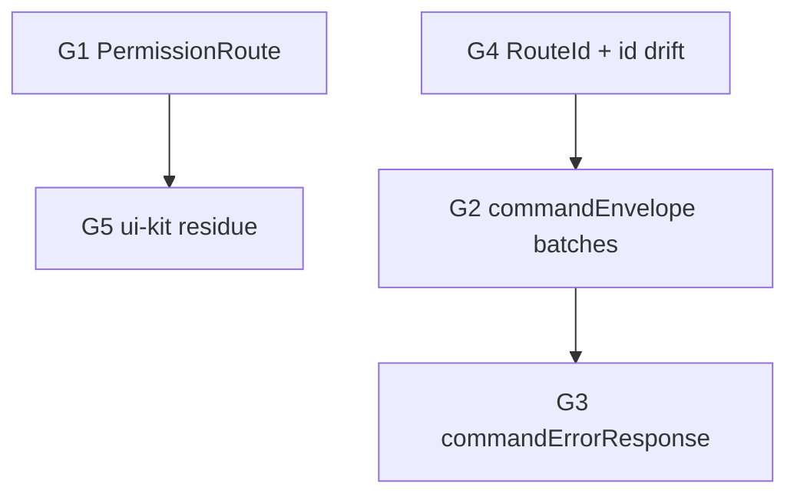

# Audit Phase G — structural cleanup (G1–G5)

**Tree verified 2026-08-16:** `COMMAND_CATALOG` length **89**, `AUDIT_WRITER_COMMAND_IDS.size === 63`, `V1_HTTP_ROUTE_AUDIT` length **144** (`[143].id === 'get_city_ledger_statement'`), `PROPERTY_SCHEMA_HEAD === 34`, `NIGHT_AUDIT_STEPS` length **8**, `[3] === 'AUTO_TRANSFER'`, `idempotency.ts` `export const` count **158**. Phases **A** (test signal), **B** (business logic), **C** (security), **D** (typed error channel), **E** (user-facing behaviour), and **F** (performance) are landed on `main`.

**Date:** 2026-08-16  
**Status:** Draft (spec writer)  
**Sources:** [Full codebase audit — remediation plan](../../audit/2026-08-15-full-codebase-audit.md) Phase **G** items **G1**–**G5** (`:607–684`); [Ground rules](../../audit/2026-08-15-full-codebase-audit.md) (`:20–33`); [Do not fix](../../audit/2026-08-15-full-codebase-audit.md#do-not-fix--deliberate-decisions) (`:751–766`); §16.4 platform-owned appearance (`:669`); `apps/web-pms/src/screens/*Route.tsx`; `apps/web-pms/src/auth/me.ts`; `apps/pms-core/src/v1-dispatch.ts`; `apps/pms-core/src/invoke-property-do.ts`; `scripts/permissions-check.mjs`; `packages/contracts/src/v1-http-routes.ts`; `scripts/ui-kit-adoption-check.mjs`.

**Closes:** Audit **G1** (route-guard duplication), **G2** (`invokePropertyDo` preamble), **G3** (error-tail ladder), **G4** (route-audit index coupling), **G5** (ui-kit residue). **Requires:** Phases **A/B/C/D/E/F** green. **Does not** advance Phase **H**, DO/schema/catalog-command changes, or server error semantics (Phase D locked).

---

## Executive summary

Phase G is five mechanical consolidations — **two in web-pms (G1, G5)**, **two in pms-core dispatch (G2, G3)**, and **one in contracts + scripts (G4)**. **G1** replaces seven near-identical `*Route.tsx` guards (~317 lines) with one `<PermissionRoute>` rendering `<Outlet/>`, converts four direct-render routes to nested routes in `App.tsx`, and adds a guard for housekeeping. **G2** extracts a `commandEnvelope` builder for the six-line `invokePropertyDo` arg block (61 audit sites; tree may show more after A–F). **G3** generalizes `rosterWriteErrorResponse` into `commandErrorResponse(err, permission)` and merges the near-identical guest/roster status mappers on Phase D's `CommandError` union. **G4** adds `id` to each `V1_ROUTES` entry, keys `check:permissions` drift detection on `id`, and exports a `RouteId` union — **144 route count unchanged; file shape changes**. **G5** extends the ui-kit adoption ratchet to catch `className="panel"` / `"badge"` literals, migrates 13 + 2 sites to `<Card>` / `<Badge>`, deletes duplicate CSS, and merges duplicate `.side-panels` rules.

**Dependency order:** **G4 ∥ G1** (no file overlap) → **G5** (after G1; both web-pms) → **G2** (after G4; needs `RouteId`) → **G3** (after G2; same `v1-dispatch.ts`).

---

## 1. Context & motivation

### 1.1 Problem statement

| Item | Severity | Symptom | Root cause |
|---|---|---|---|
| **G1** | medium | 317 lines across 7 `*Route.tsx` files; Rates/Inventory byte-identical; two composition models (Outlet vs direct screen) | Copy-paste permission gate with no shared component |
| **G2** | low | Same six `invokePropertyDo` args hand-assembled in every property command handler | No envelope builder |
| **G3** | low | Identical 5-line error ladder inline in ≥15 handlers beside extracted `rosterWriteErrorResponse`; guest/roster mappers differ in 3 lines | Helper not generalized; mappers not merged |
| **G4** | medium | `permissions-check.mjs:80` compares routes by **array index**; adjacent swaps with identical metadata pass silently; `routeId: string` never validated | Index coupling; no closed `RouteId` type |
| **G5** | medium | `.panel` / `.badge` duplicate ui-kit styles; gates count 0 raw controls while 13 + 2 className literals drift | Tag-based ratchet misses div/span components |

### 1.2 G1 — route guards (evidence)

Seven files under `apps/web-pms/src/screens/`:

| File | Permission | Pass render | Fail redirect |
|---|---|---|---|
| `RatesRoute.tsx` | `rates:write` | `<Outlet/>` | `/arrivals` |
| `InventoryRoute.tsx` | `inventory:write` | `<Outlet/>` | `/arrivals` |
| `SettingsRoute.tsx` | `settings:configure` | `<Outlet/>` | `/arrivals` |
| `BookRoute.tsx` | `reservations:write` | `<BookingScreen/>` | `/arrivals` |
| `NightAuditRoute.tsx` | `night_audit:run` | `<NightAuditScreen/>` | `/arrivals` |
| `RosterRoute.tsx` | `roster:write` | `<RosterScreen/>` | `/arrivals` |
| `StaffRoute.tsx` | `staff:read` | `<StaffScreen/>` | `/arrivals` |

All share: `useQuery(['me', propertyId])`, `meShellStateFromQuery`, pending/null shell → `null`, live without permission → `<Navigate replace>`, **`authority.kind === 'unknown'` → fail open** (render pass target).

`HousekeepingScreen.tsx` has **no guard** — computes `canAssign` / `canReadRoster` / `canSetOoo` from possibly-`undefined` `me`, causing read-only→editable flicker. Nav contribution (`@hospai/pms-housekeeping/ui`) declares `permission: 'housekeeping:read'`.

Seven route-guard spec files exist (`*Route.test.tsx`); each asserts deep-link without permission redirects and screen never mounts.

### 1.3 G2 — invokePropertyDo preamble (evidence)

Typical block (`v1-dispatch.ts:1659–1675`):

```ts
await invokePropertyDo({
  env: ctx.env,
  commandId: 'inventory.add_room_type',
  routeId: 'post_room_types',
  orgId: resolvedCtx.property.orgId,
  propertyId,
  timeZone: resolvedCtx.property.timeZone,
  actorUserId: ctx.actor.userId,
  idempotencyKey: body.idempotencyKey,
  requestFingerprint: fingerprint,
  commandPayload,
  observability: ctx.observability,
  invoke: () => …,
});
```

Audit count: **61** handlers. Tree grep (`await invokePropertyDo`): **72** — treat audit **61** as the consolidation target; any delta is post-audit additions and must also use `commandEnvelope`.

### 1.4 G3 — error-tail ladder (evidence)

`rosterWriteErrorResponse` (`v1-dispatch.ts:2224–2230`) — used 5×:

```ts
if (err === 'not_member') return json({ error: 'not_found' }, 404);
if (err === FORBIDDEN || err === 'scope_mismatch') {
  return json({ error: 'forbidden', permission }, 403);
}
return json({ ok: false, error: err }, mapRosterCommandErrorStatus(coerceCommandError(err)));
```

Identical 3-line prefix appears inline in ≥15 other handlers. `mapGuestCommandErrorStatus` (`:563`) and `mapRosterCommandErrorStatus` (`:753`) share structure; concrete switches (`mapGuestConcreteCommandErrorStatus` / `mapRosterConcreteCommandErrorStatus`) differ only in domain 404/409 cases (`GUEST_NOT_FOUND` / `GUEST_ALREADY_ERASED` / `GUEST_EXISTS` vs `STAFF_NOT_FOUND` / `STAFF_EXITED`).

Phase D locked all mapper signatures to `(error: CommandError): number` with exhaustive `never` defaults — G3 builds on that; **HTTP status codes must not change**.

### 1.5 G4 — route-audit drift (evidence)

- `V1_HTTP_ROUTE_AUDIT` (`packages/contracts/src/v1-http-routes.ts`) — **144** entries, each has `id`.
- `V1_ROUTES` (`v1-dispatch.ts:7784+`) — **144** entries, **no `id` field**; order must match audit for index check to pass.
- `permissions-check.mjs:79–88` — compares `parsedRoutes[i]` to `V1_HTTP_ROUTE_AUDIT[i]` on `scope`, `permission`, `commandId`, `entitlement` only.
- `invoke-property-do.ts:17` — `routeId: string`; flows to `ProvisionalCommand.routeId` for degraded replay.

### 1.6 G5 — ui-kit residue (evidence)

- `.panel` (`apps/web-pms/src/styles.css:199–204`) byte-identical to `.ui-card` (`packages/ui-kit/src/styles.css:171–176`).
- `.badge` (`web-pms/styles.css:378–391`) duplicates `.ui-badge` pattern; 2 raw spans at `TapeChartScreen.tsx:280,:343`.
- **13** `className="panel"` literals across 12 screen files (SettingsScreen has 3).
- `.side-panels` declared twice (`styles.css:165–169` shared with `.top-bar`/`.shift-strip`; `:421–427` adds grid + cancels `border-bottom`).
- `ui-kit-adoption-check.mjs:17–28` — tag-based `FORBIDDEN` list only; baseline `total: 0`.

### 1.7 Heads (frozen counts — shape change on G4 only)

| Head | Current | This chunk |
|---|---|---|
| `COMMAND_CATALOG` | length **89** | **89** — unchanged |
| `AUDIT_WRITER_COMMAND_IDS.size` | **63** | **63** — unchanged |
| `V1_HTTP_ROUTE_AUDIT` | length **144**, tail `get_city_ledger_statement` | **144** — count unchanged; **G4 adds `id` to `V1_ROUTES` and exports `RouteId`** (sanctioned shape change, not a count change) |
| `PROPERTY_SCHEMA_HEAD` | **34** | **34** — no migration |
| `NIGHT_AUDIT_STEPS` | length **8**, `[3] === 'AUTO_TRANSFER'` | **8** — unchanged |
| `idempotency.ts` `export const` count | **158** | **158** — unchanged |

### 1.8 Scope in

1. **G1** — `PermissionRoute` component; nested routes in `App.tsx`; housekeeping guard; delete 7 `*Route.tsx` files.
2. **G2** — `commandEnvelope` builder; adopt in all `invokePropertyDo` call sites in reviewable domain batches.
3. **G3** — `commandErrorResponse`; merge guest/roster concrete mappers; replace inline ladders and `rosterWriteErrorResponse`.
4. **G4** — `id` on `V1_ROUTES`; id-keyed drift check; `RouteId` union export; type `invokePropertyDo.routeId`.
5. **G5** — ratchet extension; 13 `<Card>` + 2 `<Badge>` migrations; CSS cleanup; `.side-panels` merge.

### 1.9 Scope out (normative)

- **DO / schema / catalog-command changes** — none.
- Phase **H** audit items.
- **Route-guard fail-open** on `authority.kind === 'unknown'` — deliberate; do **not** fix (`apps/web-pms/src/auth/me.ts:21`, audit Do-not-fix table).
- **Server error codes / HTTP statuses** — Phase D locked; G3 consolidates mapping only; statuses unchanged.
- **Behaviour changes** beyond mechanical consolidation (redirect targets, permission strings, fail-open semantics stay as today).
- Degraded-replay permission bypass, edge rate limiting, code splitting, KV registry projection.
- Push.

---

## 2. Locked decisions (verbatim — do not deviate)

### Lock 1 — G1: `<PermissionRoute>` + nested routes + housekeeping guard

#### 1a — Component shape (locked)

**New file:** `apps/web-pms/src/auth/PermissionRoute.tsx`

```tsx
import type { PropertyScopedPermission } from '@hospai/contracts';

export type PermissionRouteProps = {
  permission: PropertyScopedPermission;
  /** Redirect target when live authority lacks permission. Default `/arrivals`. */
  fallback?: string;
};

export function PermissionRoute({ permission, fallback = '/arrivals' }: PermissionRouteProps) {
  // useQuery(['me', propertyId]) + meShellStateFromQuery — same as today
  // shell.kind !== 'authority' → null
  // authority.kind === 'pending' → null
  // authority.kind === 'live' && !hasPropertyPermission(me, permission) → <Navigate to={fallback} replace />
  // authority.kind === 'live' && has permission → <Outlet />
  // authority.kind === 'unknown' → <Outlet />   // fail open — DO NOT CHANGE
}
```

**Locked constraints:**

- **Always renders `<Outlet/>` on pass** — never renders a screen component directly.
- **No `children` prop** — composition is exclusively via React Router nested routes.
- **`fallback` defaults to `/arrivals`** — matches all seven existing guards.
- **Preserve fail-open:** when `authority.kind === 'unknown'`, render `<Outlet/>` (same as Rates/Inventory/Settings today; same as Book/NightAudit/Roster/Staff direct-render today). Do **not** redirect, do **not** block, do **not** "fix" to fail-closed.

#### 1b — Routes converted to nested (locked)

**File:** `apps/web-pms/src/App.tsx`

| Path | Permission | Nested element |
|---|---|---|
| `book` | `reservations:write` | `<BookingScreen />` |
| `night-audit` | `night_audit:run` | `<NightAuditScreen />` |
| `staff` | `staff:read` | `<StaffScreen />` |
| `roster` | `roster:write` | `<RosterScreen />` |
| `housekeeping/*` | `housekeeping:read` | `<HousekeepingScreen />` (new guard) |
| `rates/*` | `rates:write` | existing child routes unchanged |
| `inventory/*` | `inventory:write` | existing child routes unchanged |
| `settings/*` | `settings:configure` | existing child routes unchanged |

Pattern:

```tsx
<Route path="book" element={<PermissionRoute permission="reservations:write" />}>
  <Route index element={<BookingScreen />} />
</Route>
```

#### 1c — Deletions (locked)

Delete after migration:

- `apps/web-pms/src/screens/RatesRoute.tsx`
- `apps/web-pms/src/screens/InventoryRoute.tsx`
- `apps/web-pms/src/screens/SettingsRoute.tsx`
- `apps/web-pms/src/screens/BookRoute.tsx`
- `apps/web-pms/src/screens/NightAuditRoute.tsx`
- `apps/web-pms/src/screens/RosterRoute.tsx`
- `apps/web-pms/src/screens/StaffRoute.tsx`

Remove corresponding imports from `App.tsx`; import `PermissionRoute` from `./auth/PermissionRoute.js`.

#### 1d — Housekeeping guard (locked)

- Wrap `housekeeping/*` with `<PermissionRoute permission="housekeeping:read" />` + nested `<HousekeepingScreen />`.
- **Remove** inline permission derivation from unsettled `me` for gating purposes — screen may still read `me` for affordances (`canAssign`, etc.) but only after guard passes (me settled + permission confirmed or fail-open).
- Permission **`housekeeping:read`** matches `@hospai/pms-housekeeping/ui` nav contribution and `filterNavEntries` tests in `me.test.ts`.

#### 1e — Tests (locked)

**New file:** `apps/web-pms/src/auth/PermissionRoute.test.tsx`

Parameterized matrix covering **all 8 permissions** (7 migrated + housekeeping):

1. Live without permission → redirect to `/arrivals`; nested screen testid absent.
2. Live with permission → `<Outlet/>` renders nested screen.
3. Unknown authority → nested screen **does** render (fail-open).

Migrate assertions from the seven `*Route.test.tsx` files; **delete** the seven old test files after migration. Net behaviour must match existing specs.

---

### Lock 2 — G2: `commandEnvelope` builder + domain batches

#### 2a — Signature (locked)

**New file:** `apps/pms-core/src/command-envelope.ts`

```ts
import type { RouteId } from '@hospai/contracts';
import type { V1DispatchContext } from './v1-dispatch.js';
import type { PropertyRecord } from './registry.js';

export type ResolvedPropertyCtx = {
  property: PropertyRecord;
  resolved: NonNullable<Awaited<ReturnType<typeof resolvePropertyFromRegistry>>>;
};

export function commandEnvelope(
  ctx: V1DispatchContext,
  resolvedCtx: ResolvedPropertyCtx,
  opts: {
    commandId: string;
    routeId: RouteId;
    idempotencyKey: string;
    requestFingerprint: string;
    commandPayload: unknown;
  },
) {
  return {
    env: ctx.env,
    observability: ctx.observability,
    commandId: opts.commandId,
    routeId: opts.routeId,
    orgId: resolvedCtx.property.orgId,
    propertyId: resolvedCtx.property.propertyId,
    timeZone: resolvedCtx.property.timeZone,
    actorUserId: ctx.actor.userId,
    idempotencyKey: opts.idempotencyKey,
    requestFingerprint: opts.requestFingerprint,
    commandPayload: opts.commandPayload,
  };
}
```

**Usage pattern (locked):**

```ts
const invoked = await invokePropertyDo({
  ...commandEnvelope(ctx, resolvedCtx, {
    commandId: 'inventory.add_room_type',
    routeId: 'post_room_types',
    idempotencyKey: body.idempotencyKey,
    requestFingerprint: fingerprint,
    commandPayload,
  }),
  invoke: () => resolvedCtx.resolved.stub.tryAddRoomType(…),
});
```

- **`propertyId`** comes from `resolvedCtx.property.propertyId` — do not pass a separate decoded `propertyId` param unless it is validated equal to `resolvedCtx.property.propertyId` (existing handlers decode from `ctx.match[1]`; keep decode for observability assignment, but envelope uses registry record).
- **Requires G4 `RouteId`** — land G4 before G2, or use a temporary `RouteId` import from contracts once G4 lands.

#### 2b — Batching commits (locked)

Mechanical replacement only — **one commit per batch**, no single mega-commit:

| Batch | Domain | `commandId` prefixes / handlers |
|---|---|---|
| **G2-1** | Inventory + rooms | `inventory.*`, `rooms.*` |
| **G2-2** | Reservations + assign | `reservations.*`, `housekeeping.assign` |
| **G2-3** | Folio + shift + cash | `folio.add_item`, charge/tax/routing/shift/payment/fx |
| **G2-4** | Folio windows + void/refund | `folio.open_window`, `split_charge`, `void`, `refund`, `capture*`, `authorize`, `reconcile_payment`, `post_discount` |
| **G2-5** | Rates + restrictions + promo | `rates.*`, `restrictions.*` |
| **G2-6** | Guests + roster | `guests.*`, `roster.*` |
| **G2-7** | City ledger + invoice | `city_ledger.*`, `invoice.*` |
| **G2-8** | Night audit + provisional + config | `night_audit.*`, `provisional.*`, `config.*`, `property.update_details` |

Each batch: replace preamble blocks only; **do not** refactor handler error tails (G3) or business logic in the same commit.

---

### Lock 3 — G3: `commandErrorResponse` + mapper merge

#### 3a — Generalized helper (locked)

**File:** `apps/pms-core/src/v1-dispatch.ts` (or `apps/pms-core/src/command-error-response.ts` if extract reduces noise)

```ts
import type { CommandError, Permission } from '@hospai/contracts';

function commandErrorResponse(err: CommandError, permission: Permission): Response {
  if (err === NOT_MEMBER) return json({ error: 'not_found' }, 404);
  if (err === FORBIDDEN || err === SCOPE_MISMATCH) {
    return json({ error: 'forbidden', permission }, 403);
  }
  return json({ ok: false, error: err }, mapCommandErrorStatus(err));
}
```

- **Replace** `rosterWriteErrorResponse` — delete it; all 5 call sites use `commandErrorResponse`.
- **Replace** inline handlers whose error tail is **exactly** the 3-line ladder + single mapper call (no entity-specific NOT_FOUND prefix).
- Handlers with **`NOT_FOUND || NOT_MEMBER`** (or entity-specific NOT_FOUND like `RATE_PLAN_NOT_FOUND`) **keep local prefix checks** before calling `commandErrorResponse` for the remainder — do **not** extend the helper to absorb entity-not-found variants (status mapping stays local and unchanged).

#### 3b — Mapper merge (locked)

Merge `mapGuestConcreteCommandErrorStatus` and `mapRosterConcreteCommandErrorStatus` into **one** function:

```ts
function mapPersonEntityCommandErrorStatus(error: ConcreteCommandError): number { … }
```

- **404 cases:** `GUEST_NOT_FOUND`, `STAFF_NOT_FOUND`, `NOT_MEMBER` (already in ladder — not duplicated here).
- **409 cases:** `GUEST_ALREADY_ERASED`, `GUEST_EXISTS`, `STAFF_EXITED`, `IDEM_KEY_REUSED`.
- **Shared tail:** identical cases from both switches remain identical (FORBIDDEN, SCOPE_MISMATCH, config unset → 500, money/tax → 422, etc.).

Thin public wrappers (locked):

```ts
function mapGuestCommandErrorStatus(error: CommandError): number {
  if (error.startsWith(UNDECLARED_CONFIG_PREFIX)) return 422;
  return mapPersonEntityCommandErrorStatus(error as ConcreteCommandError);
}

function mapRosterCommandErrorStatus(error: CommandError): number {
  if (error.startsWith(UNDECLARED_CONFIG_PREFIX)) return 422;
  return mapPersonEntityCommandErrorStatus(error as ConcreteCommandError);
}
```

**New unified entry** for write handlers that previously called either guest or roster mapper interchangeably:

```ts
function mapCommandErrorStatus(error: CommandError): number {
  return mapGuestCommandErrorStatus(error); // identical to mapRoster after merge
}
```

`commandErrorResponse` calls `mapCommandErrorStatus`. **Delete** duplicated switch bodies — one `mapPersonEntityCommandErrorStatus` only.

#### 3c — Status preservation (locked)

- Phase D exhaustive switches and status assignments are **normative**.
- G3 is refactor-only: run existing dispatch integration tests; any status change is a **regression**.
- **`rosterGetJson` paths** keep their response wrapper; swap inline ladders to `commandErrorResponse` where body shape matches `{ ok: false, error }` — roster GET paths that return `{ error: 'not_found' }` without `ok` keep local helpers.

---

### Lock 4 — G4: `id`-keyed drift + `RouteId` union

#### 4a — Add `id` to `V1_ROUTES` (locked)

**File:** `apps/pms-core/src/v1-dispatch.ts`

Extend `V1RouteDef` base (all scopes) with **`id: RouteId`**.

Each entry's `id` **must equal** the corresponding `V1_HTTP_ROUTE_AUDIT` entry's `id` for the same route. Order in the array may diverge after this change — drift check no longer depends on order.

Example:

```ts
{
  id: 'post_room_types',
  scope: 'property',
  method: 'POST',
  pattern: /^\/v1\/properties\/([^/]+)\/room-types$/,
  permission: 'inventory:write',
  commandId: 'inventory.add_room_type',
  handler: handlePostRoomTypes,
},
```

#### 4b — `RouteId` export (locked)

**File:** `packages/contracts/src/v1-http-routes.ts`

```ts
export type RouteId = (typeof V1_HTTP_ROUTE_AUDIT)[number]['id'];
```

Re-export from `packages/contracts/src/index.ts` (already exports `./v1-http-routes.js`).

**Sanctioned shape change:** `V1_ROUTES` entries gain `id`; contracts gain `RouteId` type export. **`V1_HTTP_ROUTE_AUDIT.length` stays 144** — no new routes, no removed routes.

#### 4c — Id-keyed permissions check (locked)

**File:** `scripts/permissions-check.mjs`

1. Parse `id` from each `V1_ROUTES` block (regex `id:\s*'([^']+)'`).
2. Build `Map<string, parsedRoute>` keyed by `id`.
3. For each `V1_HTTP_ROUTE_AUDIT` entry, look up by `audit.id`.
4. Missing id → `Drift detected: V1_ROUTES missing id '…' referenced in V1_HTTP_ROUTE_AUDIT`.
5. Extra id in dispatch not in audit → fail.
6. Field compare on match: `scope`, `permission`, `commandId`, `entitlement` (same keys as today).
7. **Remove index-based loop** at `:79–88`.

#### 4d — Type `routeId` in invoke wrapper (locked)

**File:** `apps/pms-core/src/invoke-property-do.ts`

```ts
import type { RouteId } from '@hospai/contracts';

export async function invokePropertyDo<T extends { ok: boolean }>(opts: {
  …
  routeId: RouteId;
  …
}): …
```

All call sites must pass audit-valid ids (compile-time enforced after G4).

#### 4e — Reorder verification (locked)

Manual verify step (document in PR, not CI):

1. Deliberately swap two adjacent `V1_ROUTES` entries with identical metadata.
2. Run `pnpm check:permissions`.
3. **Expect:** check stays green (order-independent).
4. Change one entry's `permission` without updating audit.
5. **Expect:** `Drift detected for route id '…': field 'permission' mismatch`.

---

### Lock 5 — G5: ui-kit ratchet + CSS cleanup

#### 5a — Extend `ui-kit-adoption-check.mjs` (locked)

Add literal className counting:

```js
const PANEL_RE = /className="panel"/g;
const BADGE_RE = /className="badge"/g;
```

Scan same roots as today (`apps/web-pms/src`, `modules/pms/housekeeping/src/ui`).

**Baseline file:** `scripts/.ui-kit-adoption-baseline.json`

```json
{
  "total": 0,
  "byTag": { … },
  "panelClassName": 13,
  "badgeClassName": 2,
  …
}
```

Ratchet rules (same semantics as `total`):

- Count **rises** → fail.
- Count **falls** without baseline update in same commit → fail.
- After replacements land, baseline → `{ panelClassName: 0, badgeClassName: 0 }`.

#### 5b — Replacements (locked)

| Literal sites | Replacement |
|---|---|
| **13** `className="panel"` | `<Card>` from `@hospai/ui-kit` |
| **2** `className="badge"` in `TapeChartScreen.tsx` | `<Badge rung={…}>` from `@hospai/ui-kit` |

**Card migration:** extend `Card` root div to accept `TestIdProps & React.ComponentPropsWithoutRef<'div'>` (at minimum `className`, `role`, `aria-modal`, `data-testid`) so dialog panels (`SettingsScreen`, `RatesScreen`) preserve a11y attributes — **minimal ui-kit additive change**.

**Badge migration:** map room status string to `StatusRung` using existing severity helpers where possible (`statusClass` / `boardRowSeverity` patterns); default `rung="neutral"` when no mapping exists.

Preserve all existing `data-testid` attributes on migrated sites.

#### 5c — CSS deletions (locked)

**File:** `apps/web-pms/src/styles.css`

- **Delete** `.panel { … }` block (`:199–204`).
- **Delete** `.badge { … }` and `.badge.status-exception { … }` blocks (`:378–391`).
- **Merge** `.side-panels` — single rule combining:
  - From first block (`:165–169`): `background`, `border-bottom`, `padding` shared with `.top-bar`/`.shift-strip` — **keep** `.top-bar, .shift-strip, .side-panels` grouping for shared props.
  - From second block (`:421–427`): `display: grid`, `gap`, `grid-template-columns`, `border-top`, `border-bottom: none`.
- Result: one `.side-panels` rule set; no duplicate top-level selector.

#### 5d — Gates (locked)

- `pnpm check:ui-kit-adoption` green at new baseline (13/2, then 0/0).
- `pnpm check:web-pms-colors` green (token-only colours preserved).
- `pnpm --filter @hospai/web-pms test` green.

---

## 3. Dependency & implementation order



| Step | Item | Package / area | Notes |
|---|---|---|---|
| 1a | **G4** | `contracts`, `permissions-check.mjs`, `v1-dispatch.ts` (`V1_ROUTES` ids), `invoke-property-do.ts` | Parallel-safe with G1 |
| 1b | **G1** | `web-pms` routes | Parallel-safe with G4 |
| 2 | **G5** | `web-pms` screens/styles, `ui-kit`, `ui-kit-adoption-check.mjs` | After G1 — avoids `App.tsx` + screen collision |
| 3 | **G2-1 … G2-8** | `pms-core` `v1-dispatch.ts` | After G4 — needs `RouteId`; one commit per batch |
| 4 | **G3** | `pms-core` `v1-dispatch.ts` | After all G2 batches — same file |

**Working-tree discipline:** Do not start G3 until G2 batches are merged. Do not start G5 until G1 route tree is stable. G4 and G1 may land in either order or concurrently (disjoint paths).

---

## 4. File map

| File | Change |
|---|---|
| `apps/web-pms/src/auth/PermissionRoute.tsx` | **New** — G1 shared guard |
| `apps/web-pms/src/auth/PermissionRoute.test.tsx` | **New** — G1 parameterized gate tests |
| `apps/web-pms/src/App.tsx` | G1 — nested routes for all guarded paths |
| `apps/web-pms/src/screens/*Route.tsx` (×7) | G1 — **delete** |
| `apps/web-pms/src/screens/*Route.test.tsx` (×7) | G1 — **delete** after migration |
| `apps/web-pms/src/screens/HousekeepingScreen.tsx` | G1 — remove unsettled-me gate flicker (affordances only post-guard) |
| `apps/web-pms/src/screens/*.tsx` (12 files) | G5 — `panel` → `<Card>` |
| `apps/web-pms/src/screens/TapeChartScreen.tsx` | G5 — `badge` → `<Badge>` |
| `apps/web-pms/src/styles.css` | G5 — delete `.panel`/`.badge`; merge `.side-panels` |
| `packages/ui-kit/src/Card.tsx` | G5 — forward div props for dialog/testid |
| `packages/contracts/src/v1-http-routes.ts` | G4 — export `RouteId` type |
| `apps/pms-core/src/v1-dispatch.ts` | G4 `id` on routes; G2 envelope adoption; G3 error helper + mapper merge |
| `apps/pms-core/src/command-envelope.ts` | **New** — G2 builder |
| `apps/pms-core/src/invoke-property-do.ts` | G4 — `routeId: RouteId` |
| `scripts/permissions-check.mjs` | G4 — id-keyed drift |
| `scripts/ui-kit-adoption-check.mjs` | G5 — panel/badge literal counts |
| `scripts/.ui-kit-adoption-baseline.json` | G5 — baseline 13/2 → 0/0 |

---

## 5. Test & verification plan

### 5.1 G1 — route guards

```bash
pnpm --filter @hospai/web-pms test src/auth/PermissionRoute.test.tsx
```

- Live without permission → `/arrivals` redirect; screen testid absent.
- Live with permission → screen mounts.
- Unknown authority → screen mounts (fail-open).
- Housekeeping: without `housekeeping:read` → redirect; no flicker on assign controls.

### 5.2 G2 — command envelope

- `pnpm typecheck` — all `routeId` literals satisfy `RouteId`.
- No runtime test required — mechanical refactor; existing pms-core integration tests must stay green per batch.

### 5.3 G3 — error response

- Existing dispatch tests covering guest/roster/reservation write errors — statuses unchanged.
- Spot-check: `not_member` → **404**, `FORBIDDEN`/`scope_mismatch` → **403**, domain errors → same as Phase D mapper table.

### 5.4 G4 — permissions drift

```bash
pnpm check:permissions
```

Manual: reorder two `V1_ROUTES` entries → still green; mutate one field by id → clear per-id error message.

### 5.5 G5 — ui-kit

```bash
pnpm check:ui-kit-adoption
pnpm check:web-pms-colors
pnpm --filter @hospai/web-pms test
```

Visual spot-check: tape chart badges, settings/rates dialog panels, board created-banner panel → Card styling matches pre-migration.

### 5.6 Full suite

```bash
pnpm test:local
# all 14 check:* gates green
```

---

## 6. Open decisions / ambiguities (for product owner review)

| Question | Resolution |
|---|---|
| **`invokePropertyDo` count 61 vs 72** | **Locked:** consolidate all `await invokePropertyDo` sites in tree; audit **61** is the documented minimum — do not leave stragglers. |
| **Housekeeping permission** | **Locked:** `housekeeping:read` — matches module nav contribution and `me.test.ts` nav filter specs. |
| **`Card` div prop forwarding** | **Locked:** extend `Card` with div props for dialog/`data-testid` — minimal ui-kit change in G5. |
| **TapeChart `Badge` rung mapping** | **Implementer choice** within constraint: use existing severity/rung helpers; default `neutral`. Flag if room-status strings need a new mapping table. |
| **`commandEnvelope` file location** | **Locked:** `apps/pms-core/src/command-envelope.ts` — keeps `invoke-property-do.ts` transport-only. |
| **G3 compound NOT_FOUND prefixes** | **Locked OUT of helper** — local prefix + `commandErrorResponse` for tail only. |

---

## 7. Risks

| Risk | Mitigation |
|---|---|
| G1 fail-open regression | Explicit unknown-authority test case; do-not-fix table cited in component comment |
| G2/G3 merge conflicts in `v1-dispatch.ts` | Strict batch order; G3 only after G2 complete |
| G4 `id` typo in `V1_ROUTES` | `RouteId` compile-time check on `commandEnvelope` + `invokePropertyDo` |
| G5 Card styling regression on dialog panels | Preserve `role`/`aria-modal`/`data-testid`; visual spot-check |
| G5 Badge colour drift on tape chart | Map through `StatusRung` + `statusRungClass` — same token rungs as `.badge.status-exception` |
| G3 accidental status change | Phase D mapper table is normative; integration tests must not change expectations |
| Index-based check removal hides count mismatch | Keep length equality check: `parsedRoutes.length === V1_HTTP_ROUTE_AUDIT.length` plus id set equality |

---

## 8. Implementation checklist (reviewer §8)

- [ ] Lock 1 (G1): `PermissionRoute` with `permission`, `fallback`, `<Outlet/>` only; 4 routes nested; housekeeping `housekeeping:read`; fail-open preserved
- [ ] Lock 2 (G2): `commandEnvelope` in `command-envelope.ts`; 8 domain batches committed separately
- [ ] Lock 3 (G3): `commandErrorResponse(err: CommandError, permission)`; merged `mapPersonEntityCommandErrorStatus`; statuses unchanged
- [ ] Lock 4 (G4): `id` on all `V1_ROUTES`; `RouteId` export; id-keyed `check:permissions`; `invokePropertyDo.routeId: RouteId`
- [ ] Lock 5 (G5): ratchet counts `panel`/`badge`; 13 + 2 replacements; CSS deleted/merged; baseline 0/0
- [ ] Frozen head **counts** unchanged (§1.7); **G4 shape change only** — `RouteId` additive export, 144 routes
- [ ] Scope-out respected — no DO/schema/catalog, no Phase H, no fail-open fix, no status changes
- [ ] `pnpm test:local` green (or sharded equivalent)
- [ ] All **14** `check:*` gates green

---

## 9. Tree conflicts with reviewer locks

| Head | Count moves? | Shape moves? | Justification |
|---|---|---|---|
| `COMMAND_CATALOG` (89) | **No** | **No** | G2/G3 dispatch refactor only |
| `AUDIT_WRITER_COMMAND_IDS` (63) | **No** | **No** | — |
| `V1_HTTP_ROUTE_AUDIT` (144) | **No** | **No** | Audit list unchanged |
| `V1_ROUTES` in dispatch | **No** (144) | **Yes** — adds `id: RouteId` per entry | G4 — drift check keyed by id |
| `RouteId` type export | — | **Yes** (new additive export) | G4 — closes latent typo gap |
| `PROPERTY_SCHEMA_HEAD` (34) | **No** | **No** | — |
| `NIGHT_AUDIT_STEPS` (8) | **No** | **No** | — |
| `idempotency.ts` const count (158) | **No** | **No** | — |
