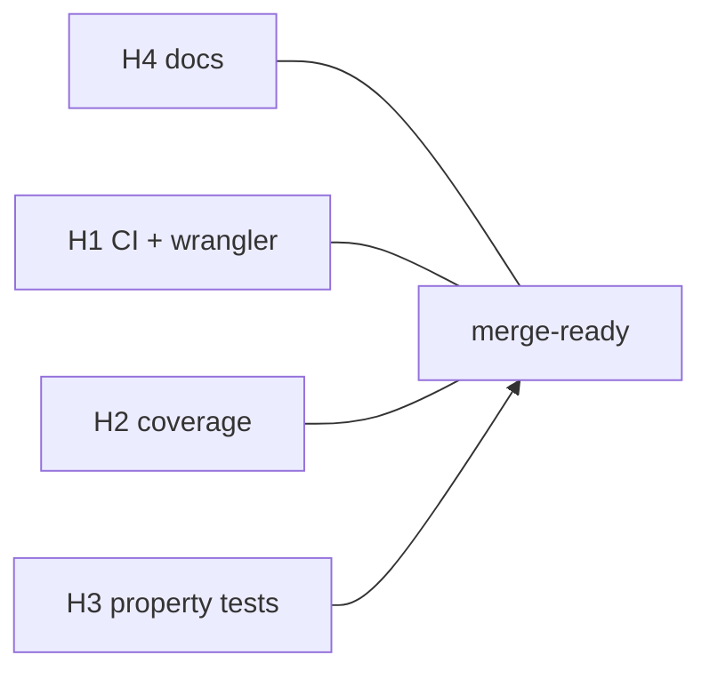

# Audit Phase H — test, deployment, and documentation infrastructure (H1–H4)

**Tree verified 2026-08-16:** `COMMAND_CATALOG` length **89**, `AUDIT_WRITER_COMMAND_IDS.size === 63`, `V1_HTTP_ROUTE_AUDIT` length **144** (`[143].id === 'get_city_ledger_statement'`), `PROPERTY_SCHEMA_HEAD === 34`, `NIGHT_AUDIT_STEPS` length **8**, `[3] === 'AUTO_TRANSFER'`, `idempotency.ts` `export const` count **158**. Phases **A** through **G** are landed on `main`.

**Date:** 2026-08-16  
**Status:** Draft (spec writer)  
**Sources:** [Full codebase audit — remediation plan](../../audit/2026-08-15-full-codebase-audit.md) Phase **H** items **H1**–**H4** (`:687–748`); [Do not fix](../../audit/2026-08-15-full-codebase-audit.md#do-not-fix--deliberate-decisions) (`:751–766`); [Verified correct](../../audit/2026-08-15-full-codebase-audit.md#verified-correct--do-not-fix-these-either) (`:768–776`); ARCHITECTURE.md §4.1 (`:333–338`), §7.1 (`:1056–1175`, virtual oversell `:1164–1175`), §10.1 (`:1715–1718`), §16.4 (`:2118–2132`); `.github/workflows/ci.yml` (`checks`, `test-pms-core-ledger-prop`); `apps/pms-core/wrangler.jsonc`; `packages/tenant-router/src/index.ts` (`resolvePropertyStub` `:119–153`); `packages/tenant-router/src/index.test.ts`; `apps/pms-core/test/reservations-ledger.property.spec.ts`; `apps/pms-core/test/virtual-reservations.spec.ts` (`seedKingQueenRoh`); `docs/superpowers/specs/2026-07-28-queues-consumer-design.md:92`; [Phase A README / test:local](./2026-08-15-audit-phase-a-test-signal-design.md).

**Closes:** Audit **H1** (Worker deploy verification + jurisdiction production path), **H2** (coverage measurement), **H3** (ledger property-test expansion), **H4** (documentation reconciliation). **Requires:** Phases **A–G** green. **Does not** advance any post-audit vertical, change DO/schema/catalog/route heads, or alter product behaviour.

---

## Executive summary

Phase H is the **final audit remediation chunk** — four infra items with **no frozen-head movement**. **H1** adds `wrangler deploy --dry-run` to CI, scaffolds a `staging` env block in `wrangler.jsonc` (config only — **no live deploy job**), and locks jurisdiction-success coverage in `@hospai/tenant-router` (existing unit test verified/strengthened). **H2** adds `@vitest/coverage-v8` and a coverage run on the non-sharded CI test step — **no threshold**. **H3** expands the sold-ledger property tests: richer operation mix (`tryConfirm`, `tryHold`, `tryNoShow`, OOO/`blocked`), **20+ seeds**, and a **second property test** for virtual room types asserting the §7.1 invariant on **physical** rows. **H4** is docs-only: reword §10.1 / §4.1 retention and archival claims as not-yet-implemented, add a §16.4 viewport decision (desktop-only; tablet deferred), and confirm README Phase A consistency.

**Dependency order:** **H4 ∥ H1 ∥ H2** (no cross-deps) → **H3** (longest pole; may start in parallel but lands last for review clarity). H1 item (2) live deploy is the **only** piece touching Cloudflare account secrets — **explicitly deferred**.

---

## 1. Context & motivation

### 1.1 Problem statement

| Item | Severity | Symptom | Root cause |
|---|---|---|---|
| **H1** | high | CI never validates Worker config/bindings outside miniflare; DO `jurisdiction()` success branch never exercised in production-adjacent checks | No `wrangler deploy --dry-run`; no staging env; local workerd always throws on `namespace.jurisdiction()` |
| **H2** | medium | Review cannot distinguish tested from untested code; static name-matching misleads (e.g. `tryStartNightAudit` via URL helper) | No `@vitest/coverage-v8`, no coverage CI step |
| **H3** | medium | Ledger property test covers create/cancel/modify/check-in only; five seeds; no virtual-type interleaving | Operation mix omits confirm/hold/no-show/OOO; no virtual SKU property test |
| **H4** | low | ARCHITECTURE asserts 7-day idempotency sweep and archival that code does not implement; §16.4 silent on viewport | Docs ahead of implementation; viewport never decided |

### 1.2 H1 — deploy and jurisdiction (evidence)

**CI today** (`.github/workflows/ci.yml` `checks`): build → 14 `check:*` gates → typecheck → `turbo run test --filter=!@hospai/pms-core` → lint. **No wrangler step.**

**`apps/pms-core/wrangler.jsonc`:** top-level bindings only — **no `env` blocks**.

**`resolvePropertyStub`** (`packages/tenant-router/src/index.ts:119–153`) — three branches when `route.jurisdiction !== null`:

1. **Production:** `scoped = ns.jurisdiction(j)` succeeds → `scoped.idFromName` / `scoped.get`.
2. **Local simulate:** `jurisdiction()` throws "not implemented" **and** `simulateJurisdiction: true` → name-prefix shim.
3. **Fail closed:** unimplemented without simulate, or non-"not implemented" throw → `JurisdictionUnavailableError`.

Local workerd/miniflare always hits branch 2 or 3. Branch 1 is security-critical (ARCHITECTURE §4.5).

**Existing coverage:** `packages/tenant-router/src/index.test.ts:71–97` (`uses jurisdictional subnamespace when available`) already mocks a namespace whose `jurisdiction()` **returns** a sub-namespace. Audit predates or missed this — implementer **verifies and strengthens** rather than duplicating.

### 1.3 H2 — coverage gap (evidence)

- Root `package.json` has no `@vitest/coverage-v8`.
- Per-package `vitest.config.ts` files have no `coverage` block.
- CI `checks` runs `pnpm exec turbo run test --filter=!@hospai/pms-core` — pass/fail only.
- `@hospai/pms-core` runs in **8 shards** + separate ledger-prop job — **shard report merge is explicitly out of scope** (follow-up).

### 1.4 H3 — ledger property test limits (evidence)

**File:** `apps/pms-core/test/reservations-ledger.property.spec.ts`

| Aspect | Current | Gap |
|---|---|---|
| Seeds | 5 fixed (`0xdecaf`, `0xcafe`, `0xbeef`, `0xfeed`, `0xface`); `LEDGER_PROP_SEED` override | Audit wants **20+**; no shrinking (accepted) |
| Operations | `tryCreateReservation` (45% when live), `tryCancelReservation`, `tryModifyReservation`, `tryCheckIn` | Missing `tryConfirm`, `tryHold`, `tryNoShow`, `trySetOooRange` / `blocked` |
| Invariant | `sold === countSoldHoldingReservationsCovering` on `rt_king` | Virtual types not interleaved; §7.1 oversell mechanism untested under random sequences |
| CI | Dedicated `test-pms-core-ledger-prop` job | Must include new virtual spec |

**Reference patterns:** `virtual-reservations.spec.ts` (`seedKingQueenRoh`), `rooms-ooo.spec.ts` (`tryCreateRoom` + `trySetOooRange`), `reservations-lifecycle.spec.ts` (confirm/hold/no-show).

### 1.5 H4 — documentation drift (evidence)

1. **§10.1 (`ARCHITECTURE.md:1715–1716`):** *"Retention is 7 days — … swept in the `BULK` lane."* — no `DELETE FROM idempotency` / outbox / audit_log purge in tree. Correctly deferred in `docs/superpowers/specs/2026-07-28-queues-consumer-design.md:92`; `DEDUPE_TTL_SEC = 30 days ≥ retention` honoured (`event-consumer.ts:10`).
2. **§4.1 Archival rule (`ARCHITECTURE.md:336–338`):** Describes fiscal-year projection to R2 — **not implemented**; same character as retention sweep.
3. **§4.1 Sizing (`ARCHITECTURE.md:333–334`):** 10 GB ceiling argument can be misread as covering unbounded idempotency/outbox/audit_log growth.
4. **§16.4 (`ARCHITECTURE.md:2118–2132`):** Palette/Tailwind/ui-kit decided; **no viewport strategy**. Product has **zero width breakpoints** (four `@media`: reduced-motion, screen, print ×2); `.app-shell` = flex + 16rem non-collapsing sticky sidebar.
5. **README.md:** Phase A landed `test:local` in pre-push table (`:28`) and explanatory sentence (`:31`). Line 11 still says `pnpm test # primary loop` — **Phase A Lock 3 scope-out** (table-only).

### 1.6 Heads (frozen counts — this chunk moves **none**)

| Head | Current | This chunk |
|---|---|---|
| `COMMAND_CATALOG` | length **89** | **89** — unchanged |
| `AUDIT_WRITER_COMMAND_IDS.size` | **63** | **63** — unchanged |
| `V1_HTTP_ROUTE_AUDIT` | length **144**, tail `get_city_ledger_statement` | **144** — unchanged |
| `PROPERTY_SCHEMA_HEAD` | **34** | **34** — no migration |
| `NIGHT_AUDIT_STEPS` | length **8**, `[3] === 'AUTO_TRANSFER'` | **8** — unchanged |
| `idempotency.ts` `export const` count | **158** | **158** — unchanged |

**H2 note:** `@vitest/coverage-v8` is a **root devDependency** — does not move any catalog/route/schema head.

### 1.7 Scope in

1. **H1** — CI dry-run; `staging` env scaffold in `wrangler.jsonc`; tenant-router jurisdiction-success test verification/strengthening.
2. **H2** — `@vitest/coverage-v8`; coverage config; CI coverage step on non-sharded tests.
3. **H3** — Expanded ledger property test; new virtual-type ledger property test; seed count ≥ 20; CI job update.
4. **H4** — ARCHITECTURE §10.1, §4.1, §16.4 edits; README consistency note (no change unless drift found).

### 1.8 Scope out (normative)

- DO / schema / catalog / HTTP route changes
- Product-code behaviour changes (including `property-do.ts`, `v1-dispatch.ts`)
- **H1 live deploy:** no deploy-on-`main` job, no smoke test against real bindings, no Cloudflare secrets wiring — **staging env block is config scaffolding only**; owner enables deploy later via `workflow_dispatch` or separate vertical
- Coverage **threshold** or ratchet (invites gaming)
- Merging **8 pms-core shard** coverage reports (follow-up)
- Changing the §7.1 ledger **invariant** itself (`sold === countSoldHoldingReservationsCovering`)
- Idempotency / outbox / audit-log **retention sweep implementation** (do-not-fix table — docs only via H4)
- README line 11 `pnpm test` primary-loop wording change (Phase A scope-out unless owner explicitly reopens)
- Git push

---

## 2. Locked decisions (verbatim — do not deviate)

### Lock 1 — H1: wrangler dry-run in CI

Add **one step** to `.github/workflows/ci.yml` job `checks`, **after `pnpm build`** and **before** the first `check:*` gate (bindings must compile; dry-run validates wrangler config against built artifacts):

```yaml
- run: pnpm --filter @hospai/pms-core exec wrangler deploy --dry-run
```

**Rationale:** Near-zero cost; catches binding name typos, migration tag errors, and invalid `wrangler.jsonc` shape that miniflare never reads.

**Verify:** Step passes on `main` tree; deliberately breaking a binding name fails CI.

### Lock 2 — H1: staging env scaffold only (live deploy **deferred**)

Add an `"env": { "staging": { … } }` block to `apps/pms-core/wrangler.jsonc` that **mirrors top-level bindings** with staging-specific placeholder IDs:

| Binding kind | Staging placeholder pattern |
|---|---|
| `d1_databases[].database_id` | `00000000-0000-0000-0000-000000000010` (distinct from dev `…001`) |
| `kv_namespaces[].id` | Increment dev placeholders (`…002` → `…012`, etc.) |
| `r2_buckets[].bucket_name` | `hospai-event-log-staging` |
| `queues.producers/consumers[].queue` | `hospai-events-staging`, `hospai-pending-commands-staging`, DLQ suffixes `-staging` |
| `workflows[].name` | `hospai-night-audit-staging`, etc. |
| `name` | `hospai-pms-core-staging` |

**Explicitly NOT in scope:**

- No `.github/workflows/*` deploy job (not even disabled-by-default without owner review)
- No `CLOUDFLARE_API_TOKEN` / account secrets
- No smoke test (provision → book → check-in → check-out)
- No documentation claiming staging is live

Add a **comment** above the `staging` block:

```jsonc
// Staging env — config scaffold only (Audit Phase H). Live deploy requires owner
// Cloudflare account setup + secrets; do not wire CI deploy until enabled.
```

**Follow-up vertical (not Phase H):** deploy-on-`main` or `workflow_dispatch` + HTTP smoke against real bindings.

### Lock 3 — H1: jurisdiction production branch test

**Primary:** Existing test `uses jurisdictional subnamespace when available` (`packages/tenant-router/src/index.test.ts:71–97`) satisfies the audit intent — mock `jurisdiction()` **returns** sub-namespace; asserts `eu::prop_123` idFromName path.

**Implementer must:**

1. Confirm test exercises branch 1 (`scoped = ns.jurisdiction(j)` success) — **not** simulate shim.
2. **Strengthen** if missing: assert `resolvePropertyStub` **return value** comes from sub-namespace `get` (e.g. `expect(result).toEqual({ stub: { id: 'eu-prop_123' } })`); assert default namespace `get` is **never** called.
3. **Do not** add a duplicate test file unless the existing test is deleted/refactored.

**Out of scope:** miniflare/workerd integration test with real `jurisdiction()` — Cloudflare production API only.

### Lock 4 — H2: coverage without threshold

| Decision | Value |
|---|---|
| Package | **`@vitest/coverage-v8`** in **root** `package.json` `devDependencies` (hoisted; no per-package version drift) |
| Config | Add `coverage: { provider: 'v8', reporter: ['text', 'json-summary'], include: ['src/**/*.ts'], exclude: ['**/*.test.ts', '**/dist/**'] }` to each **non-pms-core** package `vitest.config.ts` that runs tests today (16 configs in tree — **exclude** `apps/pms-core/vitest.config.ts`) |
| Command | Root script: `"test:coverage": "pnpm exec turbo run test:coverage --filter=!@hospai/pms-core"` |
| Per-package script | Each covered package adds `"test:coverage": "vitest run --coverage"` |
| CI job | **`checks`** — replace **or supplement** the existing test step with `pnpm test:coverage` (preferred: **replace** `turbo run test` with `test:coverage` for that filter so CI always emits a report) |
| Threshold | **None** — no `lines`/`functions`/`statements` gates |
| Deliverable | CI log shows per-package text summary; optional upload of `coverage/coverage-summary.json` as artifact (implementer choice — **not required**) |
| pms-core | **Explicitly deferred** — 8-shard merge is a follow-up vertical |

### Lock 5 — H3: expanded operation mix (existing spec)

**File:** `apps/pms-core/test/reservations-ledger.property.spec.ts`

**Seeds:** Change default array from 5 → **24** fixed seeds (deterministic, hex-labelled). Keep `LEDGER_PROP_SEED` override behaviour unchanged (single seed when set).

**Setup additions (once per seed case):**

- After `tryAddRoomType` for `rt_king` (`roomCount: 4`), call `tryCreateRoom` for at least **2** rooms (`room_k1`, `room_k2`) — required for OOO.
- Track `live` reservations with `{ status: 'confirmed' | 'pending' | 'inquiry' | 'checked_in' }` and optional `roomId` after check-in.

**Operation mix (60 steps; renormalize weights when preconditions fail — `continue` on skip):**

| Op | Weight (when eligible) | Method | Preconditions / notes |
|---|---|---|---|
| Create (confirmed path) | 30% | `tryCreateReservation` default status | Same as today |
| Create pending | 8% | `tryCreateReservation` `{ status: 'pending' }` | For confirm path |
| Create inquiry | 7% | `tryCreateReservation` `{ status: 'inquiry' }` | For confirm/hold path |
| Confirm | 10% | `tryConfirm` | Target `inquiry` or `pending` in `live` |
| Hold | 5% | `tryHold` | Target `inquiry` in `live`; `{ reservationId, holdMinutes: 30 }` |
| Cancel | 12% | `tryCancelReservation` | Non-checked-in in `live` |
| Modify | 10% | `tryModifyReservation` | Non-checked-in |
| Check-in | 8% | `tryCheckIn` | `confirmed` only |
| No-show | 5% | `tryNoShow` | `confirmed`, `arrival <= business_date`; advance `business_date` via existing test helpers if needed (`tryAdvanceBusinessDate` or seed arrival on anchor) |
| OOO | 5% | `trySetOooRange` | Unassigned room; short range within horizon; skip on `OOO_ROOM_ASSIGNED` |

**Invariant checks:** Unchanged — every 3 steps + final, assert `sold === countSoldHoldingReservationsCovering` on `rt_king`. **Do not** assert on virtual SKU rows in this file.

**Timeout:** Keep 60_000 ms per case; raise to 90_000 ms only if CI flakes after expansion (implementer documents if changed).

### Lock 6 — H3: virtual-type property test (second file)

**New file:** `apps/pms-core/test/reservations-ledger-virtual.property.spec.ts`

**Setup:** Reuse `seedKingQueenRoh` pattern from `virtual-reservations.spec.ts` — `rt_king` (1 room), `rt_queen` (1 room), virtual `rt_roh` over `['rt_king', 'rt_queen']`. Seed BAR rates for all three.

**Seeds:** Same `ledgerPropSeedCases()` helper — **duplicate the function** or extract to `test/ledger-prop-seeds.ts` (implementer choice; prefer **shared helper** if duplication exceeds ~15 lines).

**Operations (48 steps):** Random interleave of:

- Book on **`rt_roh`** (virtual) — confirmed and pending paths
- Book on **`rt_king`** / **`rt_queen`** directly (physical)
- Cancel, modify, check-in, no-show on live virtual/physical bookings
- Confirm pending virtual bookings

**Invariant assertion:** After every 3 steps + final, call `assertSoldMatchesReservations` for **`rt_king` AND `rt_queen`** — **never** assert `sold` on `rt_roh` (virtual row has no independent physical count per §7.1).

**Verify (mandatory implementer check):** Deliberately break virtual allocation (e.g. comment out one constituent decrement in `commitSoldNightsSync` or local test shim) → virtual property test **must fail**; revert before commit.

**CI:** Update `test-pms-core-ledger-prop` job:

```yaml
- run: pnpm --filter @hospai/pms-core exec vitest run test/reservations-ledger.property.spec.ts test/reservations-ledger-virtual.property.spec.ts
```

Update shard `--exclude` comment in `test-pms-core` to mention both files.

### Lock 7 — H4: documentation reconciliation

**§10.1 Scope and retention (`ARCHITECTURE.md:1715–1718`) — reword to:**

- State **intended** retention policy: keys scoped `(property_id, key)`; **target** 7-day retention for OTA retry windows.
- Mark sweep as **not yet implemented** — reference `docs/superpowers/specs/2026-07-28-queues-consumer-design.md:92`.
- Note records currently persist for DO lifetime; consumer dedupe TTL constraint (`DEDUPE_TTL_SEC ≥ retention`) already honoured.
- Remove imperative language implying BULK lane already sweeps idempotency.

**§4.1 Archival rule (`ARCHITECTURE.md:336–338`) — reword to:**

- Frame as **planned** fiscal-year archival to R2/Iceberg — not implemented in Phase 1.
- Cross-link §10.1 deferred purge (same BULK-lane natural home).

**§4.1 Sizing (`ARCHITECTURE.md:333–334`) — add one sentence:**

- Clarify 10 GB sizing assumes folio/reservation working set; **idempotency, outbox, and audit_log grow until retention/archival land** (H4 docs fix; no code change).

**§16.4 — add viewport subsection (after ui-kit table, before Enforcement):**

> **Viewport (2026-08-16, Audit Phase H).** Operator SPA targets **desktop terminals** (≥1280px effective width): fixed 16rem sidebar, no collapse, no width breakpoints. **Tablet support is deferred** — the housekeeping board (attendants in corridors) is the most likely surface to force a revisit; track as an unscheduled Phase 2+ UX decision.

**README.md:**

- **Verify** Phase A consistency: pre-push table lists `pnpm test:local` (`:28`); sentence explains segfault + ledger CI split (`:31`).
- **No change required** if consistent — spec records: **consistent as of Phase A**; line 11 `# primary loop` → `pnpm test` remains intentional Phase A scope-out.
- If implementer finds new drift (e.g. removed `test:local`), restore Phase A Lock 3 wording.

**H4 touches only:** `ARCHITECTURE.md`, optionally `README.md` (fix-only). **Zero code files.**

---

## 3. Dependency and ordering



| Order | Items | Rationale |
|---|---|---|
| **Parallel batch 1** | H4, H1, H2 | No file overlap; H4 is docs-only |
| **Batch 2** | H3 | Longest runtime; touches pms-core tests + CI comment only |
| **Blocked on owner** | H1 staging **live deploy** | Secrets + production-adjacent — **not Phase H** |

**Commit strategy (plan writer guidance):** One commit per lock group — `(H1)`, `(H2)`, `(H3)`, `(H4)` — or single Phase H commit if plan prefers one vertical; spec does not mandate commit count.

---

## 4. File map

| File | Change |
|---|---|
| `.github/workflows/ci.yml` | H1 dry-run step; H2 `test:coverage` step; H3 ledger-prop vitest paths |
| `apps/pms-core/wrangler.jsonc` | H1 `env.staging` scaffold + comment |
| `package.json` (root) | H2 `@vitest/coverage-v8`, `test:coverage` script |
| `packages/*/vitest.config.ts`, `apps/web-pms/vitest.config.ts`, `modules/*/vitest.config.ts` | H2 coverage block (16 files; **not** pms-core) |
| `packages/*/package.json`, etc. | H2 `test:coverage` script where `test` exists |
| `packages/tenant-router/src/index.test.ts` | H1 strengthen jurisdiction success assertions |
| `apps/pms-core/test/reservations-ledger.property.spec.ts` | H3 expanded mix + 24 seeds |
| `apps/pms-core/test/reservations-ledger-virtual.property.spec.ts` | H3 **new** virtual property test |
| `apps/pms-core/test/ledger-prop-seeds.ts` | H3 optional shared seed helper |
| `ARCHITECTURE.md` | H4 §4.1, §10.1, §16.4 |
| `README.md` | H4 verify-only (edit only if drift) |

**Not touched:** `property-do.ts`, migrations, catalog, routes, `tenant-router/src/index.ts` (production code), web-pms UI, entitlements, idempotency constants.

---

## 5. Test and verification plan

| # | Command / assertion | Expectation |
|---|---|---|
| 1 | `pnpm --filter @hospai/pms-core exec wrangler deploy --dry-run` | Exit 0 |
| 2 | `pnpm --filter @hospai/tenant-router test` | Green; jurisdiction success test asserts sub-namespace `get` return |
| 3 | `pnpm test:coverage` | Green; text coverage summary in stdout; **no threshold failure** |
| 4 | `pnpm --filter @hospai/pms-core exec vitest run test/reservations-ledger.property.spec.ts test/reservations-ledger-virtual.property.spec.ts` | Green with 24 + 24 seed cases (or override via `LEDGER_PROP_SEED=0x1`) |
| 5 | Deliberate virtual allocation break | Virtual property test **fails**; physical-only test may or may not fail — virtual must |
| 6 | `pnpm test:local` | Full suite green |
| 7 | All **14** `check:*` + typecheck + lint | Green |
| 8 | Read ARCHITECTURE §4.1, §10.1, §16.4 | No imperative "swept"/"archived" for unimplemented behaviour |
| 9 | CI workflow dry-run on PR | New steps appear in `checks` and ledger-prop job |

**TDD order:** H1 dry-run → tenant-router test → H2 coverage locally → H3 property tests (expand existing, then add virtual file) → H4 docs → full §5 matrix.

---

## 6. Open decisions / ambiguities (for product owner review)

| Question | Resolution |
|---|---|
| Staging binding IDs | **Locked:** placeholder UUIDs / `-staging` suffix names — owner replaces with real IDs at deploy time |
| Coverage artifact upload | **Implementer choice** — CI log text is sufficient deliverable |
| H3 shared seed helper vs duplicate | **Implementer choice** — prefer extract if >15 lines duplicated |
| H3 step count / timeout | **Locked:** 60 steps physical, 48 virtual; 60s timeout unless CI flakes |
| README line 11 vs table | **Locked OUT of H4** — Phase A scope-out; note only |
| pms-core shard coverage merge | **Deferred** — separate follow-up |
| Staging smoke test vertical | **Deferred** — requires owner secrets + explicit enablement |

---

## 7. Risks

| Risk | Mitigation |
|---|---|
| Dry-run fails on PR forks without Cloudflare auth | `wrangler deploy --dry-run` is local validation — should not need API token; verify on fork |
| Coverage slows `checks` job | Non-pms-core only (~smaller packages); no threshold blocking |
| H3 property tests saturate events queue | Keep separate `test-pms-core-ledger-prop` job; exclude both files from shards |
| H3 runtime exceeds 60s with 24 seeds × expanded ops | Raise timeout to 90s; or split jobs (last resort) |
| Staging scaffold mistaken for live env | Comment + spec scope-out; no deploy workflow |
| H4 wording triggers retention implementation pressure | Explicit cross-link to deferred queues-consumer spec; do-not-fix table unchanged |

---

## 8. Implementation checklist (reviewer §8)

- [ ] Lock 1 (H1): `wrangler deploy --dry-run` in `checks` after build
- [ ] Lock 2 (H1): `env.staging` scaffold in `wrangler.jsonc`; **no** deploy job / secrets
- [ ] Lock 3 (H1): jurisdiction success path verified/strengthened in `tenant-router` unit test
- [ ] Lock 4 (H2): `@vitest/coverage-v8` root; `test:coverage` turbo + CI; **no threshold**
- [ ] Lock 5 (H3): expanded operation mix; **24 seeds**; `LEDGER_PROP_SEED` preserved
- [ ] Lock 6 (H3): `reservations-ledger-virtual.property.spec.ts`; invariant on **physical** rows only; deliberate-break verified
- [ ] Lock 7 (H4): §10.1 / §4.1 / §16.4 reword; README verified consistent
- [ ] Frozen head **counts** unchanged (§1.6)
- [ ] Scope-out respected — no product code, no live deploy, no coverage threshold, no retention sweep code
- [ ] `pnpm test:local` green
- [ ] All **14** `check:*` gates green

---

## 9. Tree conflicts with reviewer locks

| Head | Count moves? | Shape moves? | Justification |
|---|---|---|---|
| `COMMAND_CATALOG` (89) | **No** | **No** | Test/CI/docs only |
| `AUDIT_WRITER_COMMAND_IDS` (63) | **No** | **No** | — |
| `V1_HTTP_ROUTE_AUDIT` (144) | **No** | **No** | — |
| `PROPERTY_SCHEMA_HEAD` (34) | **No** | **No** | — |
| `NIGHT_AUDIT_STEPS` (8) | **No** | **No** | — |
| `idempotency.ts` const count (158) | **No** | **No** | — |
| `wrangler.jsonc` | — | **Yes** — adds `env.staging` block | H1 scaffold only; not a catalog head |
| Root `devDependencies` | — | **Yes** — adds `@vitest/coverage-v8` | H2; not a head |
