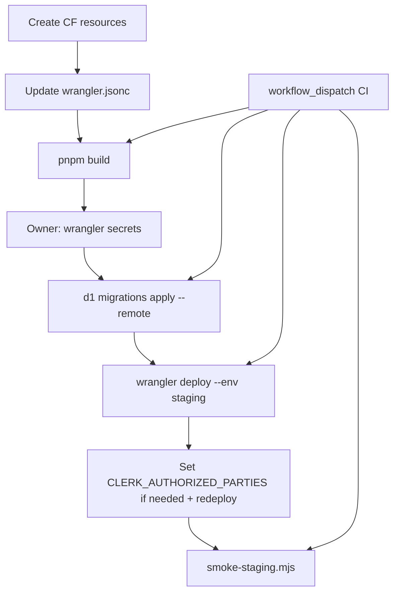

# Staging live deploy + HTTP smoke test (H1 item 2 follow-up)

**Tree verified 2026-08-16:** `COMMAND_CATALOG` length **89**, `AUDIT_WRITER_COMMAND_IDS.size === 63`, `V1_HTTP_ROUTE_AUDIT` length **144** (`[143].id === 'get_city_ledger_statement'`), `PROPERTY_SCHEMA_HEAD === 34`, `NIGHT_AUDIT_STEPS` length **8**, `[3] === 'AUTO_TRANSFER'`, `idempotency.ts` `export const` count **158**. Phase **H** landed on `main` (staging env scaffold in `wrangler.jsonc`; dry-run in CI).

**Date:** 2026-08-16  
**Status:** Draft (spec writer)  
**Sources:** [Audit Phase H — H1 infra](./2026-08-16-audit-phase-h-infra-design.md) Lock 2 follow-up (item 2 deferred); `apps/pms-core/wrangler.jsonc` `env.staging` (`:117–233`); `apps/pms-core/src/env.ts` (`:60–90`); `apps/pms-core/src/auth.ts` (`:28–101`); `apps/pms-core/src/provision.ts`, `registry.ts`; `packages/contracts/src/v1-http-routes.ts`; `migrations/d1-platform/` (`0001`–`0005`); `apps/pms-core/test/reservations-routes.spec.ts`, `rooms-routes.spec.ts`, `guests-routes.spec.ts`, `rate-plans-routes.spec.ts` (request shapes).

**Closes:** Audit **H1** deferred item (2) — live staging deploy against real Cloudflare bindings + HTTP smoke (provision → book → check-in → check-out) + optional `workflow_dispatch` CI job. **Requires:** Phase **H** landed; owner approval for live staging deploy (granted). **Does not** advance any post-audit product vertical or frozen head.

---

## Executive summary

This vertical turns the Phase H **staging scaffold** into a **live, Clerk-authenticated staging Worker** on account `Abdus@hospai.co's Account` (`9c3a73acfa30fd1c244bf519f7c7bce9`). Implementer creates real KV / R2 / queue / D1 resources, replaces placeholder IDs in `apps/pms-core/wrangler.jsonc` `env.staging`, wires Clerk public vars (test instance `caring-drake-8317.clerk.accounts.dev`), applies D1 migrations remotely, deploys, and runs a **10-step HTTP smoke script**. Secrets (`CLERK_SECRET_KEY`, `HOSPAI_ORG_MASTER_KEY`) are owner-set via `wrangler secret put` — never committed. Dev-actor flags are **absent** on staging; auth is Clerk-only. A **`workflow_dispatch`-only** GitHub workflow deploys staging when manually triggered (never on push). **No frozen heads move** — only `wrangler.jsonc` staging block, smoke script, root script alias, and new workflow file.

---

## 1. Context & motivation

### 1.1 Problem statement

| Item | Symptom | Root cause |
|---|---|---|
| **H1 (2) deferred** | CI validates wrangler config via `--dry-run` only; no proof bindings work in Cloudflare production | Phase H Lock 2 explicitly scoped out live deploy, secrets, and smoke |
| **Auth gap on staging** | Staging scaffold has placeholder resource IDs and no Clerk vars | Owner had not approved account-level deploy |
| **No rehearsal path** | Operators cannot verify provision → lifecycle on real DO/D1/KV/R2/queues | No scripted smoke against remote Worker |

### 1.2 What Phase H already landed (do not redo)

- `env.staging` block in `apps/pms-core/wrangler.jsonc` with placeholder KV `…012/013/014`, D1 `…010`, `-staging` suffix names for R2/queues/workflows, worker name `hospai-pms-core-staging`
- CI step: `pnpm --filter @hospai/pms-core exec wrangler deploy --dry-run` (default env — validates top-level config shape)

### 1.3 Cloudflare account (locked)

| Field | Value |
|---|---|
| Account | `Abdus@hospai.co's Account` |
| Account ID | `9c3a73acfa30fd1c244bf519f7c7bce9` |
| Local auth | Wrangler OAuth (`iamabdus@gmail.com`) |

### 1.4 Heads (frozen — this vertical moves **none**)

| Head | Current | This vertical |
|---|---|---|
| `COMMAND_CATALOG` | length **89** | **89** — unchanged |
| `AUDIT_WRITER_COMMAND_IDS.size` | **63** | **63** — unchanged |
| `V1_HTTP_ROUTE_AUDIT` | length **144**, tail `get_city_ledger_statement` | **144** — unchanged |
| `PROPERTY_SCHEMA_HEAD` | **34** | **34** — no migration |
| `NIGHT_AUDIT_STEPS` | length **8**, `[3] === 'AUTO_TRANSFER'` | **8** — unchanged |
| `idempotency.ts` `export const` count | **158** | **158** — unchanged |

### 1.5 Scope in

1. Create staging Cloudflare resources (KV×3, R2, queues×4 incl. DLQs, D1).
2. Update `env.staging` in `wrangler.jsonc` with real IDs + Clerk public vars.
3. Remote D1 migration apply + `wrangler deploy --env staging`.
4. Owner secret setup (`CLERK_SECRET_KEY`, `HOSPAI_ORG_MASTER_KEY`).
5. Committed smoke script (`scripts/smoke-staging.mjs`) + root `smoke:staging` script.
6. New `.github/workflows/staging-deploy.yml` — **`workflow_dispatch` only**.

### 1.6 Scope out (normative)

- Production deploy or production resources
- Custom domain / DNS / TLS certificates
- Product code, schema, catalog, HTTP route, or idempotency constant changes
- Secrets or PEM private keys in repo, chat, or committed files
- `HOSPAI_UNSAFE_LOCAL`, `HOSPAI_ALLOW_DEV_ACTOR`, or any dev-actor path on staging
- Coverage threshold changes
- Auto-deploy on push to `main` or PR
- Git push (owner/reviewer only when explicitly requested)
- SPA build-time Clerk key changes beyond what staging Worker already serves via Assets (no `apps/web-pms` code edits in this vertical)

---

## 2. Locked decisions (verbatim — do not deviate)

### Lock 1 — Full staging deploy (not dry-run)

Create **real** staging resources on the locked account. Replace **all** placeholder IDs in `env.staging`. Apply D1 migrations **remotely**. Deploy Worker + bundled SPA assets. Run smoke against the deployed `*.workers.dev` URL.

### Lock 2 — Clerk auth (test instance; Clerk-only on staging)

| Binding / secret | Staging value | How set |
|---|---|---|
| `CLERK_PUBLISHABLE_KEY` | `pk_test_Y2FyaW5nLWRyYWtlLTgzMTcuY2xlcmsuYWNjb3VudHMuZGV2JA` | `vars` in `env.staging` (public) |
| `CLERK_JWT_KEY` | PEM public key (owner-provided) | `vars` in `env.staging` (public; networkless JWT verify) |
| `CLERK_AUTHORIZED_PARTIES` | Staging SPA origin — **`https://hospai-pms-core-staging.<subdomain>.workers.dev`** (exact URL **TBD at first deploy** once subdomain is known) | `vars` in `env.staging` |
| `CLERK_SECRET_KEY` | Clerk test secret | **`wrangler secret put CLERK_SECRET_KEY --env staging`** (stdin; owner only) |
| `HOSPAI_ORG_MASTER_KEY` | 64-char hex (`openssl rand -hex 32`) | **`wrangler secret put HOSPAI_ORG_MASTER_KEY --env staging`** (pipe via `printf '%s' "$KEY" \| …`) |

**Explicitly absent on staging:** `HOSPAI_UNSAFE_LOCAL`, `HOSPAI_ALLOW_DEV_ACTOR`, `HOSPAI_JURISDICTION_MODE=simulate`, `HOSPAI_PSP_MODE=simulate`.

**Smoke user:** Owner creates a test user in Clerk dashboard (Users → Add user). Smoke uses that user's **session JWT** (`Authorization: Bearer …`). The Clerk `sub` becomes org owner on `POST /v1/orgs` (bootstrap scope — `post_orgs` in `V1_HTTP_ROUTE_AUDIT`).

### Lock 3 — D1 database name

Create D1 database **`hospai-platform-staging`**. Update `env.staging` `d1_databases[0].database_name` from `hospai-platform` → **`hospai-platform-staging`** and replace `database_id` placeholder `…010` with the UUID returned by `wrangler d1 create`.

### Lock 4 — Deploy sequence (locked order)

All commands run from repo root unless noted. **`cd apps/pms-core`** for wrangler resource/deploy steps.

| Step | Action |
|---|---|
| **1** | Create Cloudflare resources via wrangler (§3) — capture KV IDs + D1 UUID |
| **2** | Edit `apps/pms-core/wrangler.jsonc` `env.staging`: real KV IDs, D1 `database_id` + `database_name`, Clerk `vars`; update scaffold comment to reflect live staging |
| **3** | Add `account_id`: `"9c3a73acfa30fd1c244bf519f7c7bce9"` under `env.staging` (or export `CLOUDFLARE_ACCOUNT_ID` consistently) |
| **4** | `pnpm build` (builds `apps/web-pms/dist` consumed by Worker assets binding) |
| **5** | Owner sets secrets (§2 Lock 2) — **before deploy** so guest create works on first smoke |
| **6** | `pnpm --filter @hospai/pms-core exec wrangler d1 migrations apply hospai-platform-staging --env staging --remote` |
| **7** | `pnpm --filter @hospai/pms-core exec wrangler deploy --env staging` — note deployed URL; set `CLERK_AUTHORIZED_PARTIES` to that origin if not known pre-deploy; redeploy if vars changed |
| **8** | Run smoke: `BASE=<deployed-origin> CLERK_SESSION_JWT=<jwt> pnpm smoke:staging` |

**Note on step 7 ↔ authorized parties:** First deploy may use a placeholder `CLERK_AUTHORIZED_PARTIES`; after wrangler prints `https://hospai-pms-core-staging.<subdomain>.workers.dev`, update the var to that exact origin (no trailing slash) and redeploy once. Lock: **must match** deployed workers.dev origin.

### Lock 5 — Smoke script (committed; secrets at runtime only)

| Decision | Value |
|---|---|
| Path | **`scripts/smoke-staging.mjs`** (Node 22 `fetch`; no new dependencies) |
| Committed | **Yes** — parameterized; **no secrets** in file |
| Env inputs | **`BASE`** — staging origin (e.g. `https://hospai-pms-core-staging.<subdomain>.workers.dev`); **`CLERK_SESSION_JWT`** — Clerk session token (required) |
| Root script | `"smoke:staging": "node scripts/smoke-staging.mjs"` in root `package.json` |
| Exit code | Non-zero on first failed assertion; print step name + status + body snippet |
| Auth header | `Authorization: Bearer ${CLERK_SESSION_JWT}` on every request |
| IDs per run | Generate unique suffix (`smoke_${Date.now()}` or UUID) for `orgId`, `propertyId`, `roomTypeId`, `guestId`, `roomId`, `reservationId`, idempotency keys |

### Lock 6 — CI: `workflow_dispatch` only

Add **`.github/workflows/staging-deploy.yml`** triggered **only** by `workflow_dispatch` (never `push` / `pull_request`).

**Required GitHub repository secrets (owner must add):**

| Secret | Purpose |
|---|---|
| `CLOUDFLARE_API_TOKEN` | Wrangler deploy (Workers + D1 + assets) |
| `CLOUDFLARE_ACCOUNT_ID` | `9c3a73acfa30fd1c244bf519f7c7bce9` |
| `CLERK_SECRET_KEY` | Clerk test secret |
| `HOSPAI_ORG_MASTER_KEY` | Guest PII envelope key |

**Workflow inputs (optional):**

| Input | Purpose |
|---|---|
| `clerk_session_jwt` | If non-empty, run smoke after deploy; if empty, deploy-only |

**Workflow steps (high level):** checkout → pnpm install → pnpm build → configure wrangler secrets from GitHub secrets → `wrangler d1 migrations apply … --remote` → `wrangler deploy --env staging` → conditional smoke when JWT input provided.

**Assumption:** `wrangler.jsonc` already contains real resource IDs + Clerk public vars (step 1–2 done once locally and committed). CI job does **not** create Cloudflare resources — it deploys + migrates + optional smoke only.

### Lock 7 — Rollback / teardown (brief)

To tear down staging:

1. `pnpm --filter @hospai/pms-core exec wrangler delete hospai-pms-core-staging --env staging`
2. Delete D1: `wrangler d1 delete hospai-platform-staging`
3. Delete KV namespaces by ID (three `wrangler kv namespace delete --namespace-id=…`)
4. Delete R2 bucket: `wrangler r2 bucket delete hospai-event-log-staging`
5. Delete queues (four): `wrangler queues delete <name>` for each `-staging` / `-dlq-staging` queue

Durable Object storage for deleted Worker names is eventually garbage-collected by Cloudflare; no explicit DO purge API in scope.

---

## 3. Resource creation commands

**Important:** KV, R2, Queues, and D1 creation are **account-level** operations. Do **not** pass `--env staging` on create commands — `--env staging` applies only to deploy, secrets, and D1 migrations apply.

Run from **`apps/pms-core`**:

```bash
# KV namespaces (capture "id" from JSON output for each → wrangler.jsonc bindings)
wrangler kv namespace create "hospai-entitlement-kv-staging"
wrangler kv namespace create "hospai-event-dedupe-kv-staging"
wrangler kv namespace create "hospai-ari-kv-staging"

# R2 bucket (name-only binding — no ID)
wrangler r2 bucket create hospai-event-log-staging

# Queues — create DLQs before consumers reference them (name-only bindings)
wrangler queues create hospai-events-dlq-staging
wrangler queues create hospai-pending-commands-dlq-staging
wrangler queues create hospai-events-staging
wrangler queues create hospai-pending-commands-staging

# D1 (capture "uuid" / database_id from output)
wrangler d1 create hospai-platform-staging
```

### IDs to capture → `wrangler.jsonc` `env.staging`

| Resource | wrangler.jsonc field | Capture from |
|---|---|---|
| Entitlement KV | `kv_namespaces[ENTITLEMENT_KV].id` | `wrangler kv namespace create` → `id` |
| Event dedupe KV | `kv_namespaces[EVENT_DEDUPE_KV].id` | same |
| ARI KV | `kv_namespaces[ARI_KV].id` | same |
| Platform D1 | `d1_databases[0].database_id` | `wrangler d1 create` → `uuid` |
| Platform D1 | `d1_databases[0].database_name` | **`hospai-platform-staging`** (Lock 3) |
| R2 / queues / workflows | `bucket_name` / `queue` / `name` fields | **Already correct** in scaffold — no IDs |

Workflows (`hospai-night-audit-staging`, etc.) are **name-bound** — no pre-create step; Cloudflare provisions on first deploy.

### `env.staging` vars block (add after bindings)

```jsonc
"vars": {
  "CLERK_PUBLISHABLE_KEY": "pk_test_Y2FyaW5nLWRyYWtlLTgzMTcuY2xlcmsuYWNjb3VudHMuZGV2JA",
  "CLERK_JWT_KEY": "-----BEGIN PUBLIC KEY-----\n...\n-----END PUBLIC KEY-----",
  "CLERK_AUTHORIZED_PARTIES": "https://hospai-pms-core-staging.<subdomain>.workers.dev"
}
```

Implementer embeds owner-provided PEM with `\n` escapes (or JSONC multiline string). **Never** commit `CLERK_SECRET_KEY` or `HOSPAI_ORG_MASTER_KEY`.

Update scaffold comment to:

```jsonc
// Staging env — live deploy (Audit H1 follow-up). Resource IDs + Clerk vars committed;
// CLERK_SECRET_KEY + HOSPAI_ORG_MASTER_KEY via wrangler secrets only.
```

---

## 4. HTTP smoke sequence (10 steps)

All routes from `V1_HTTP_ROUTE_AUDIT`. Pattern references: `reservations-routes.spec.ts`, `rooms-routes.spec.ts`, `guests-routes.spec.ts`, `rate-plans-routes.spec.ts`.

**Global:** `Authorization: Bearer $CLERK_SESSION_JWT`, `Content-Type: application/json` where body is sent.

| # | Method + path | Body / headers | Assert |
|---|---|---|---|
| 1 | `POST /v1/orgs` | `{ "orgId", "name" }` | **201**; bootstrap — actor becomes owner |
| 2 | `POST /v1/orgs/{orgId}/properties` | `{ "propertyId", "name", "timeZone": "UTC", "currency": "USD" }` | **201** |
| 3 | `POST /v1/properties/{propertyId}/room-types` | `{ roomTypeId, code, name, roomCount: 1, maxOccupancy: 2, maxAdults: 2, idempotencyKey }` | **201**; capture `fromDate` |
| 4 | `PUT /v1/properties/{propertyId}/rate-days` | `{ roomTypeId, stayDate: fromDate, amountMinor: 10000, currency: "USD", idempotencyKey }` (omit `ratePlanId` → BAR default) | **200** |
| 5 | `POST /v1/properties/{propertyId}/guests` | `{ guestId, displayName, idempotencyKey }` | **200**; requires `HOSPAI_ORG_MASTER_KEY` secret |
| 6 | `POST /v1/properties/{propertyId}/rooms` | `{ roomId, roomTypeId, code, idempotencyKey }` (room starts clean) | **201** |
| 7 | `POST /v1/properties/{propertyId}/reservations` | `{ reservationId, roomTypeId, guestRef: guestId, arrivalDate: fromDate, departureDate: fromDate+1day, idempotencyKey }` | **201** |
| 8 | `POST …/reservations/{id}/assign-room` | `{ roomId, idempotencyKey }` in JSON body | **200** |
| 9 | `POST …/reservations/{id}/check-in` | **`x-idempotency-key`** header (no body required) | **200** |
| 10 | `POST …/reservations/{id}/check-out` | **`x-idempotency-key`** header | **200** |

**Final assertion:** `GET /v1/properties/{propertyId}/reservations/{reservationId}` → `status === 'checked_out'` (or equivalent checked-out terminal status in response body).

**Idempotency rule (locked):** Body-field `idempotencyKey` for room-type, rate-days, guest, room, reservation, assign-room; header `x-idempotency-key` for check-in and check-out only.

**Date helper:** `departureDate` = calendar day after `fromDate` (UTC `YYYY-MM-DD` arithmetic — mirror `addCalendarDays` in tests).

---

## 5. Dependency and ordering



| Order | Items | Blocker |
|---|---|---|
| **1** | Resource create + wrangler.jsonc commit | Owner Cloudflare access |
| **2** | Secrets + deploy + smoke (local) | Clerk test user + JWT |
| **3** | GitHub secrets + workflow file | Repo admin |
| **Parallel** | CI workflow can land in same PR as script; first CI run still needs committed real IDs |

---

## 6. File map

| File | Change |
|---|---|
| `apps/pms-core/wrangler.jsonc` | Replace placeholder IDs; `database_name`; add `vars` + `account_id`; update comment |
| `scripts/smoke-staging.mjs` | **New** — 10-step HTTP smoke |
| `package.json` (root) | Add `"smoke:staging": "node scripts/smoke-staging.mjs"` |
| `.github/workflows/staging-deploy.yml` | **New** — `workflow_dispatch` deploy + optional smoke |

**Not touched:** `apps/pms-core/src/**`, `packages/**`, `migrations/**`, `ARCHITECTURE.md`, catalog, routes, schema, existing `ci.yml` (no auto staging on PR).

---

## 7. Verification plan

| # | Command / assertion | Expectation |
|---|---|---|
| 1 | Resource create commands (§3) | All exit 0; IDs captured |
| 2 | `pnpm build` | Exit 0; `apps/web-pms/dist` present |
| 3 | `wrangler d1 migrations apply hospai-platform-staging --env staging --remote` | Applies `0001`–`0005`; exit 0 |
| 4 | `wrangler deploy --env staging` | Prints workers.dev URL; exit 0 |
| 5 | `curl -s -o /dev/null -w '%{http_code}' "$BASE/"` | **200** (SPA assets) |
| 6 | Unauthenticated `POST /v1/orgs` | **401** (proves dev-actor off) |
| 7 | `BASE=… CLERK_SESSION_JWT=… pnpm smoke:staging` | Exit 0; all 10 steps green |
| 8 | `pnpm --filter @hospai/pms-core exec wrangler deploy --dry-run` | Still exit 0 (default env unchanged) |
| 9 | Manual `workflow_dispatch` with JWT input | Deploy succeeds; smoke green |
| 10 | All **14** `check:*` + typecheck + lint + `pnpm test:local` | Green (no product code changed) |

**Smoke pass criterion:** Script exits 0 **and** final reservation GET shows checked-out status.

---

## 8. Open decisions / ambiguities (for product owner review)

| Question | Resolution |
|---|---|
| Exact `*.workers.dev` subdomain | **TBD at first deploy** — capture from wrangler deploy output; set `CLERK_AUTHORIZED_PARTIES`; redeploy once |
| PEM embedding in jsonc | **Locked:** public `CLERK_JWT_KEY` in `vars`; owner delivers PEM out-of-band |
| CI creates resources vs local-only | **Locked:** resource create is **one-time local** (committed IDs); CI deploys only |
| Smoke in CI without JWT input | **Locked:** deploy-only; smoke skipped unless `clerk_session_jwt` input provided |
| `.mjs` vs `.sh` | **Locked:** `.mjs` (Node 22 fetch; CI-friendly) |

---

## 9. Risks

| Risk | Mitigation |
|---|---|
| Wrong `CLERK_AUTHORIZED_PARTIES` → 401 on all routes | Capture exact deploy URL; redeploy after var fix |
| Forgot `HOSPAI_ORG_MASTER_KEY` → guest step fails | Document in deploy sequence step 5 before smoke |
| Placeholder IDs committed without replace | Reviewer checks wrangler.jsonc IDs ≠ `00000000-…` placeholders |
| JWT expiry during CI smoke | Short workflow; JWT via manual dispatch input; re-run if expired |
| Staging Worker serves SPA but Clerk sign-in untested in smoke | Smoke uses Bearer JWT directly; SPA sign-in is owner manual check (out of scope) |
| Resource name collision on re-run create | Create commands are idempotent only once; teardown (Lock 7) before recreate |

---

## 10. Implementation checklist (reviewer §8)

- [x] Lock 1: Real resources created; placeholder IDs replaced in `env.staging`
- [x] Lock 2: Clerk vars committed; secrets **not** committed; dev-actor flags **absent**
- [x] Lock 3: D1 name `hospai-platform-staging`; remote migrations applied
- [ ] Lock 4: Deploy sequence followed; `CLERK_AUTHORIZED_PARTIES` matches live origin — Reopened by R0.2 spec 2026-09-04; recheck after staging deploy verifies var.
- [x] Lock 5: `scripts/smoke-staging.mjs` committed; `pnpm smoke:staging` works with `BASE` + `CLERK_SESSION_JWT`
- [x] Lock 6: `.github/workflows/staging-deploy.yml` is **`workflow_dispatch` only**; four GitHub secrets documented
- [x] Lock 7: Teardown steps documented (§2 Lock 7)
- [x] Smoke: 10-step sequence; body vs header idempotency correct
- [x] Frozen head **counts** unchanged (§1.4)
- [x] Scope-out respected — no product code, no production, no push, no auto CI on PR
- [x] `pnpm test:local` + all **14** `check:*` gates green

---

## 11. Tree conflicts with reviewer locks

| Head | Count moves? | Shape moves? | Justification |
|---|---|---|---|
| `COMMAND_CATALOG` (89) | **No** | **No** | Infra + script only |
| `AUDIT_WRITER_COMMAND_IDS` (63) | **No** | **No** | — |
| `V1_HTTP_ROUTE_AUDIT` (144) | **No** | **No** | Smoke **calls** routes; does not edit audit |
| `PROPERTY_SCHEMA_HEAD` (34) | **No** | **No** | Applies existing D1 migrations only |
| `NIGHT_AUDIT_STEPS` (8) | **No** | **No** | — |
| `idempotency.ts` const count (158) | **No** | **No** | — |
| `wrangler.jsonc` | — | **Yes** — real staging IDs + vars | Not a catalog head |
| `.github/workflows/staging-deploy.yml` | — | **Yes** — new file | H1 item 2 CI half |
