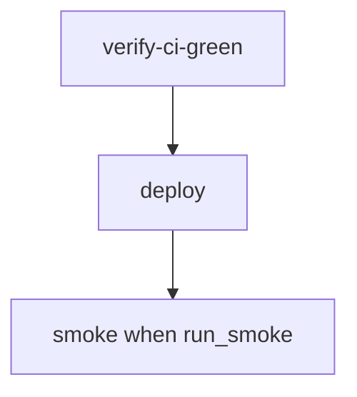
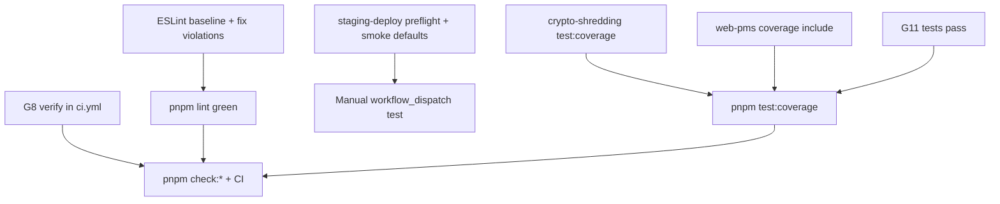

# CI safety net (R0.13)

**Tree verified 2026-09-05:** `COMMAND_CATALOG` length **89**, `V1_HTTP_ROUTE_AUDIT` length **144** (`[143].id === 'get_city_ledger_statement'`), `PROPERTY_SCHEMA_HEAD === 34`, `ORG_SCHEMA_HEAD === 9`, `NIGHT_AUDIT_STEPS` length **8**, `[3] === 'AUTO_TRANSFER'`. Pins match `packages/contracts/src/register.test.ts` and `packages/do-runtime/src/migrate.test.ts` on current `main`. CI runs **17** `check:*` scripts (includes `check:resolve-property-prefetch` from R0.12 / G8).

**Date:** 2026-09-05  
**Status:** Approved (reviewer)  
**Sources:** [Full codebase audit — Vertical 13](../../audit/2026-09-04-full-codebase-audit.md) (**G4**, **G5**, **G7**, **G8**, **G11**, **N9**); [Staging deploy + smoke](./2026-08-16-staging-deploy-smoke-design.md); [Clerk azp + headers](./2026-09-04-clerk-azp-headers-design.md) (smoke JWT masking — already landed); [Operator SPA UX/UI](./2026-09-05-operator-spa-ux-ui-design.md) (**G11** tests — R0.11); [Request cost + dispatch](./2026-09-05-request-cost-dispatch-design.md) (**G8** ratchet — R0.12); [Audit Phase A — test signal](./2026-08-15-audit-phase-a-test-signal-design.md) (8-shard topology); [AGENTS.md §5 Tests and CI](../../../AGENTS.md); `.github/workflows/ci.yml`; `.github/workflows/staging-deploy.yml`; `apps/web-pms/vitest.config.ts`; `packages/crypto-shredding/package.json`; `eslint.config.js`; `scripts/test-pms-core-shards.mjs`; `scripts/smoke-staging.mjs`.

**Closes:** Audit **G4** (staging deploy may skip green CI), **G5** (coverage blind spots — web-pms `*.tsx`, crypto-shredding invisible to `test:coverage`), **G7** / **N9** (no `eslint:recommended`, no `no-floating-promises`, dead `preparePiiRecord` params, dishonest `"lint": "echo ok"`), **G8** (prefetch ratchet must stay enforced — verify only), **G11** (registration-card + front-office-editor tests must stay in CI signal — verify + coverage include). **Roadmap:** **R0.13**. **Requires:** R0.11 (G11 component tests), R0.12 (G8 script + CI wire). **Does not** advance R0.14, Playwright, husky pre-commit (G1/G2 deferred), PropertyDO extraction, catalog/schema pin bumps, pms-core coverage % gates, or shard topology changes.

---

## Executive summary

CI catches unit tests and static gates, but **staging deploy is decoupled**: `.github/workflows/staging-deploy.yml` is `workflow_dispatch` only and never checks that the checked-out SHA passed the `CI` workflow. Operators can deploy a red commit. **G5:** `apps/web-pms/vitest.config.ts` coverage `include` is `src/**/*.ts` only — every screen (`.tsx`) is invisible to `pnpm test:coverage` even though vitest runs `*.test.tsx`. `@hospai/crypto-shredding` has `vitest` but no `test:coverage` script, so turbo skips it in CI coverage. **G7/N9:** root `eslint.config.js` applies only the 11 `hospai/*` rules — no `eslint:recommended`, no `@typescript-eslint/no-floating-promises`. Fourteen packages claim `"lint": "echo ok"` while root `eslint .` is the real gate. `PiiVault.preparePiiRecord` accepts `scope` / `subjectId` and ignores them (N9 hygiene).

This spec locks: a **preflight job** on staging deploy that fails unless the **`CI` workflow succeeded on `github.sha`**; **`smoke:staging` on by default** with an overridable skip input; web-pms coverage **`src/**/*.tsx`**; crypto-shredding **`test:coverage`**; **eslint recommended + `no-floating-promises` at error** without duplicating `hospai/no-id-from-name-outside-tenant-router`; **delete** dead `preparePiiRecord` params; **honest lint stubs** on echo-ok packages; **verify** G8 stays in CI and G11 tests remain green under expanded coverage. **No Playwright. No husky. No pms-core coverage threshold. Shard topology unchanged.**

---

## Locked product call

1. **G4 — Green CI on deploy SHA:** Before build/deploy, staging workflow runs a **`verify-ci-green`** job that queries GitHub Actions for a **completed success** run of the **`CI`** workflow (`ci.yml`) on **`github.sha`**. If none exists, fail with a clear message (“push/merge this commit and wait for CI green before staging deploy”). Optional workflow input **`skip_ci_check`** (default **`false`**) for emergency deploy-only — documented, not the default path.
2. **G4 — Smoke default on:** **`run_smoke`** boolean input defaults **`true`**. When true, mint JWT from **`inputs.smoke_user_id`** or repo variable **`STAGING_SMOKE_USER_ID`** (input wins); run `pnpm smoke:staging`. When **`run_smoke: false`**, skip smoke (deploy-only). When `run_smoke: true` and no user id is available, **fail fast** before deploy with setup instructions — do not silently skip.
3. **G5 — web-pms coverage include:** `coverage.include` → `['src/**/*.ts', 'src/**/*.tsx']`; extend `exclude` with `'**/*.test.tsx'`.
4. **G5 — crypto-shredding coverage script:** Add `"test:coverage": "vitest run --coverage"` to `@hospai/crypto-shredding`; add minimal `vitest.config.ts` with v8 provider matching sibling packages if absent. **No** global coverage % threshold; **no** PropertyDO coverage gate.
5. **G7/N9 — ESLint baseline:** Enable **`eslint.configs.recommended`** and **`@typescript-eslint/no-floating-promises`: `'error'`** on `**/*.{ts,tsx}`. Add **`typescript-eslint`** (or `@typescript-eslint/eslint-plugin` + typed flat config) as root devDependency. **Do not** add a second `hospai/no-id-from-name-outside-tenant-router` — it already exists in `eslint-plugin-hospai` recommended (11 rules).
6. **G7/N9 — `preparePiiRecord`:** **Delete** unused `scope` and `subjectId` parameters from `preparePiiRecord` (keep on `provisionKey`, `prepareGuestRecord` where used). Update `org-do.ts`, `vault.test.ts`, and any callers. **Do not** change AES-GCM AAD semantics (no migration).
7. **G7/N9 — Lint stubs:** Replace `"lint": "echo ok"` on the **14** stub packages with `"lint": "echo 'lint via root eslint'"` (match `@hospai/web-pms` / `@hospai/contracts`). Document in **AGENTS.md** that authoritative lint is root `eslint .`; per-package `lint` is a turbo coordination stub.
8. **G8 — Verify only:** Assert `pnpm check:resolve-property-prefetch` remains in `.github/workflows/ci.yml` `checks` job and root `package.json` scripts. **No** new ratchet logic — R0.12 landed it.
9. **G11 — Verify only:** Assert `apps/web-pms/src/screens/registration-card.test.tsx` and `front-office-editor.test.tsx` exist (R0.11) and pass under expanded coverage include. **No** new Playwright layer; **no** duplicate test authoring in this vertical unless R0.11 files are missing (they should not be).
10. **Shard topology — frozen:** Local `scripts/test-pms-core-shards.mjs` stays **8** shards **including** ledger property specs. CI `test-pms-core` matrix stays **8** shards **excluding** ledger files into `test-pms-core-ledger-prop`. **Do not** fold ledger back into noisy shards or drop the isolated job.

### Reviewer locks (normative)

| Lock | Decision |
|---|---|
| **G4 CI gate** | Preflight job on **`github.sha`** against **`CI` / `ci.yml`** success. **`skip_ci_check`** default false. Not `workflow_run` auto-deploy — staging stays **`workflow_dispatch` only**. |
| **G4 smoke** | **`run_smoke`** default **true**; overridable to false. User id from input or **`vars.STAGING_SMOKE_USER_ID`**. Keep existing JWT mint + `::add-mask::` (N12 — do not regress). **No Playwright.** |
| **G5 web-pms** | Coverage **`include`** both `*.ts` and `*.tsx` production sources; exclude both test suffixes. |
| **G5 crypto-shredding** | **`test:coverage`** script so turbo `pnpm test:coverage` reaches the package. **No** % gate on `@hospai/pms-core` / PropertyDO. |
| **G7 eslint** | `eslint:recommended` + **`no-floating-promises` error**. **No** duplicate idFromName rule. Fix any new violations in-repo in this vertical (do not `--max-warnings` relax). |
| **N9 preparePiiRecord** | **Delete** dead params — do **not** change `profileAad(piiKeyId)` wire format. |
| **N9 lint stubs** | Stop **`echo ok`** — use **`lint via root eslint`** string + AGENTS note. Do **not** add per-package eslint configs where root already covers the tree (cheap honesty, not 14 new configs). |
| **G8** | Verification + regression guard in reviewer checklist only unless CI line removed. |
| **G11** | R0.11 tests must pass; coverage include makes them visible in json-summary. **No Playwright.** |
| **Shards** | 8 local inclusive; CI 8 + isolated ledger — **unchanged**. |
| **Out** | Playwright; husky; pms-core coverage threshold; new `check:*` unless CI gate script is truly needed (prefer workflow YAML + `gh api`); catalog/route/schema pin bumps; G10 smoke (R0.3). |
| **Pins** | `COMMAND_CATALOG` **89**, routes **144**, `PROPERTY_SCHEMA_HEAD` **34**, `ORG_SCHEMA_HEAD` **9**, `NIGHT_AUDIT_STEPS` **8**, `check:*` count **17** — unchanged. |

---

## 1. Problem / evidence

### 1.1 G4 — Staging deploy without green CI (high)

`.github/workflows/staging-deploy.yml` triggers on **`workflow_dispatch`** only. The single `deploy` job checks out the selected ref, builds, migrates, deploys, and optionally smokes — **nowhere** does it verify that the same commit passed `.github/workflows/ci.yml`.

```1:74:.github/workflows/staging-deploy.yml
name: Staging Deploy

on:
  workflow_dispatch:
    inputs:
      smoke_user_id:
        description: 'Clerk user ID (user_...) to smoke as; mints a fresh session token in-job. Leave empty for deploy-only.'
        required: false
        type: string

jobs:
  deploy:
    runs-on: ubuntu-latest
    steps:
      - uses: actions/checkout@v4
      # ... build, migrate, deploy ...
      - name: Smoke test (optional)
        if: inputs.smoke_user_id != ''
        # ... pnpm smoke:staging
```

**Symptom:** A manual staging deploy can ship TypeScript errors, failing characterization tests, or broken `check:*` gates that CI would have blocked on `main`.

**AGENTS.md** already states: “Staging deploy must not outrun a green CI SHA.”

### 1.2 G4 — Smoke off unless operator remembers user id (medium)

Today smoke runs **only** when `inputs.smoke_user_id != ''`. Description says “Leave empty for deploy-only” — inverted from the audit lock (**smoke on by default**). Post-deploy HTTP validation is easy to skip accidentally.

### 1.3 G5 — web-pms TSX invisible to coverage (medium)

```21:26:apps/web-pms/vitest.config.ts
    coverage: {
      provider: 'v8',
      reporter: ['text', 'json-summary'],
      include: ['src/**/*.ts'],
      exclude: ['**/*.test.ts', '**/dist/**'],
    },
```

Vitest **runs** `src/**/*.test.tsx` (include lines 12–19), but v8 coverage **never** attributes lines in `.tsx` screen/components. Operator SPA screens — the highest UX-risk surface — report **0** covered lines in CI `test:coverage`.

### 1.4 G5 — crypto-shredding skipped by turbo coverage (medium)

```13:18:packages/crypto-shredding/package.json
  "scripts": {
    "build": "tsc -p tsconfig.build.json",
    "test": "vitest run",
    "typecheck": "tsc -p tsconfig.json --noEmit",
    "lint": "echo ok"
  },
```

Root `package.json`:

```12:12:package.json
    "test:coverage": "pnpm exec turbo run test:coverage --filter=!@hospai/pms-core",
```

Turbo only runs packages that define `test:coverage`. **`@hospai/crypto-shredding` tests never run in the CI coverage job** despite HKDF / vault tests existing (`vault.test.ts`, `keystore-conformance.ts`).

### 1.5 G7 / N9 — ESLint baseline missing (medium)

```4:22:eslint.config.js
export default [
  {
    ignores: ['**/dist/**', '**/node_modules/**', '**/.wrangler/**', '**/coverage/**'],
  },
  {
    files: ['**/*.{ts,tsx}'],
    languageOptions: { parser: tsParser, ... },
    plugins: { hospai },
    rules: {
      ...hospai.configs.recommended.rules,
    },
  },
];
```

No `eslint:recommended`. No `@typescript-eslint/no-floating-promises`. Fire-and-forget promises in Workers/DO paths are not caught at lint time.

**N9 idFromName sub-claim refuted:** `hospai/no-id-from-name-outside-tenant-router` already exists (`tooling/eslint-plugin-hospai/src/index.ts:290`). **Do not** add a duplicate rule.

### 1.6 N9 — Dead `preparePiiRecord` parameters (low)

```107:117:packages/crypto-shredding/src/vault.ts
  async preparePiiRecord<T extends object>(
    scope: KeyScope,
    subjectId: string,
    profile: T,
  ): Promise<{
```

`scope` and `subjectId` are never read inside the method (unlike `provisionKey`, which persists them via `store.insert`). Call site: `org-do.ts` passes `'staff', staffId`. Misleading API suggests AAD or key scope binding that does not happen.

### 1.7 G7 — Dishonest per-package lint (low)

Fourteen packages use `"lint": "echo ok"` while root runs `eslint . && turbo run lint`. CI green does **not** mean those packages ran eslint — it means echo succeeded. Packages already using the honest pattern: `@hospai/web-pms`, `@hospai/contracts`, `@hospai/client-core` → `"lint": "echo 'lint via root eslint'"`.

### 1.8 G8 — Prefetch ratchet (verify — landed R0.12)

`.github/workflows/ci.yml` line 37: `pnpm check:resolve-property-prefetch`. Root `package.json` script present. **This vertical must not remove it.**

### 1.9 G11 — Component tests (verify — landed R0.11)

`apps/web-pms/src/screens/registration-card.test.tsx` and `front-office-editor.test.tsx` exist with T9/T29 cases from operator SPA spec. This vertical ensures they stay in CI and become **coverage-visible** via G5 include fix — not re-implement Playwright.

### 1.10 Shard topology (frozen)

| Surface | Ledger property specs |
|---|---|
| `scripts/test-pms-core-shards.mjs` | **Included** in 8 shards (no `--exclude`) |
| CI `test-pms-core` | **Excluded**; isolated `test-pms-core-ledger-prop` job |
| CI shard count | **8** |

Do not change this split — ledger sequences saturate shared queues in the same isolate (Phase A / audit evidence).

---

## 2. G4 — Staging deploy CI gate + default smoke

### 2.1 Workflow structure (locked)

Replace single-job workflow with:



| Job | `needs` | Purpose |
|---|---|---|
| **`verify-ci-green`** | — | Fail unless `CI` workflow succeeded on `github.sha` |
| **`deploy`** | `verify-ci-green` | Existing build / secrets / migrate / deploy steps |
| Smoke steps | inside `deploy` | Conditional on `run_smoke` input |

### 2.2 `verify-ci-green` implementation (locked)

Use **`actions/github-script@v7`** (or `gh api` with `GITHUB_TOKEN`) in the preflight job:

1. List workflow runs for repo with `head_sha: context.sha`, `event` in `push`, `pull_request` (or filter by workflow name **`CI`** / file **`.github/workflows/ci.yml`**).
2. Require at least one run with **`conclusion === 'success'`** and **`status === 'completed'`**.
3. If **`inputs.skip_ci_check === true`**, skip this check (log warning).
4. On failure, emit: commit SHA, link to Actions, instruction to merge/wait for green `CI`.

**Permissions:** `verify-ci-green` job needs `actions: read` (default `GITHUB_TOKEN` on same repo is sufficient).

**Not chosen:** `workflow_run` trigger that auto-deploys after CI — staging stays manual; only the **gate** is automated.

### 2.3 Workflow inputs (locked)

| Input | Type | Default | Purpose |
|---|---|---|---|
| **`run_smoke`** | boolean | **`true`** | When false, deploy-only (no JWT mint, no `pnpm smoke:staging`) |
| **`smoke_user_id`** | string | empty | Overrides `vars.STAGING_SMOKE_USER_ID` when non-empty |
| **`skip_ci_check`** | boolean | **`false`** | Emergency bypass of green-CI preflight |

**Repo variable (new):** `STAGING_SMOKE_USER_ID` — Clerk `user_…` for default smoke. Document in workflow header comment + `DEMO-READY.md` / staging ops note (one line — do not write a new ops doc unless missing).

### 2.4 Smoke step conditions (locked)

Replace `if: inputs.smoke_user_id != ''` with:

```
if: inputs.run_smoke == true
```

Before mint step, resolve `SMOKE_USER_ID`:

```
${{ inputs.smoke_user_id != '' && inputs.smoke_user_id || vars.STAGING_SMOKE_USER_ID }}
```

If resolved id is empty → **`exit 1`** with message to set `STAGING_SMOKE_USER_ID` or pass `smoke_user_id`.

Keep: JWT **`::add-mask::`**, hardcoded staging `BASE` (`https://hospai-pms-core-staging.hospai.workers.dev`), `pnpm smoke:staging`. **G10** COMPANY smoke extension remains **R0.3** — out of scope here.

### 2.5 GitHub secrets / vars (unchanged)

Existing secrets: `CLOUDFLARE_API_TOKEN`, `CLOUDFLARE_ACCOUNT_ID`, `CLERK_SECRET_KEY`, `HOSPAI_ORG_MASTER_KEY`. Existing vars for SPA build: `VITE_CLERK_PUBLISHABLE_KEY`, `VITE_ORG_ID`, `VITE_PROPERTY_ID`. **Add** variable `STAGING_SMOKE_USER_ID`.

---

## 3. G5 — Coverage visibility

### 3.1 web-pms `vitest.config.ts`

```ts
coverage: {
  provider: 'v8',
  reporter: ['text', 'json-summary'],
  include: ['src/**/*.ts', 'src/**/*.tsx'],
  exclude: ['**/*.test.ts', '**/*.test.tsx', '**/dist/**'],
},
```

**Expectation:** `registration-card.tsx`, `front-office-editor.tsx`, and other screens appear in json-summary output. **No** minimum % enforcement in CI.

### 3.2 `@hospai/crypto-shredding`

| Change | Detail |
|---|---|
| `package.json` | `"test:coverage": "vitest run --coverage"` |
| `vitest.config.ts` | **New** if missing — mirror `packages/money/vitest.config.ts` (v8, include `src/**/*.ts`, exclude tests) |

Root `@vitest/coverage-v8` devDependency already exists — package inherits via hoisting.

### 3.3 pms-core (explicit non-goals)

- CI **`test-pms-core`** / **`test-pms-core-ledger-prop`** remain **`vitest run`** without coverage collection.
- **Do not** add 80% PropertyDO gate (AGENTS.md “Do not”).
- **Do not** change `--filter=!@hospai/pms-core` on root `test:coverage`.

---

## 4. G7 / N9 — ESLint + hygiene

### 4.1 Root `eslint.config.js` (locked shape)

1. Add devDependency: **`typescript-eslint`** (v8 line matching existing parser).
2. Flat config stack (order matters):
   - ignores
   - **`eslint.configs.recommended`**
   - **`typescript-eslint` recommended** (or minimal: parser + `no-floating-promises` only if full recommended is too noisy — prefer full recommended; fix violations in this vertical)
   - existing **hospai** block (11 rules unchanged)
3. Rule lock: **`@typescript-eslint/no-floating-promises`: `'error'`**
4. **Do not** add `hospai/no-id-from-name-outside-tenant-router` again.

**Type-aware lint (optional stretch):** if `recommendedTypeChecked` is too large for one vertical, land **`no-floating-promises`** with `projectService: true` on `apps/pms-core` + `packages/*` only — but reviewer lock says **`eslint:recommended` + `no-floating-promises`** at minimum. Implementer fixes all new errors before merge.

### 4.2 `preparePiiRecord` signature (locked)

**Before:**

```ts
async preparePiiRecord<T extends object>(scope: KeyScope, subjectId: string, profile: T)
```

**After:**

```ts
async preparePiiRecord<T extends object>(profile: T)
```

| Caller | Change |
|---|---|
| `prepareGuestRecord` | Keep `(scope, subjectId, profile)` public API; call `preparePiiRecord(profile)` internally |
| `org-do.ts` staff path | `preparePiiRecord(input.profile)` |
| `vault.test.ts` | Update calls |

**Out of scope:** changing `profileAad`, re-encrypting existing rows, or N14 broader AAD work.

### 4.3 Per-package lint stubs (locked)

Replace on all **14** packages currently `"lint": "echo ok"`:

```json
"lint": "echo 'lint via root eslint'"
```

**Packages (exact list at spec time):**

- `apps/pms-core`
- `packages/crypto-shredding`
- `packages/do-runtime`
- `packages/entitlement-client`
- `packages/kernel`
- `packages/money`
- `packages/observability`
- `packages/tenant-router`
- `packages/temporal-utils`
- `tooling/eslint-plugin-hospai`
- `modules/pms/inventory`
- `modules/pms/rates`
- `modules/pms/reservations`
- `modules/pms/restrictions`

**AGENTS.md** — add under Tests and CI (one short paragraph): root **`pnpm lint`** runs **`eslint .`** on the full tree; workspace package **`lint`** scripts are **stubs** for turbo and do not run standalone eslint.

**Do not** promote `@hospai/observability` `"test": "echo ok"` — audit Low, unchanged.

---

## 5. G8 — Prefetch ratchet (verification only)

R0.12 landed:

- `scripts/check-resolve-property-prefetch.mjs`
- `pnpm check:resolve-property-prefetch` in root `package.json`
- CI `checks` job step

**This vertical:**

- [ ] Confirm all three still present after edits.
- [ ] Run `pnpm check:resolve-property-prefetch` in verification plan.
- [ ] **Do not** remove two-arg call sites regression — that's R0.12 product work, not R0.13.

---

## 6. G11 — SPA component tests (verification only)

R0.11 landed:

| File | Cases |
|---|---|
| `apps/web-pms/src/screens/registration-card.test.tsx` | T9 UUID not in print content; T10 room label |
| `apps/web-pms/src/screens/front-office-editor.test.tsx` | T29 VIP/DND badges |

**This vertical:**

- [ ] Both files exist and pass `pnpm --filter @hospai/web-pms test`.
- [ ] After G5 include fix, coverage summary lists those `.tsx` sources (non-zero line hits if exercised by tests).
- [ ] **No Playwright** — HTTP smoke remains `scripts/smoke-staging.mjs` only.

---

## 7. Shard topology (frozen — no file changes expected)

| Command | Shards | Ledger property specs |
|---|---|---|
| `pnpm test:local` → `scripts/test-pms-core-shards.mjs` | 8 | **In** |
| CI `test-pms-core` matrix | 8 | **Out** (`--exclude` both ledger files) |
| CI `test-pms-core-ledger-prop` | 1 job | **Only** ledger files |

**Reviewer rejects** any PR that removes `--exclude` from CI shards or drops the ledger job “to simplify CI.”

---

## 8. Dependency and ordering



| Order | Work | Blocker |
|---|---|---|
| **1** | ESLint deps + config + fix new violations | May touch many files — single vertical commit series per plan |
| **2** | G5 coverage config + crypto-shredding script | None |
| **3** | preparePiiRecord signature + callers | None |
| **4** | Lint stub package.json + AGENTS note | None |
| **5** | staging-deploy.yml jobs/inputs | Repo admin for `STAGING_SMOKE_USER_ID` var |
| **Parallel** | G8/G11 verification | R0.11/R0.12 already on main |

---

## 9. File map

| File | Change |
|---|---|
| `.github/workflows/staging-deploy.yml` | **`verify-ci-green`** job; **`run_smoke`** / **`skip_ci_check`** inputs; default smoke; user id resolution |
| `apps/web-pms/vitest.config.ts` | G5 coverage **`include` / `exclude`** |
| `packages/crypto-shredding/package.json` | **`test:coverage`** script |
| `packages/crypto-shredding/vitest.config.ts` | **New** — coverage provider config |
| `eslint.config.js` | **`eslint:recommended`**, **`no-floating-promises`**, typescript-eslint |
| `package.json` (root) | Add **`typescript-eslint`** devDependency (if not present) |
| `packages/crypto-shredding/src/vault.ts` | **Delete** dead **`preparePiiRecord`** params |
| `apps/pms-core/src/org-do.ts` | Update **`preparePiiRecord`** call |
| `packages/crypto-shredding/src/vault.test.ts` | Update tests |
| **14×** `package.json` | **`lint via root eslint`** stub |
| `AGENTS.md` | Lint stub paragraph; confirm **17** `check:*` count unchanged |
| `docs/roadmap.md` | Tick **R0.13** when vertical lands (plan writer — not this spec commit) |

**Not touched:** `ci.yml` shard matrix (unless G8 line accidentally removed — restore only); `COMMAND_CATALOG`; routes; migrations; Playwright; husky; `scripts/smoke-staging.mjs` sequence (G10 separate).

---

## 10. Verification plan

| # | Command / assertion | Expectation |
|---|---|---|
| 1 | `pnpm check:resolve-property-prefetch` | Exit 0 (G8) |
| 2 | All **17** `pnpm check:*` + self-tests | Exit 0 |
| 3 | `pnpm typecheck` | Exit 0 |
| 4 | `pnpm lint` | Exit 0 with **recommended** + **no-floating-promises** enabled |
| 5 | `pnpm test:coverage` | Exit 0; log shows **`@hospai/web-pms`** and **`@hospai/crypto-shredding`** ran |
| 6 | Inspect web-pms coverage json-summary | **`src/screens/*.tsx`** files listed with coverage data |
| 7 | `pnpm --filter @hospai/web-pms test` registration-card + front-office-editor | Green (G11) |
| 8 | `pnpm --filter @hospai/crypto-shredding test:coverage` | Green |
| 9 | `pnpm test:local` | 8 shards green; ledger specs included locally |
| 10 | `pnpm --filter @hospai/pms-core exec vitest run --shard=1/8 --exclude …` | Matches CI exclude pattern |
| 11 | Manual / PR: attempt `staging-deploy` on commit **without** CI success | **`verify-ci-green`** fails |
| 12 | Manual: `staging-deploy` with `run_smoke: true` + `STAGING_SMOKE_USER_ID` | Smoke runs after deploy |
| 13 | Manual: `run_smoke: false` | Deploy without smoke |
| 14 | `preparePiiRecord` TypeScript signature | No unused `scope` / `subjectId` params |
| 15 | Grep stub packages | No remaining `"lint": "echo ok"` |

**Merge criterion:** 1–10 green in CI; 11–13 documented in plan task for owner manual verification; 14–15 in PR diff.

---

## 11. Scope out (normative)

- Playwright / Cypress / browser e2e
- husky / lint-staged pre-commit (**G1/G2**)
- pms-core / PropertyDO coverage % gate or sharded coverage collection
- Folding **`test-pms-core-ledger-prop`** back into matrix shards
- Reducing local shards below **8**
- New HTTP routes, commands, DO migrations, catalog pins
- **`smoke-staging.mjs` G10** COMPANY AR step (R0.3)
- Duplicate **`hospai/no-id-from-name-outside-tenant-router`**
- Re-opening **`preparePiiRecord` AAD / HKDF** semantics (R0.5 done)
- Auto-deploy staging on **`push: main`**
- Git commit / push from spec writer session

---

## 12. Open decisions / ambiguities

| Question | Resolution |
|---|---|
| CI gate via `workflow_run` vs preflight job | **Locked:** preflight on **`workflow_dispatch`** SHA; no auto-deploy |
| Full `@typescript-eslint/recommended` vs only `no-floating-promises` | **Locked:** **`eslint:recommended` + `no-floating-promises` error**; add typed recommended if manageable in one vertical |
| Emergency deploy without CI | **`skip_ci_check`** input default **false**; logged bypass |
| Default smoke user storage | **Locked:** repo **`vars.STAGING_SMOKE_USER_ID`** + optional input override |
| Remove per-package `lint` scripts entirely | **Rejected** — turbo expects scripts; use honest echo stub |
| Add `check:staging-ci-guard.mjs` | **Rejected unless** workflow gate is repeatedly deleted — YAML + Actions API sufficient |

---

## 13. Risks

| Risk | Mitigation |
|---|---|
| `no-floating-promises` large blast radius | Fix in this vertical; do not disable rule repo-wide |
| Operators lack `STAGING_SMOKE_USER_ID` | Fail fast with setup message; document var |
| `skip_ci_check` misuse | Default false; code review; optional audit log in job summary |
| Coverage include increases web-pms CI time slightly | Acceptable — still unit tests only |
| crypto-shredding coverage config drift | Mirror `packages/money` minimal config |
| Removing `preparePiiRecord` params breaks external importers | Package is workspace-internal; grep callers |

---

## 14. Implementation checklist (reviewer)

- [ ] **G4:** `verify-ci-green` job; **`skip_ci_check`** default false
- [ ] **G4:** **`run_smoke`** default true; **`STAGING_SMOKE_USER_ID`** var documented
- [ ] **G4:** JWT masking preserved; **no Playwright**
- [ ] **G5:** web-pms coverage includes **`*.tsx`**
- [ ] **G5:** crypto-shredding **`test:coverage`** in CI turbo graph
- [ ] **G5:** **No** pms-core coverage % gate
- [ ] **G7:** **`eslint:recommended`** + **`no-floating-promises` error**
- [ ] **G7:** **No** duplicate idFromName rule
- [ ] **N9:** **`preparePiiRecord`** dead params removed
- [ ] **N9:** **No** `"lint": "echo ok"` on stub packages; AGENTS lint note
- [ ] **G8:** `check:resolve-property-prefetch` still in CI
- [ ] **G11:** registration-card + front-office-editor tests green
- [ ] **Shards:** 8 local inclusive; CI 8 + isolated ledger — unchanged
- [ ] **Pins:** catalog **89**, routes **144**, property schema **34**, org schema **9**, night audit **8**, check scripts **17**
- [ ] `pnpm test:local` + full CI green

---

## 15. Tree conflicts with reviewer locks

| Head / artifact | Count moves? | Shape moves? | Justification |
|---|---|---|---|
| `COMMAND_CATALOG` (89) | **No** | **No** | Infra / CI / lint only |
| `V1_HTTP_ROUTE_AUDIT` (144) | **No** | **No** | — |
| `PROPERTY_SCHEMA_HEAD` (34) | **No** | **No** | — |
| `ORG_SCHEMA_HEAD` (9) | **No** | **No** | — |
| `NIGHT_AUDIT_STEPS` (8) | **No** | **No** | — |
| `check:*` count (17) | **No** | **No** | G8 verify only |
| `.github/workflows/staging-deploy.yml` | — | **Yes** | G4 preflight + smoke defaults |
| `eslint.config.js` | — | **Yes** | G7 baseline |
| `vitest.config.ts` (web-pms, crypto-shredding) | — | **Yes** | G5 |
| `PiiVault.preparePiiRecord` API | — | **Yes** | N9 param delete — workspace-internal |

---

## 16. Roadmap linkage

When implementation passes §10 verification, mark **`R0.13`** in [docs/roadmap.md](../../roadmap.md):

> Audit V13 — G4, G5, G7, G8, G11, N9. deploy needs green CI SHA; web-pms `*.tsx` coverage; crypto-shredding `test:coverage`; eslint recommended; no Playwright; shard topology unchanged.

**Do not** tick R0.14 items. **G10** smoke remains R0.3.
